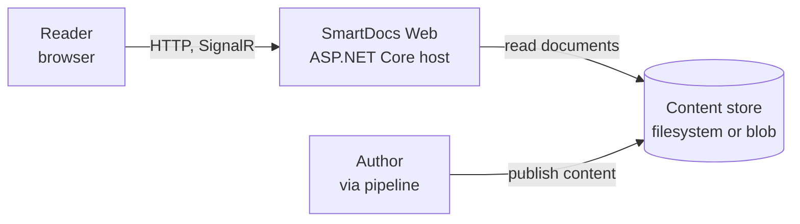
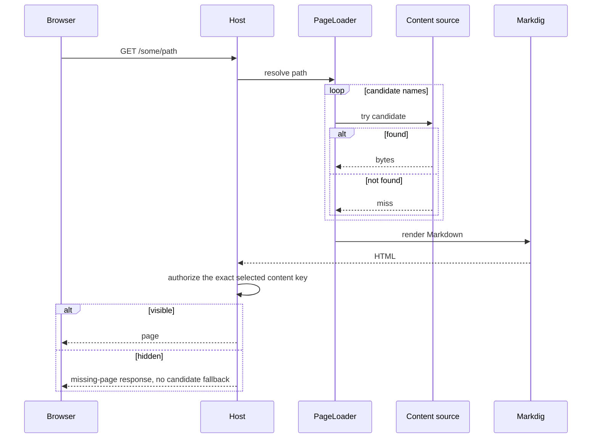
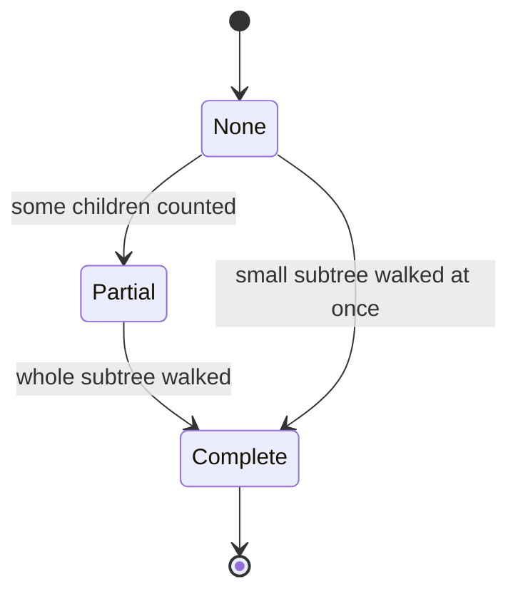

<!--
verification_stamp:
  generated: "2026-11-02"
  verified: "2026-11-02"
  gate_outcome: "pass-with-gaps"
  evidence:
    - dossier: "_evidence/smartdocs-web/code.md"
      observed: "2026-11-02"
    - dossier: "_evidence/smartdocs-web/configuration.md"
      observed: "2026-10-28"
    - dossier: "_evidence/smartdocs-web/data.md"
      observed: "2026-08-18"
    - dossier: "_evidence/smartdocs-web/environment.md"
      observed: "2026-08-18"
    - dossier: "_evidence/smartdocs-web-client/code.md"
      observed: "2026-10-28"
    - dossier: "_evidence/smartdocs-web-shared/code.md"
      observed: "2026-10-28"
  open_gaps: 2
-->

# System architecture

## 📚 Table of contents

- [🎯 Purpose and context](#-purpose-and-context)
- [🧱 Structure](#-structure)
- [🔀 Key flows](#-key-flows)
- [🔗 Dependencies](#-dependencies)
- [🧭 Design decisions](#-design-decisions)
- [🏗️ Physical placement](#-physical-placement)
- [🕳️ Open questions](#-open-questions)
- [🔗 Related](#-related)
## 🎯 Purpose and context

Diginsight SmartDocs serves a documentation site whose content is Markdown and whose structure is the shape of the content itself. The central design commitment is that **nothing is pre-computed**: a document is rendered when it is requested, and the navigation tree is discovered when it is browsed. Everything else in the architecture follows from paying that cost at request time and then working hard not to pay it twice.

## 🧱 Structure

| Part | Responsibility | Established by |
|---|---|---|
| `Diginsight.SmartDocs.Web` | Hosts everything: composes services, exposes the HTTP and SignalR surfaces, renders server-side | composition root and hub mapping ^[smartdocs-web/code-01,smartdocs-web/code-05,smartdocs-web/code-18] |
| `Diginsight.SmartDocs.Web.Client` | Runs the interactive shell in the browser under WebAssembly | client project kind ^[smartdocs-web-client/code-01] |
| `Diginsight.SmartDocs.Web.Shared` | Holds every type both sides use — abstractions, the navigation model, the rendering model, the site model | project references from both other projects ^[smartdocs-web-shared/code-01,smartdocs-web-shared/code-03] |
| Content store | Supplies document bytes through a per-space filesystem or Blob source | per-space source factory ^[smartdocs-web/code-08] |

The shared library holds `IContentSource`, `IMarkdownRenderer`, `INavProvider` and `PageLoader`. ^[smartdocs-web-shared/code-04,smartdocs-web-shared/code-06,smartdocs-web-shared/code-07,smartdocs-web-shared/code-21] The host registers rendering; the browser resolves rendered pages over HTTP rather than registering the renderer independently. ^[smartdocs-web-shared/code-03,smartdocs-web-client/code-04]

## 🔀 Key flows

### Serving a page

The shared loader retains its ordered candidate ladder, but a handled rendered-page resolution takes precedence. ^[smartdocs-web-shared/code-21] The host authorizes the exact content key selected by the rendered-page cache; a hidden result is terminal, not permission to try a different file. ^[smartdocs-web/code-20,smartdocs-web-shared/code-33]

### Reader access at the response boundary

The host initializes request-scoped `ReaderAccess` after optional authentication and before bootstrap, route guarding, and endpoint execution. ^[smartdocs-web/code-46] Every space combines the site default, deployment floor, and access-file requirement; a signed-in reader's roles grant permissions only through that space's own file. All required permissions must be covered. ^[smartdocs-web/code-47]

Shared caches hold content facts, not reader-filtered responses. Navigation uses source-folder provenance for ownership, so a displayed route isn't an authorization key. ^[smartdocs-web/code-48,smartdocs-web/code-49] The one exception is the root's generated Home link, which has no source folder: it stays whenever the reader sees the space mounted at the root or anything outside spaces, so a hidden root-mounted space leaves the root level unchanged. ^[smartdocs-web/code-62,smartdocs-web/code-68] See [Security](../09.00-security/index.md) and the [access-file schema](../06.00-reference/07-access-file-schema.md).

### Building the sidebar

The navigation tree is never materialised whole. `DynamicNavBuilder` builds **one level** at a time: list the children of a prefix, score each of them concurrently, drop the ones the rules exclude, classify the survivors, sort, and return. ^[smartdocs-web/code-23,smartdocs-web/code-24]

Scoring is where the cost sits, because each folder means reading a `metadata.yml` and each file means reading front matter. ^[smartdocs-web/code-26] Those reads are independent, so they run concurrently at the medium concurrency tier, and the final order comes from an explicit sort rather than from completion order. ^[smartdocs-web/code-23,configuration-12]

Classification decides what a child *is*. A folder becomes a section when it holds subfolders or more than one article; a folder holding exactly one article — or only an index and a readme — collapses into a leaf pointing straight at that article; anything else disappears. ^[smartdocs-web/code-25] That is why a folder that exists to hold a single page does not force a reader through an extra click.

### Keeping counts honest

Article counts beneath a folder cannot be known without walking it, and walking it is exactly what the lazy build avoids. The system resolves this by admitting it does not know yet.

A count is rendered as `…` while nothing is known, `≥ N` while a floor is known, and `N` once the subtree has been fully walked. Partial supersedes none, complete supersedes both, and an unknown count is never rendered as zero. ^[smartdocs-web/code-32] Root totals compose only visible space cells and the visible root-mounted space's root-own cell. ^[smartdocs-web/code-50] Pushes are filtered per role-set group, and the browser folds their absolute records into cached levels. ^[smartdocs-web/code-52,smartdocs-web-client/code-07]

## 🔗 Dependencies

| Depends on | For | Nature |
|---|---|---|
| Markdig | Markdown to HTML, with advanced extensions, auto identifiers, YAML front matter and Mermaid | rendering ^[smartdocs-web-shared/code-17] |
| Diginsight.Core | activity-based observability and the parallel service | cross-cutting ^[smartdocs-web/code-02,smartdocs-web/code-04,configuration-13] |
| Diginsight.SmartCache | the caching layer wrapping every content source | cross-cutting ^[smartdocs-web/code-09,configuration-18] |
| OpenTelemetry | trace and metric export | cross-cutting ^[configuration-14] |
| Azure Blob Storage | content storage for the documentation deployment | external ^[environment-08] |
| Azure Service Bus | optional cache-invalidation companion | external, opt-in ^[configuration-19] |
| Redis | optional passive cache store | external, opt-in ^[configuration-20] |
| Microsoft Identity Web | optional Entra reader sign-in | enabled by nonblank `AzureAd:ClientId` ^[configuration-28,configuration-40] |

## 🧭 Design decisions

**Render at request time rather than building a site.** The consequence is that publishing is just a file copy — no build agent stands between an author and a reader. The cost is per-request work, which is why the caching layer is not optional in the design even though it is switchable in configuration.

**Wrap every content source in a cache, and key it by space.** Each configured space gets its own `CachedContentSource` over a physical source ^[smartdocs-web/code-09], and the cache key is a value type combining space and path rather than a path string ^[data-12]. Two spaces can hold `index.md` without colliding — a class of bug that a bare string key would have made possible and hard to see.

**Make the external caching companions opt-in by configuration presence.** Service Bus is wired only when both a connection string and a topic name are present; Redis only when a configuration string is present. ^[configuration-19,configuration-20] The application runs identically without either, which is what makes a local run possible with no cloud resources at all.

**Give the Service Bus subscription a per-process identity.** The subscription name is a fresh `Guid` generated at startup. ^[configuration-19] Each instance therefore sees every invalidation message, which is the correct semantic for cache invalidation and the wrong one for work distribution.

**Fail fast on missing configuration.** The `Site` section is bound and then eagerly resolved, throwing `InvalidOperationException` when absent. ^[smartdocs-web/code-06] A misconfigured deployment refuses to start rather than serving an empty site.

**Keep resource identity out of the repository.** The public base declares an empty `Site:Spaces` array; environments supply complete space elements and their storage identity. ^[configuration-07,configuration-26] The SmartCache Service Bus section names a topic but declares no connection string. ^[configuration-11]

## 🏗️ Physical placement

Two deployments host the ASP.NET Core application on Azure App Service as self-contained Windows builds. ^[environment-01,environment-03,environment-05,environment-06] The documentation deployment reads Blob content through its managed identity. ^[environment-08,environment-10] Details and the other environment's content-source limits are in [Infrastructure](../05.00-infrastructure/index.md).

## 🕳️ Open questions

> **Not established**: no infrastructure definition exists in this repository. Searches for Bicep, ARM, Terraform, Pulumi, Dockerfile and `azure.yaml` all returned zero results, so the topology above is reconstructed from what the pipelines configure at deploy time rather than from a declared model. ^[gap]

> **Not established**: the Razor markup files were not read during this investigation, so what the layout components render — as distinct from what they hold — is not described here. ^[gap]

## 🔗 Related

- [The host](02-host-application.md), [the browser client](03-browser-client.md) and [the shared library](04-shared-library.md) each have their own page in this chapter
- [Caching and invalidation](05-caching-and-invalidation.md) — how the per-request cost above is avoided a second time
- [Reference](../06.00-reference/index.md) — the endpoint, schema and settings surfaces named above
- [Infrastructure](../05.00-infrastructure/index.md) — where this runs
