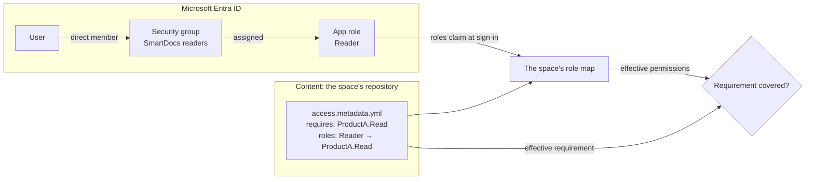
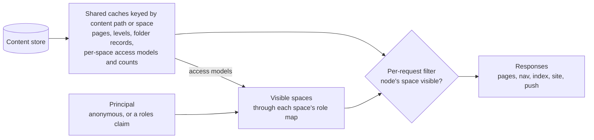

# Roles and permissions on the document hierarchy: what Entra app roles can carry

**Date:** 2026-10-27
**Revised:** 2026-10-28, version 1.7. The owner restated the scenario in three points and asked whether it's clear, unambiguous, and actionable; [The scenario, reviewed](#the-scenario-reviewed) answers, and the design now keeps permissions, requirements, and role mappings in an access file at each space's content root, with roles granted through Entra groups. Versions 1.1 to 1.6, all on 2026-10-27, closed five gaps an independent review found, added several roles per reader, evaluated permission groups, scopes, and repository metadata, and moved the options the design doesn't take to [📎 Appendix: alternatives considered](#-appendix-alternatives-considered)
**Author:** Dario Airoldi
**Status:** Sessions 1–4 delivered the access model, enforcement, reader-composed counts/push and Entra sign-in implementation; session 6 completed the generated-documentation refresh and [provisioning how-to](02-reader-access-provisioning.md) on 2026-10-28 under the owner's session-5 execution-order waiver. [Sequence 01](_validation/20261028.01-validation-sequence.md) records passing anonymous filtering, [sequence 02](_validation/20261028.02-validation-sequence.md) records passing anonymous counts/push checks, and [sequence 03](_validation/20261028.03-validation-sequence.md) records passing sign-in, space-local role union and sign-out checks after fixes. The [first sequence 04](_validation/20261028.04-validation-sequence.md) records a blocked authentication preflight. Session 5 ran on 2026-11-02, and [sequence 04 of that day](_validation/20261102.04-validation-sequence.md) records a PASS for `F1-push-per-group` through `F6-mount-route-divergence`: pushes reach only readers who see the changed space, a removed role closes its spaces at the next sign-in, `DS-4-hub-expiry` resolved on its positive branch, responses follow the response policy, anonymous bodies match the baseline commit byte for byte, unusable access files close their space, and a hidden root-mounted space leaves no trace. That run also fixed one concealment defect, the root's **Home** link, and closed the branding, newest-date, and root-own coverage gaps that sequences 01 and 02 left. The [implementation plan](01-roles-permissions-support.plan.md) tracks completion. Deployment to production remains outside it, in `PL-7-deployed-registrations`. This analysis's design and pre-implementation inventory remain the rationale, not a substitute for current runtime evidence.
**Component:** `Diginsight.SmartDocs.Web` (endpoints, content sources, navigation, caching, push hub), `Diginsight.SmartDocs.Web.Client` (shell, sign-in state), `Diginsight.SmartDocs.Web.Shared` (space options and registry, rendering contracts, bootstrap state)
**Framework:** .NET 10, ASP.NET Core, Blazor Web App (server prerender + global interactive WebAssembly), Microsoft Entra ID
**Builds on:** [the work item notes](overview.md) and [the security posture page](../../../09.00-security/01-security-posture.md)

## 📚 Table of contents

- [🎯 Summary](#-summary)
- [🧩 The model in three layers](#-the-model-in-three-layers)
- [🔍 What SmartDocs has today](#-what-smartdocs-has-today)
  - [The hierarchy and its metadata carriers](#the-hierarchy-and-its-metadata-carriers)
  - [Identity and access](#identity-and-access)
  - [Every surface that exposes content](#every-surface-that-exposes-content)
  - [Caches are shared by every reader](#caches-are-shared-by-every-reader)
- [🪪 What Entra app roles provide](#-what-entra-app-roles-provide)
- [📐 Recommended design](#-recommended-design)
  - [The scenario, reviewed](#the-scenario-reviewed)
  - [Option A, with roles defined in each repository](#option-a-with-roles-defined-in-each-repository)
  - [The access file](#the-access-file)
  - [Requirements on the hierarchy](#requirements-on-the-hierarchy)
  - [Roles in the repositories](#roles-in-the-repositories)
  - [Grants through Entra groups](#grants-through-entra-groups)
  - [Where sign-in happens](#where-sign-in-happens)
  - [From principal to permissions](#from-principal-to-permissions)
  - [Several roles per reader](#several-roles-per-reader)
  - [When an access file is missing or wrong](#when-an-access-file-is-missing-or-wrong)
  - [Enforcement: cache facts, filter per request](#enforcement-cache-facts-filter-per-request)
  - [Threats the design closes](#threats-the-design-closes)
  - [Folder and page requirements, later](#folder-and-page-requirements-later)
  - [Internal companions, later](#internal-companions-later)
- [🧭 Decisions for the owner](#-decisions-for-the-owner)
- [🏁 Conclusion](#-conclusion)
- [📎 Appendix: alternatives considered](#-appendix-alternatives-considered)
- [📚 References](#-references)

## 🎯 Summary

The work item asks whether a Microsoft Entra ID app registration, with its app roles, can support a three-part model: a permission declared on the repository's metadata, roles defined somewhere as sets of permissions, and roles granted to users or groups. The question comes from a deployment that publishes several product documentation spaces from separate repositories behind one site, where each product's documentation should reach its own readers. On 2026-10-28 the owner restated it as a scenario: permissions and role definitions in repository metadata, the permissions content requires in repository metadata too, with folder and article metadata to follow, and roles managed as app roles and granted to users through corresponding Entra groups.

**The short answer is yes, and the scenario is actionable once two ambiguities are settled.** App roles give SmartDocs a list of role names that belongs to the application, and a way to grant those names to users and groups. Entra delivers every granted name in the `roles` claim when a reader signs in, and one reader can hold any number of them. App roles don't compose, though: no app role contains another role or a permission, and none knows anything about a content hierarchy. So "a role is a set of permissions" has to live in SmartDocs, which is where the scenario puts it, in each repository. Microsoft's own guidance agrees: use app roles for stable categories, and "keep finer-grained resource permissions in your application's authorization data and enforce them in the application."

Seven findings shape the recommendation:

- **SmartDocs has no inbound authentication or authorization today.** Every surface serves every reader the same bytes, and every cache is keyed by content path alone.
- **"Repository metadata" has to mean a file inside the content root.** `repository.metadata.yml` sits outside the folder the publish workflow copies, so the host never sees it. Folder `metadata.yml` is parsed as flat lines and sent to browsers, so it can't hold role definitions. The design adds `access.metadata.yml` at each space's content root, parsed as YAML and never served.
- **Roles defined in each repository are safe when each space reads only its own file.** A repository then can't open another's content, whatever names it uses, so names need no rules. The price is that a role's meaning is spread across repositories.
- **Two Entra limits decide how grants work.** Granting an app role to a group requires Entra ID P1 or P2, and the grant reaches only the group's direct members. So each app role is granted through one security group whose direct members are users, without nesting.
- **Several roles per reader need no extra mechanism.** Entra grants one user any number of an application's roles, directly and through groups, and lists every one in the `roles` claim. SmartDocs takes the union of what they grant, space by space.
- **The hard part is SmartDocs, not Entra.** Thirteen surfaces expose content, titles, or counts—among them a whole-site article index, site-wide totals, and a push hub that broadcasts to every browser. Each must apply the same check.
- **Authorization can keep the performance work's guarantee.** A space's access file is a content fact, so it can be cached per space and cleared with navigation. What a reader may see is a request fact, so it must never enter the shared cache. Filtering at the edge costs work proportional to the response, never to the corpus.

**Recommendation:** keep app roles coarse and shared by every repository, such as `Reader`, `Contributor`, and `Admin`. Each repository declares its permissions, the permissions its space requires, and what each app role grants there, in `access.metadata.yml` at its content root, and SmartDocs evaluates each space only against its own file. Grant each app role through one Entra security group whose direct members are the role's holders, and combine all of a reader's roles by union. Sign readers in inside the application, not at the hosting platform, and answer "not visible" with the same 404 as "doesn't exist." Version 1 restricts whole spaces; folder and page requirements come later. The alternatives, and why the design doesn't take them, are in [📎 Appendix: alternatives considered](#-appendix-alternatives-considered).

## 🧩 The model in three layers

Deciding whether a reader may see a node takes three layers. Each has a different owner and changes at a different pace, so the model works best when each layer lives with its owner. In the table below, *owner* is who decides a change, and *cadence* is how often that change typically happens.

| Layer | Question it answers | Example | Owner | Cadence |
|---|---|---|---|---|
| <mark>Requirement</mark> | Which permissions does this space need? | `product-a` requires `ProductA.Read` | Content authors of the space's repository | With content |
| <mark>Role</mark> | Which permissions does a role grant in this space? | In `product-a`, `Contributor` grants `ProductA.Read` and `ProductA.Write` | Maintainers of the space's repository | Occasionally |
| <mark>Grant</mark> | Who holds a role? | Members of the *SmartDocs readers* group hold `Reader` | Identity administrators of the readers' tenant, and each role group's owners | Daily |

A reader may see a node when the reader's <mark>effective permissions</mark> in the node's space—the union of what every role they hold grants there—cover every permission in the node's <mark>effective requirement</mark>. A reader can hold any number of roles; [Several roles per reader](#several-roles-per-reader) shows how they combine.



The diagram shows where each layer lives. Entra grants the app role to a group, so the group's direct members hold it, and puts its value in the `roles` claim at sign-in. The space's access file says what that role grants in the space, and SmartDocs compares the result with the requirement the same file declares.

## 🔍 What SmartDocs has today

### The hierarchy and its metadata carriers

A SmartDocs deployment serves one <mark>site</mark>. The site publishes one or more <mark>spaces</mark>—each the documentation of one repository, mounted under a route base—and each space is a tree of folders and Markdown pages. The table lists where metadata lives at each level today and whether the running host reads it.

| Level | Carrier today | Read by the host | Owner |
|---|---|---|---|
| Site | The `Site` configuration section, from the environment overlay | Yes, at startup | Deployment |
| Space | `Site:Spaces[i]`: id, route base, source, title, `AllowGptBot` | Yes, at startup | Deployment |
| Repository | `repository.metadata.yml` at the repository root: visibility and internal peer | **No**, because it's outside the published content root | Repository |
| Folder | `metadata.yml` in the folder: flat `key: value` lines | Yes, cached per folder | Content |
| Page | YAML front matter: `title`, `publish`, `draft`, `author`, `date` | Yes, header only, cached | Content |
| Names | `_` and `.` prefixes, `*.changelog.md`, asset folders, `*.internal.md` | For navigation only | Convention |

Three details of this table matter for authorization:

- **`repository.metadata.yml` never reaches the content store.** The [publish workflow](../../../../../.github/workflows/03.PublishDocsContent.yml) copies the space's `src/docs` folder and nothing above it. A requirement written in `repository.metadata.yml` would be invisible to the host unless the pipeline learned to carry it. So whatever the host must read has to live in a file inside the content root.
- **Folder metadata can't carry access.** [`FolderMeta.Parse`](../../../../Diginsight.SmartDocs.Web.Shared/Navigation/FolderMeta.cs) reads flat `key: value` lines and ignores indentation, so it can't hold a role's list of permissions. [`FolderRecordProvider`](../../../../Diginsight.SmartDocs.Web/Navigation/FolderRecordProvider.cs) sends every key to the browser as `FolderRecord.Metadata`. Access data needs a file of its own, parsed as YAML and never sent.
- **`publish: false`, `draft: true`, and `hidden: true` control navigation, not access.** They remove an item from menus, while [`/_content/{**key}`](../../../../Diginsight.SmartDocs.Web/Endpoints/ContentEndpoints.cs) serves any key that exists. The content classification model says the same, and anticipates the runtime access check this work item designs.

### Identity and access

The [security posture page](../../../09.00-security/01-security-posture.md) establishes that no authentication middleware is registered, no endpoint carries an authorization requirement, and the read endpoints declare no identity requirement at all. The one guarded endpoint, `POST /_nav/invalidate`, compares a shared-secret header. The page leaves one question open: whether the application is *intended* to be reachable without authorization. This analysis proposes an answer—public by default, restricted where content or the deployment declares it.

Entra ID already sits in the delivery chain, but not for readers. The publish workflow signs in to Azure with a workload identity federated from GitHub Actions, and the host reads its content store with its managed identity.

### Every surface that exposes content

Authorization is only as strong as the weakest surface that returns content, titles, or counts. The table inventories every such surface in the current source. *Exposes* is what a reader would learn from the surface if it weren't filtered, and *Change* is what the surface needs.

| # | Surface | Exposes | Today | Change |
|---|---|---|---|---|
| 1 | Page routes, prerendered behind [`PageRouteGuard`](../../../../Diginsight.SmartDocs.Web/Endpoints/PageRouteGuard.cs) | Page HTML, plus nav levels and folder records that [`NavigationBootstrapMiddleware`](../../../../Diginsight.SmartDocs.Web/Navigation/NavigationBootstrapMiddleware.cs) serializes into the page | Same for every reader | Authorize the route, filter the bootstrap state, cache privately |
| 2 | `/_page/{**path}` | Rendered HTML and table of contents | Cached per route | Authorize the route before answering |
| 3 | `/_content/{**key}` | Markdown source, images, and attachments—any key, including unpublished pages, `_`-prefixed folders, and non-Markdown files such as a space's YAML files | Assets sent with `Cache-Control: public, max-age` | Authorize the key before comparing entity tags; never serve `access.metadata.yml`; send restricted bytes `private, no-store` |
| 4 | `/_nav/children` | Child labels and routes, plus folder records | Same for every reader | Drop children the reader can't see |
| 5 | `/_nav/folder` | Label, article count, newest date, metadata dictionary | Same for every reader | Answer as for a missing folder; counts for the reader |
| 6 | `/_nav/index` | Every navigable page in the site: title, route, breadcrumb, author, date—the source of menu search | Whole-tree walk | Drop leaves the reader can't see |
| 7 | `/_nav/total` | Site-wide article count and newest date | One value | Count what the reader can see |
| 8 | `/_site` | Every space: title, description, icon, repository URL | Same for every reader | Drop spaces the reader can't see |
| 9 | Generated space index, [`SpaceIndex.razor`](../../../../Diginsight.SmartDocs.Web.Shared/Components/SpaceIndex.razor) | One card per space, with its repository URL | Follows `/_site` | Follows `/_site` |
| 10 | Nav hub `/_nav/hub`, fed by [`NavChangePublisher`](../../../../Diginsight.SmartDocs.Web/Navigation/NavChangePublisher.cs) | Folder records, pushed with `Clients.All` | Broadcast | Push per role set |
| 11 | `/robots.txt`, built in [`SiteEndpoints`](../../../../Diginsight.SmartDocs.Web/Endpoints/SiteEndpoints.cs) | Every space's mount path | From configuration | List only spaces an anonymous reader can see |
| 12 | The branding mark, `BrandingAssets.LogoRoute` | The publisher's logo, read from a space | Anonymous | Stays exempt, even when its space is restricted |
| 13 | `POST /_nav/invalidate` | An administrative operation | Shared-secret header | Unchanged now; candidate for an app-only role |

Prev and next links and the menu filter need no row of their own: they read surfaces 4 and 6, so they inherit the filter. The test endpoints behind `Testing:ContentMutationEnabled` are mapped only in local runs and stay out of scope. Full-text search, the subject of the sibling work item `20261027.02-smartdocs-search`, would be the fourteenth surface.

### Caches are shared by every reader

Every server cache in SmartDocs is keyed by [`ContentPathCacheKey`](../../../../Diginsight.SmartDocs.Web/Caching/ContentPathCacheKey.cs): a kind plus a content path. That covers raw content, listings, parsed article heads, folder metadata, nav levels, folder records, and rendered pages. Folder counts live in [`FolderMetricsIndex`](../../../../Diginsight.SmartDocs.Web/Navigation/FolderMetricsIndex.cs) cells keyed by folder. Browser revalidation uses entity tags computed over the exact bytes sent.

None of these keys varies by reader, and that's good news. A space's requirements and role mappings are facts about content: they can be cached per space and cleared by the same invalidation that clears navigation. What a reader may see is a fact about the request: it must stay out of the shared cache. Because each entity tag is computed over the bytes actually sent, a filtered response gets its own tag without extra work.

## 🪪 What Entra app roles provide

The work item's notes show the **App roles** blade of an existing registration that belongs to another application. It defines two roles, *All* ("Read and write") and *Readers* ("Only read permission"), both assignable to users and groups. That's the mechanism in its common form: a few coarse categories.

The facts below describe what the mechanism can and can't do. They come from Microsoft Learn pages read on 2026-10-27, listed in [📚 References](#-references).

| Topic | Fact |
|---|---|
| Definition | An app role is declared on the app registration with a display name, a `value` without spaces that appears in tokens, and allowed member types: users and groups, applications, or both |
| Delivery | For an app that signs users in, the granted role values arrive in the `roles` claim of the ID token: an array that holds every role the reader was granted, so a reader with several roles receives several values |
| Grant | Roles are granted under **Enterprise applications** > **Users and groups**, or through the Microsoft Graph `appRoleAssignedTo` API. Each assignment links one principal to one role, so the portal gives a user a second role by adding the user again and selecting the other role |
| Several roles | Microsoft asks apps that read the `roles` claim to handle three cases: no claim, a user with no role, and several values when a user holds several roles |
| Groups | Group-based assignment requires Microsoft Entra ID P1 or P2. A group's direct members are considered assigned its roles, in addition to any roles granted to them directly |
| Nesting | A group grant doesn't cascade to nested groups; only direct members receive the role |
| Workloads | App roles can be granted to service principals and managed identities. A service principal that's a member of a group holding a role receives no `roles` claim |
| Limits | 700 definitions per application, shared by app roles and exposed scopes, within a separate 1,200-entry manifest limit |
| Guidance | "Use app roles for stable authorization categories ... rather than defining a role for every resource ... Keep finer-grained resource permissions in your application's authorization data and enforce them in the application." |
| Disabling | A disabled role can't be assigned, but existing grants keep emitting it until they're removed |
| Assignment required | When set to **Yes**, a user without a grant can't sign in (`AADSTS50105`); Global Administrators sign in regardless |
| Roles and groups | App roles move with the application across tenants; groups are tenant objects whose IDs differ per tenant |
| Groups claim | Carries up to 200 memberships in a JWT, nested ones included, then switches to an overage claim. The *groups assigned to the application* filter includes only direct members of assigned groups. A group filter set on the enterprise application keeps only groups whose display name matches a prefix, suffix, or substring, at any depth, for users in 1,000 groups or fewer |
| Graph fallback | `checkMemberGroups` returns which of up to 20 given groups a user belongs to, nested memberships included. Its least-privileged delegated permission is `GroupMember.Read.All` |
| Access packages | Entitlement management can bundle several of an application's app roles into an access package, with requests, approvals, and expiry. A user assigned several packages keeps an app role while any of them includes it, and a role the user held before a package was assigned is removed with the package. Packages are assigned to users, not to groups, and entitlement management requires Entra ID Governance or Entra Suite |
| Dynamic `memberOf` | A dynamic group can take in the direct members of other groups. The operator is a preview that Microsoft says isn't for production use, and after November 3, 2026, groups that use it stop updating and keep their last membership |
| Scopes | A scope, defined on the **Expose an API** blade, is a delegated permission: it lets a client application call the API on behalf of a signed-in user. It's granted by consent, for all users or for one user, never for a group, and a scope set to **Admins and users** can be consented to by each user unless the tenant restricts user consent. Granted scopes arrive in the `scp` claim of access tokens; ID tokens carry no `scp` |
| Blazor | A Blazor Web App passes the server's name and role claims to WebAssembly with `AddAuthenticationStateSerialization`; Entra app roles need the role claim type mapped to `roles` |
| App Service | Built-in authentication "provides only authentication, not authorization." With unauthenticated requests allowed, the app decides, and it receives the caller's claims in `x-ms-client-principal` |

Read together, these facts say what app roles are: <mark>a flat, application-scoped list of names that Entra grants and the application interprets</mark>. They don't provide four things the model needs:

- **Composition.** No app role contains another, and nothing in Entra maps a role to a set of permissions. Entra does give one reader several roles; it doesn't say what any of them means.
- **Resources.** A role is a string; which pages it opens is the application's business.
- **Group nesting for grants**, which is how many organizations express "this team of teams holds that role."
- **Instant revocation.** The role list is captured at sign-in and lives in the session. ASP.NET Core's authentication cookie defaults to a 14-day lifetime with sliding expiration, so without an explicit setting, a removed grant could keep working for weeks.

## 📐 Recommended design

Requirements belong in content in every option this analysis weighed, because declaring them on the hierarchy is the point of the model. The options differ in where roles live and in what Entra grants. The design takes option A in the form the owner's scenario gives it: app roles are roles, and each repository says what they grant in its own space. The other options, the deployment-catalog form of option A that version 1.6 recommended, and the owner's earlier proposals are in [📎 Appendix: alternatives considered](#-appendix-alternatives-considered).

### The scenario, reviewed

The owner restated the model as a scenario in three points and asked whether it's clear, unambiguous, and actionable. The table gives a verdict on each point and the resolution the design adopts.

| Point | Verdict | Resolution |
|---|---|---|
| 1. Permissions and role definitions live in repository metadata | Ambiguous in two ways: whether each repository maps its own slice of a role or one file defines every role, and where a site-wide read permission lives, since no repository owns it | Each repository maps the shared roles in its own space and is evaluated only against its own file. Site-wide read is deferred, because signing in, or a baseline role on a private site, already gates a whole site |
| 2. The permissions content requires live in repository metadata, with folder and article metadata to follow | Clear, with one correction: `repository.metadata.yml` never reaches the host | Requirements go in `access.metadata.yml` at the space's content root. Version 1 restricts whole spaces, and folder and page requirements follow under the rules in [Folder and page requirements, later](#folder-and-page-requirements-later) |
| 3. Roles are app roles, granted to users through corresponding Entra groups | Clear and actionable | One security group per app role, assigned the role on the enterprise application, with users as direct members. Group grants need Entra ID P1 or P2 and reach direct members only, and SmartDocs reads only the `roles` claim, never group IDs |

The resolutions are decisions taken on the owner's behalf on 2026-10-28; [🧭 Decisions for the owner](#-decisions-for-the-owner) lists them, and each can be reversed on review. With them, the scenario is unambiguous, and [the plan](01-roles-permissions-support.plan.md) turns it into six sessions of ordered, verifiable steps.

**What the scenario costs.** Defining roles in each repository has three costs, and the design answers each:

- **A role's meaning is spread across repositories.** "What does `Contributor` grant?" takes reading every space's access file. The host logs each space's requirement and role map whenever it loads the space's file, and a report across repositories is parked as `PL-20-role-summary-report`.
- **An unmapped role hides the space from that role's holders.** A repository that forgets to map `Reader` stays hidden from readers who hold only `Reader`. That fails safe, and the space's logged role map shows it.
- **Role values are shared vocabulary.** Every repository maps the same values, so every deployment that publishes those repositories must define app roles with exactly those values.

### Option A, with roles defined in each repository

Entra holds a few coarse app roles, such as `Reader`, `Contributor`, and `Admin`, each granted through one security group. Each space's repository maps those role values to its own permissions in its access file. At sign-in, the `roles` claim delivers role values, and SmartDocs expands them space by space, through each space's own map.

- **One layer per owner.** Content teams declare what their space requires and what each role grants there, and identity administrators decide who holds each role.
- **Entra changes only when a role is created.** A new permission or mapping is an access-file change, reviewed in git with the content, not an app registration change.
- **Microsoft's guidance, followed.** Roles stay few, far from the 700-definition limit, and tokens stay small.
- **<mark>Containment</mark> without naming rules.** A repository's mappings reach only its own space, so one repository can't open another's content, whatever names it uses.
- **Two lookups for "who can read X?"** X's access file says which roles grant the permissions X requires; Entra says who holds those roles.
- **Access files and app roles must agree.** A role value that Entra issues but a space doesn't map grants nothing there beyond `authenticated`. That fails safe, and a value no space maps is logged.

### The access file

Each space's repository keeps one file, `access.metadata.yml`, beside the root `index.md` of its content root. The publish workflow already copies everything under the content root, so the file reaches the content store with the content it guards, and it's reviewed in the same pull requests as that content. `product-a`'s file looks like this:

```yaml
schema: 1
permissions:
  ProductA.Read: Read the product A documentation
  ProductA.Write: Edit the product A documentation
requires: [ProductA.Read]
roles:
  Reader: [ProductA.Read]
  Contributor: [ProductA.Read, ProductA.Write]
  Admin: [ProductA.Read, ProductA.Write]
```

| Key | Meaning |
|---|---|
| `schema` | The file format's version. Version 1 is the only one, and an unknown version makes the file invalid |
| `permissions` | The permissions the space declares, each with a description. Only declared names can appear in `requires` or in a role entry |
| `requires` | The permissions a reader needs to see the space, all of them. The reserved `authenticated` is allowed, and an empty or missing list requires nothing |
| `roles` | What each app role value grants in this space: a list of declared permissions |

Five rules keep the file safe to read:

- **Names are local.** SmartDocs compares permission names case-insensitively and qualifies each one with its space's id, so a name declared in one space is a different permission from the same name declared in another. Role values are compared case-insensitively too, so a file that maps both `reader` and `Reader` is invalid.
- **`authenticated` is reserved.** A file can require it, but can't declare it as a permission or map a role to it, because every signed-in reader already holds it.
- **The parser is strict.** An unknown key, a duplicate name, an unknown schema, or a name in `requires` or a role entry that `permissions` doesn't declare makes the whole file invalid, and the space is hidden until a valid file is published.
- **Only the root file counts in version 1.** A file of the same name deeper in the tree is ignored, and the host logs a Warning, so a misplaced file can't look as if it restricts a folder.
- **The file is never served.** SmartDocs excludes it, at any depth, from content reads, folder listings, and article heads—including the site root's listing—so `/_content` answers 404 for it. The provider reads it from the space's underlying source, below the mounted view. Another site generator that builds the same folder doesn't know the file: MkDocs, for example, copies every file it doesn't recognize as Markdown into its site unaltered. A repository that also publishes its content root that way must exclude the file there, with MkDocs' `exclude_docs`.

### Requirements on the hierarchy

In version 1, a node's effective requirement is its space's, and it combines three sources:

- **The space's `requires`**, from its access file.
- **A deployment floor.** A new `Site:Spaces[i]:Access` setting, next to the existing `AllowGptBot`, lets a deployment restrict a space whose repository declares nothing—for example, a public repository published privately. A floor accepts only an empty value or `authenticated` (`D14-authenticated-only-floors`), because a floor naming a repository's permission would let that repository's own mappings satisfy it.
- **The site default.** A new `Site:Authorization:DefaultRequirement` setting, with the same two values, applies to every node. A deployment makes its whole site private by setting it to `authenticated`.

A reader needs every entry. Three more rules complete the picture:

- **No file means public.** Existing deployments keep today's behavior. A space whose `Site:Spaces[i]:AccessFileRequired` setting is on is hidden instead, and the host logs an Error (`D16-required-access-file`).
- **A root-mounted space's requirement covers only its own nodes.** A prefixed space's nodes start at its mount folder, so the root-mounted space's file never reaches them.
- **Nodes outside every space follow the site default.** On a site without a root-mounted space, the generated space index belongs to no space, so only the default applies to it.

The table applies these rules to four example spaces on a site with no default:

| Space | Access file | Floor | Effective requirement |
|---|---|---|---|
| `product-a` | `requires: [ProductA.Read]` | Empty | `ProductA.Read` |
| `product-b` | `requires: [ProductB.Read]` | Empty | `ProductB.Read`, as `product-b` defines it |
| `product-c` | None | Empty | None: public |
| `product-d` | None | `authenticated` | `authenticated` |

### Roles in the repositories

Roles are shared because they're defined once, on the app registration; what a role grants is each repository's to say. `product-a`'s file is the example in [The access file](#the-access-file). `product-b`'s file is deliberately hostile: it declares a permission whose name only looks like `product-a`'s, and maps an extra role to it.

```yaml
schema: 1
permissions:
  ProductB.Read: Read the product B documentation
  ProductA.Read: A name that only looks like product A's
requires: [ProductB.Read]
roles:
  ProductB.Reader: [ProductB.Read, ProductA.Read]
  Contributor: [ProductB.Read]
  Admin: [ProductB.Read]
```

SmartDocs evaluates each space only against its own file (`D13-per-space-evaluation`). A permission is the pair of a space and a name, and a role's grant in one space never counts in another, so `product-b`'s `ProductA.Read` can't open `product-a`, and its `ProductB.Reader` mapping opens nothing outside `product-b`. No naming convention is needed to keep repositories apart, and a mistake in one file can only hide or open its own space. The table shows what each app role grants in each restricted space:

| App role | In `product-a` | In `product-b` |
|---|---|---|
| `Reader` | `ProductA.Read` | Nothing |
| `Contributor` | `ProductA.Read`, `ProductA.Write` | `ProductB.Read` |
| `Admin` | `ProductA.Read`, `ProductA.Write` | `ProductB.Read` |
| `ProductB.Reader` | Nothing | `ProductB.Read`, and `product-b`'s own `ProductA.Read` |

`product-c` and `product-d` have no access file, so no role grants anything there, and none needs to: `product-c` requires nothing, and `product-d` requires only `authenticated`. `Admin` grants the same as `Contributor` until SmartDocs gains an operation that only administrators may perform.

### Grants through Entra groups

Each app role is granted through one security group, which is assigned the role on the app's enterprise application. A user holds the role by being a direct member of its group, so granting and revoking a role are membership changes. The example uses four groups:

| Security group | App role it's assigned |
|---|---|
| *SmartDocs readers* | `Reader` |
| *SmartDocs contributors* | `Contributor` |
| *SmartDocs administrators* | `Admin` |
| *Product B readers* | `ProductB.Reader` |

- **Group grants need Entra ID P1 or P2.** Without them, roles are granted to users directly, one assignment per user and role, and the rest of the design doesn't change.
- **Only direct members receive the role.** A group nested inside a role group gives its members nothing, as [Permission groups inside role groups](#permission-groups-inside-role-groups) explains. A team that already has a group of its own can't simply be nested, so its members are added to the role group one by one, or kept in step by a synchronization job.
- **SmartDocs never reads group IDs.** It reads only the `roles` claim, so renaming or recreating a group changes nothing in SmartDocs, and tokens don't grow with a reader's group memberships.
- **Group owners manage membership.** Each role group can have owners who add and remove members without administrator rights over the application.
- **Changes apply at the next sign-in.** A reader keeps their session's roles until the session ends, so the session lifetime bounds how long a removed member keeps access: eight hours by default, without sliding (`D9-explicit-session-lifetime`).
- **Assignment required** stays **No** for sites that mix public and restricted content, so any reader of the tenant can sign in and receive `authenticated`. A fully private site sets it to **Yes**, and every reader then needs a grant to sign in. Microsoft recommends always defining a baseline role without elevated authorization; on a fully private site, it's the role that lets a reader in, such as `Reader`.

Each deployment needs one app registration in the tenant where its readers sign in, with app role values equal to those the repositories map. The registration of another application can't be reused: app roles are scoped to their own application, and its tokens carry its own audience.

### Where sign-in happens

Readers sign in inside the application, with Microsoft Identity Web and an authentication cookie. That runs the same way locally—where the repository's validation rules require a visible run—and on App Service, and it's the pattern Microsoft documents for Blazor Web Apps. Authentication at the hosting platform remains available as an extra hardening layer later, and [Sign-in at the hosting platform](#sign-in-at-the-hosting-platform) explains why it isn't the foundation.

### From principal to permissions

- **Anonymous readers** hold no permissions, so only nodes with an empty effective requirement are visible to them.
- **Signed-in readers** hold `authenticated` in every space, plus, in each space, what that space's access file maps their roles to, combined as [Several roles per reader](#several-roles-per-reader) describes. A role value that no space maps adds nothing and is logged.
- **The expansion runs on every request** and yields the set of spaces the reader may see. It's a few set operations per space over the cached access models, so no cache entry holds anything derived from a principal, and a changed access file reaches open sessions at the next invalidation. Its only input from the principal is the reader's <mark>role set</mark>: whether they're signed in, plus the set of their role values.
- **The session lifetime is explicit.** Roles refresh only at sign-in, so the session lifetime is the revocation latency. The deployment sets it in configuration, eight hours by default without sliding, instead of inheriting the 14-day sliding default (`D9-explicit-session-lifetime`).

### Several roles per reader

A reader can hold any number of roles at once. The owner set this as a requirement, and the design depends on it: in the example, `Reader` opens `product-a` and `ProductB.Reader` opens `product-b`, so a reader who needs both spaces holds both roles.

**How Entra grants several roles.** Each assignment links one principal to one role. The portal gives a user or group another role by adding it again under **Users and groups** and selecting that role, and Microsoft Graph creates one `appRoleAssignment` per principal and role. A user who's a direct member of two role groups holds both groups' roles, on top of any direct grants. At sign-in, the `roles` claim lists every one of them.

**How SmartDocs combines them.** The rules below also cover the three cases Microsoft asks apps to handle: no `roles` claim, no role, and several roles.

- **Union, space by space.** In each space, a signed-in reader's effective permissions are `authenticated` plus everything that space's access file maps any of their roles to. A reader with no roles, or no `roles` claim, holds `authenticated` only. Permissions from different roles combine to meet one requirement, but a role's grant in one space never counts in another, even when both spaces use the same permission name.
- **Additive only.** A role can only add permissions. There's no deny entry and no role that withdraws what another grants. To keep a reader out of a space, the space must require a permission that none of the reader's roles grants there.
- **No precedence.** No role outranks another, and no role is primary. SmartDocs treats the values as a case-insensitive set, so their order and any repeats don't matter.
- **Overlap is harmless.** A role whose grants another held role already includes changes nothing, so granting a broader role never requires removing a narrower one.
- **An unmapped role doesn't spoil the rest.** A value a space doesn't map, such as a role a repository dropped while Entra still issues it, adds nothing there. The reader's other roles keep working, and a value no space maps is logged.
- **Push groups follow role sets.** Readers with the same role set see the same spaces, so the push hub groups connections by role set.
- **Removing one role removes only what it alone granted.** A membership removed in Entra takes effect at the reader's next sign-in. A mapping removed from an access file takes effect at the next invalidation, or within 30 seconds, for open sessions too, because roles are expanded on every request. Disabling a role in Entra removes nothing: existing grants keep issuing it.

The table applies these rules to the four example spaces:

| Reader | Sees |
|---|---|
| Anonymous | `product-c` |
| Signed in, no roles | `product-c` and `product-d` |
| `Reader` | `product-a`, `product-c`, and `product-d` |
| `Reader` and `ProductB.Reader` | All four |
| `Contributor` | All four |
| `ProductB.Reader` only | `product-b`, `product-c`, and `product-d`. `product-b`'s own `ProductA.Read` doesn't open `product-a` |

**Several roles keep roles few.** With one role per reader, every combination of access needs a role of its own: covering every non-empty subset of four restricted spaces takes fifteen roles. With several roles per reader, four product roles cover the same combinations, and a site-wide `Reader` that every repository maps is one more. There's no wildcard role. Adding a space to a site-wide role is that repository's deliberate, reviewed mapping, and a site-wide read permission that no repository owns is deferred (`D15-site-wide-read-deferred`).

**Only checked permissions have an effect.** Every check in version 1 decides visibility. A permission meant for another operation, such as `ProductA.Write` for editing or publishing, can be declared and mapped like any other, but it changes nothing until SmartDocs gains an operation that checks it. In version 1, `Contributor` therefore opens exactly what its read permissions open.

### When an access file is missing or wrong

Requirements are computed from content, so a broken or missing file must never publish a restricted space (`D8-computed-requirements`). Every failure closes the space, except a missing file, which keeps today's behavior unless the deployment requires one (`D16-required-access-file`).

| Case | Effect on the space | Logged |
|---|---|---|
| No file | Public, or hidden when `AccessFileRequired` is on | An Error when the file is required |
| A read error other than "not found" | Hidden. The error isn't cached, so the next check retries | An Error |
| Invalid content: malformed YAML, an unknown key or schema, a duplicate or reserved name | Hidden until a valid file is published | An Error naming the problem |
| `requires` names an undeclared permission | Invalid content, so a typo hides the space instead of publishing it | An Error |
| A role entry names an undeclared permission | Invalid content | An Error |
| `requires` is empty | Public, while the role map still applies | The load summary |

**Publish the file first.** The [publish workflow](../../../../../.github/workflows/03.PublishDocsContent.yml) uploads content with `az storage blob upload-batch`, one blob at a time, and then deletes stale blobs. During a space's first publish, pages can become readable before the access file arrives, and deleting the file from the repository turns the space public at the next publish. Setting `AccessFileRequired` before the first publish closes both windows. A publish that uploads the access file first, and a pipeline check that the file is present and valid, are parked as `PL-16-access-first-publish` and `PL-19-access-file-pipeline-check`.

### Enforcement: cache facts, filter per request



The diagram shows the principle. Shared caches keep holding content facts, now including each space's access model. A filter at the edge combines them with the configured default and floors and with the reader's roles, and only the filtered result leaves the server.

- **Access models are content facts.** Each space's parsed access file is cached per space, for 30 seconds by default through a new `Access` freshness setting, and cleared by the same invalidation that clears navigation. The floors and the default are combined with it at each check, so no cache entry holds an effective requirement, and nothing stale—or shared with another deployment—can loosen one.
- **The file is read beneath the caches.** The provider reads the access file from the space's underlying source, below the mounted view that hides it and below the content cache.
- **Each node knows its space.** Navigation nodes record the content folder they come from (`SourceFolder`), and filters resolve the space from it, never from a route: a mount node and the root-mounted space's `<mount>.md` page can share a route.
- **The checked file is the rendered file.** A route can be backed by up to five candidate files, and at a mount route the first candidate, `<mount>.md`, belongs to the root-mounted space. The rendered-page cache records which file it rendered, and the check runs on that file. A hidden file is never rendered, and the route never falls through to the next candidate, so authorization and rendering can't pick different files. The route then answers as a folder without a page of its own when it names a folder the reader can see, which only a mount route can, and 404 otherwise. That's also what the browser shows, because `/_page` answers a hidden file exactly as a missing one.
- **One check, everywhere, before entity tags.** A node is visible when the reader's permissions in its space cover the space's effective requirement. Every surface in the inventory calls the same service, so no surface can drift into a rule of its own, and the check runs before entity tags are compared, so no reader gets a `304` for a node they can't see.
- **Counts per space.** Within a visible space, every reader sees the whole space, so its cached counts are already the reader's. The root folder record and the site total are composed per request from per-space aggregates: one cell per mounted space, plus one for the root-mounted space's own articles, which needs a new snapshot format version. The existing rule that hides empty sections keeps working.
- **Push per role set.** SignalR groups are keyed by role set, so a pushed folder record reaches only readers who can see it, carrying their counts. A connection closes when its session expires, so a socket can't outlive the roles it was grouped by.
- **Caching headers follow the principal.** A response whose content depends on the reader carries `private, no-cache`, and restricted asset bytes carry `private, no-store`. Neither a shared proxy nor the next person on the same browser can reuse them.
- **Not visible looks like not found.** Each surface answers a node the reader can't see exactly as it answers a node that doesn't exist; for page routes, that's the route guard's existing 404 page. When sign-in is configured, every 404 page offers anonymous readers a **Sign in** link, whose return path is encoded for both the URL and the HTML; the sign-in endpoint accepts only local return paths. On a site whose default is `authenticated`, every anonymous page request is challenged before the route is looked up, so the challenge reveals nothing.
- **The browser never decides.** WebAssembly code and data are downloadable, so the client only shows the signed-in reader and a **Sign in** or **Sign out** action. The server filters everything it sends.

### Threats the design closes

Each of these threats maps to a step or a validation scenario in the plan:

- **Existence leaks** through 403 responses, `304` answers, titles in the article index, counts, newest dates, and the site total.
- **Storage failures** that would otherwise read as "no file" and publish a restricted space.
- **Candidate divergence at a mount route**, where `<mount>.md` in the root-mounted space and the mounted space's own index answer the same route.
- **Shared-cache leaks** through responses and assets marked `public`, or reused by the next person on the same browser.
- **Broadcast leaks** through the push hub's `Clients.All`, and **open sockets** that outlive a session.
- **Asset leaks** through `/_content`, when an image or attachment sits in a restricted space.
- **The access file itself**, which would reveal which permissions and roles open the space if it were served like any other key, or copied into another site by a generator that builds the same folder.
- **Hostile or mistaken mappings**, which per-space evaluation confines to their own space.
- **Typos** in `requires` or a role entry, which make the file invalid and hide the space instead of publishing it.
- **A misplaced or misnamed file.** A file below the space root is ignored and logged, and `AccessFileRequired` catches a missing root file.
- **The publish-order window and accidental deletion**, which `AccessFileRequired` closes.
- **Reflected input** in the 404 page's sign-in link, which is built from the request path.
- **`robots.txt`**, which today names every space's mount path, restricted or not.
- **A Redis cache shared by two deployments** under one key prefix, which would mix their content facts, access models included. Each deployment needs its own prefix when Redis is enabled.
- **Links from public pages** to restricted ones. The link text is author-written and stays visible; the target answers 404.
- **A restricted root-mounted space**, which makes the home page itself private. That's by design: at `/`, a reader who can't see that space gets the generated index of the spaces they can see, after a reload and after navigation alike, and a reader who sees no space gets the 404 page.
- **A branding mark** stored inside a restricted space. It must stay readable, or the header breaks for anonymous readers.
- **Guests and Global Administrators.** `authenticated` is as broad as the tenant's sign-in rules: guests can sign in when assignment isn't required, and Global Administrators sign in even when it is. Neither receives a role without a grant.
- **Stale sessions** after a membership is removed, bounded by the session lifetime.
- **A disabled role that still grants.** Disabling an app role stops new grants, but existing grants keep issuing it, and the access files keep mapping it. Revoking a role means removing its group's members or assignment in Entra, or its mappings in the access files.
- **Workload identities** that are members of granted groups receive no `roles` claim, so automation needs direct grants.

**One exposure is outside the design.** A repository that also publishes its content root through another site generator publishes the same pages under that site's own access rules. Restricting the space in SmartDocs restricts only SmartDocs' copy. A deployment that restricts such a space must therefore restrict the other site to the same readers, or stop publishing the space there. Platform sign-in in front of that site isn't enough on its own, because it authenticates readers without checking their roles. The deployment's sibling plan owns that work (`PL-7-deployed-registrations`).

### Folder and page requirements, later

The owner plans to let folder metadata and article metadata add requirements of their own. The design leaves room for both, under four rules:

- **Monotonic within the space.** A node's effective requirement becomes the union of its space's requirement and every declaration from the space's root down to the node. A declaration can only add, so nothing below a restriction can lift it, and a mistake in a child can't open what a parent closed.
- **Names come from the space's access file.** A folder or page can require only permissions its space's access file declares, and the same strict check applies, so a typo hides the node instead of publishing it.
- **Pages through their folders first.** `/_content` authorizes an image or attachment by its folder, so a requirement declared only on a page couldn't protect the files the page links. Restricting a page by giving it a folder of its own costs nothing visible, because navigation already renders a one-page folder as an article link.
- **Count vectors return.** Readers of one space would no longer see the same nodes, so each folder would keep its count and newest date per distinct requirement below it, and a reader's count would be the sum over the requirements they meet.

Where the declarations live is part of that work: a flat `access` line in folder `metadata.yml`, removed from what browsers receive, or a list of paths in the access file. The plan parks it as `PL-17-folder-and-page-requirements`.

### Internal companions, later

The content classification model already names the signal this design can use: "The same signal drives the ignore rule, the sync destination and—once it exists—the runtime access check." Once folder and page requirements exist (`PL-17-folder-and-page-requirements`), `_internal/` folders could carry an implicit requirement such as an internal permission of their space, and so could `*.internal.md` files once page-level requirements have a way to cover the files a page links. A public page's pointer to its companion could then become a link that's simply absent for readers without that permission. That needs internal content published into the same content store, which is separate work.

## 🧭 Decisions for the owner

Four choices were the owner's to make, and each changes what the plan builds. On 2026-10-27 the owner delegated all four, and each was taken as recommended. On 2026-10-28 the owner's scenario settled three of them differently, and four more decisions it raised were taken on the owner's behalf. The *Taken* column records each answer with its date. The plan's *Decisions taken* section records what would reverse each; reversing one returns the plan to `draft`.

| Decision | Options | Taken |
|---|---|---|
| `D1-role-composition` | A: app roles are roles, composed in SmartDocs by a deployment catalog or by each repository · B: app roles are permissions; groups or access packages are roles · C: groups claim and a catalog | 2026-10-27: A, with a deployment catalog. 2026-10-28: A, with each repository mapping roles in its access file |
| `D2-requirement-carrier` | `access` lines in folder `metadata.yml` · `repository.metadata.yml`, carried into the content store by the publish workflow · `access.metadata.yml` at each space's content root · deployment configuration only | 2026-10-27: folder `metadata.yml`. 2026-10-28: `access.metadata.yml` |
| `D3-unauthorized-response` | 404 for "not visible," a sign-in link for anonymous readers, and a direct challenge on fully private sites · a sign-in challenge for anonymous readers everywhere, and a "no access" page for signed-in readers | The first |
| `D4-plan-scope` | Space-level requirements only · space, folder, and page requirements · either, plus any of: internal companions, app-only invalidation with an app role, access packages | 2026-10-27: the core model, which included folder and page requirements. 2026-10-28: space-level requirements only |
| `D13-per-space-evaluation` | Each space evaluated only against its own file · repositories define roles for every space, under naming rules | The first |
| `D14-authenticated-only-floors` | Floors and the site default accept only an empty value or `authenticated` · they accept any permission name | The first |
| `D15-site-wide-read-deferred` | Defer a site-wide read permission · define one in deployment configuration now | Defer |
| `D16-required-access-file` | A per-space `AccessFileRequired` setting, off by default · always require an access file · never require one | The first |

The owner also set a requirement on 2026-10-27 that isn't a choice between options: a reader must be able to hold several roles at once. The design meets it, as [Several roles per reader](#several-roles-per-reader) shows, and the plan records it as `D12-several-roles-per-reader`, with what would reverse it.

On 2026-10-27 the owner also asked three questions that the appendix answers. Nesting permission groups inside role groups grants nothing as stated, as [Permission groups inside role groups](#permission-groups-inside-role-groups) shows. Scopes authorize a client application, not the reader, as [Permissions as scopes](#permissions-as-scopes) shows, so they aren't an option for `D1-role-composition`. Keeping permissions and role definitions in repository metadata, examined in [Permissions and roles in repository metadata](#permissions-and-roles-in-repository-metadata), became the scenario that changed `D1-role-composition`, `D2-requirement-carrier`, and `D4-plan-scope` on 2026-10-28.

## 🏁 Conclusion

An Entra app registration supports the owner's scenario, provided each layer lives with its owner. Each repository declares what its space requires and what each role grants there, and Entra decides, through one security group per role, who holds which roles. Entra grants a reader as many roles as needed, and SmartDocs combines them by union, space by space, so roles stay few. App roles are the right vehicle for the grant and the wrong one for the composition, as Microsoft's own guidance on app roles says, and scopes are wrong for both: they authorize the client application a reader uses, not the reader. Entra's group rules—P1 or P2 for group grants, direct members only—are constraints to plan around, not blockers.

The scenario is clear about grants and about where requirements live. It was ambiguous about roles that span repositories, which evaluating each space only against its own file settles, and about a site-wide read permission, which is deferred. Its price is a role's meaning spread across repositories, which the host makes visible by logging each space's role map.

Most of the work is inside SmartDocs. Thirteen surfaces were built for a single audience, and each must apply one check. Caching facts and filtering per request keeps that check cheap, and it preserves the performance work's rule that no request may cost work proportional to the corpus. One prerequisite lies outside SmartDocs: a space it restricts stays readable wherever another site generator publishes the same content root, so each deployment must restrict or stop that publication before it restricts the space.

Next, review the decisions taken on the owner's behalf, each of which can still be reversed, and run [the plan](01-roles-permissions-support.plan.md) session by session; it turns them into ordered, verifiable steps.

## 📎 Appendix: alternatives considered

The recommended design rests on choices among alternatives. This appendix keeps the alternatives it doesn't take, with the reasons, so a review can reopen any choice from the evidence:

- **Other placements of the three layers.** [Option B](#option-b-app-roles-are-permissions-groups-are-roles), [option C](#option-c-groups-claim-no-app-roles), and [option D](#option-d-access-packages-on-top), then [a comparison with option A](#comparing-the-options) and two variants of option A: [roles in a deployment catalog](#roles-in-a-deployment-catalog), which version 1.6 recommended, and [roles named after permissions](#roles-named-after-permissions).
- **The owner's earlier proposals.** [Permission groups inside role groups](#permission-groups-inside-role-groups), [permissions as scopes](#permissions-as-scopes), and [permissions and roles in repository metadata](#permissions-and-roles-in-repository-metadata). The last one became the recommended design.
- **Where readers sign in.** [Sign-in at the hosting platform](#sign-in-at-the-hosting-platform) is the alternative to signing readers in inside the application.

### Option B: app roles are permissions, groups are roles

Entra holds one app role per permission, such as `ProductA.Read` and `ProductA.Write`. A role becomes a security group granted several app roles, or an access package that bundles them. SmartDocs reads the `roles` claim as the effective permissions and needs no role maps.

- **One administrative surface.** The Entra admin center answers "who can read X?" on its own.
- **Every new permission is an app registration change**, made by an application owner, before content can use it.
- **"Grant a role to a group" stops working.** A role *is* a group here, and granting it to another group needs nesting, which app role grants ignore.
- **Growth with spaces times permissions**, toward the 700-definition limit, and a claim that grows with every permission a reader holds.

### Option C: groups claim, no app roles

Entra emits the reader's groups in the `groups` claim, and a catalog in SmartDocs maps group object IDs to roles.

- **Existing groups, reused.** It's also the only option that honors nested membership.
- **Tenant-specific IDs in configuration.** Microsoft warns that an app authorizing by groups "will break in the next tenant as both the group ID and name could be different."
- **Overage beyond 200 groups**, unless the claim is filtered to groups assigned to the application—and that filter brings back direct membership only, plus the P1 or P2 requirement for assigning groups.

### Option D: access packages on top

Entitlement management adds requests, approvals, expiry, and access reviews. It's orthogonal to the other options: an access package can wrap one option A role, or bundle option B permissions into something that behaves like a role. Because it requires Entra ID Governance or Entra Suite, it's a later governance layer, not a foundation.

### Comparing the options

The table compares options A, B, and C on the criteria that decide this work item. Option D isn't a peer, because it sits on top of A or B.

| Criterion | A: roles in Entra, role maps in each repository | B: permissions in Entra, groups as roles | C: groups claim, catalog in SmartDocs |
|---|---|---|---|
| Matches "permission, role, grant to users or groups" | Yes | Partly; a role can't be granted to a group | Yes, through group membership |
| A new space or subtree permission needs | A change to the space's access file | An app registration change and new grants | A change to the space's access file |
| Group grants need P1 or P2 | Yes | Yes | Only with the *assigned groups* filter |
| Nested groups honored | No | No | Yes, without the filter |
| Portable to another tenant | Yes | Yes | No |
| Token size grows with | Roles held | Permissions held | Groups held, until overage at 200 |
| "Who can read X?" is answered by | X's access file, then Entra | Entra alone | X's access file, the catalog, then Entra |
| Consistent with Microsoft's app role guidance | Yes | No | Not applicable |

### Roles in a deployment catalog

Version 1.6 recommended this form of option A: a role catalog, `Site:Authorization:Roles`, in each deployment's environment overlay, mapping each app role value to permissions from every space, with requirements declared as flat `access` lines in folder `metadata.yml`.

- **One place per role.** "What does this role grant?" is answered by one entry, in one reviewed file per deployment.
- **A site-wide role is natural.** One entry can list the read permissions of every space, which the scenario defers.
- **Names must be global.** Permissions from every repository meet in one catalog, so they need a convention such as `<space-id>.<area>` to keep repositories from claiming each other's names, and containment rules if repositories also define roles.
- **Two owners per change.** A new space or permission needs a content change in its repository and a catalog change in each deployment that publishes it.

The scenario moved composition into the repositories. That removes the coordination between repositories and deployments, and the naming rules, at the cost of a role's meaning spread across repositories, which [The scenario, reviewed](#the-scenario-reviewed) answers. A catalog could return for one purpose: a site-wide read permission that no repository owns, parked as `PL-18-site-wide-read`.

### Roles named after permissions

A variant of option A is worth naming but not recommending: let a role value that equals a permission name grant that permission directly. It saves a mapping entry for single-permission roles, but it brings option B's coupling back for exactly those roles.

### Permission groups inside role groups

The owner asked whether Entra could compose roles itself. Each permission would be an app role, granted to a permission group of its own, and each role would be a security group that includes the permission groups it bundles. Readers would join role groups. As stated, the model grants nothing, for two reasons:

- **App role grants reach direct members only.** Microsoft's group documentation states that "nested groups don't gain access to shared resources and applications that are assigned to the parent group," and lists app assignment for nested security groups among the scenarios Entra doesn't support. A reader who reaches a permission group through another group receives none of its app roles.
- **The nesting runs the wrong way.** A group passes what it's granted to its members, never to the groups that contain it. Placing a permission group inside a role group makes the permission group a member of the role group, so the role group's readers never become members of the permission group, at any depth. For a role group's readers to inherit a permission, the role group must be a member of the permission group.

**Assignment required** has the same limit. On a site that sets it to **Yes**, a reader who reaches an assigned group only through nesting counts as unassigned and can't sign in.

Five forms keep composition in Entra. Three are fit for production, and the table shows what each gives up.

| Form | How a role gets its permissions | A reader with several roles holds | Cost |
|---|---|---|---|
| Direct grants to role groups (option B) | Each role group is granted the app role of every permission it bundles, one assignment per permission | The app roles of every role group they're a direct member of, all in the `roles` claim | No nesting anywhere: a team group can't join a role group, and a new permission needs one more grant in every role group that should include it |
| Nested groups (option C) | Each role group joins the permission groups it bundles, and SmartDocs reads the `groups` claim, which includes nested memberships | Every permission group they reach, at any depth | App roles play no part. Group IDs differ per tenant, and a reader in more than 200 groups gets an overage claim instead of the list unless a group filter narrows it |
| Access packages (option D) | Each role is an access package that bundles permission app roles | The app roles of every package assigned to them; a role two packages include survives the removal of either | Entra ID Governance or Entra Suite. Packages are assigned to users, not to groups, and a role granted before a package is removed with it |
| Dynamic groups with `memberOf` | Each permission group's rule takes in the members of its role groups | The union, until the groups stop updating | A preview that isn't for production. After November 3, 2026, such groups stop updating |
| A synchronization job | A script copies role-group members into permission groups | The union, as with direct grants | Custom automation; a missed run leaves access stale |

What SmartDocs builds depends on the form:

- **Direct grants or access packages.** The `roles` claim carries permission values. Each space's access file maps each such value to the permission of the same name, so the expansion option A builds runs unchanged. A value the file omits grants nothing in that space, so each repository still gates what Entra can grant there.
- **Nested groups.** SmartDocs reads the `groups` claim instead, and a catalog in each deployment's configuration maps group object IDs to permissions, because group IDs differ per tenant. A group filter on the enterprise application can keep only groups whose display name starts with an agreed prefix, at any depth, and Microsoft recommends filtering to stay under the 200-group limit. The filter stops applying for a reader in more than 1,000 groups, so SmartDocs still needs a fallback for the overage claim: Microsoft Graph's `checkMemberGroups` checks transitive membership in up to 20 groups per request and needs `GroupMember.Read.All`. Because the catalog keys on object IDs, a look-alike group name adds an ID that grants nothing. Microsoft documents the filter as configured in the **Enterprise apps** blade, which also customizes OpenID Connect tokens; a test registration should confirm it applies to SmartDocs' sign-in before the design relies on it.

The recommendation doesn't change. Option A keeps composition in reviewed access files, needs no nesting, and leaves Entra a few role grants, one group per role. If the owner wants composition visible in Entra, direct grants to role groups are the closest form that works, and access packages are its governed form. Nested groups are the only form that honors a team of teams. Choosing any of the three reverses `D1-role-composition`.

### Permissions as scopes

The owner asked whether each permission, such as `ProductA.Read`, could instead be a scope that SmartDocs' registration exposes on its **Expose an API** blade, with consent allowed to **Admins and users**. The blade invites the idea: it says scopes "restrict access to data and functionality protected by the API." Its next sentence says whose access they restrict: "An application that requires access to parts of this API can request that a user or admin consent to one or more of these." A scope is a <mark>delegated permission</mark>. It authorizes a client application to act on behalf of a signed-in user, and it says nothing about what that user may do. Microsoft's guidance on delegated permissions puts it plainly: "The permission and consent process has no control over what a user can do. It controls what actions the application is allowed to perform." Four consequences rule scopes out as the model's permissions:

- **Consent replaces the grant.** The client application decides which scopes it requests, and consent decides whether it receives them. With **Admins and users**, each reader can consent for themselves, and by default users may consent to any permission that doesn't require an administrator, so every reader could obtain every permission. With **Admins only**, the admin consent the portal offers covers the whole organization, so every reader again receives the same scopes.
- **No groups and no composition.** A delegated grant covers either all users or one named user, and it has no form for a group. Scopes that differ by reader therefore take one grant per reader, made through Microsoft Graph or PowerShell, and nothing in Entra bundles scopes into a role. Neither "grant a role to a group" nor "a role is a set of permissions" survives.
- **The design's sign-in never sees them.** Granted scopes arrive in the `scp` claim of an access token issued for the API, and Microsoft lists ID tokens among the tokens without `scp`. The design signs readers in with an ID token and keeps the session in a cookie, which SmartDocs' WebAssembly client sends to same-origin endpoints. Reading scopes would mean requesting an access token for SmartDocs itself only to inspect it.
- **A scope isn't enough, by Microsoft's own rule.** Microsoft's primer on delegated access states that "both your client app and the signed-in user need to be properly authorized. Granting a scope isn't enough." Microsoft Identity Web documents the split for web APIs: `scp` carries the client application's permission, and `roles` carries the user's, which is the half option A already provides.

The example registration in the work item's notes shows the intended split. Besides its two app roles, it exposes a single scope, `access_as_user`, through which a client, typically the application's own front end, calls its API on behalf of the signed-in user. The scope says that the front end may call the API; the app roles say what the user may do there. Option A mirrors the role half. SmartDocs' browser client reaches its endpoints with the session cookie instead of a token, so SmartDocs needs no scope today.

Scopes have a place later. If SmartDocs opens its endpoints to other clients that act for a reader, such as a command-line tool or an agent, one or two coarse scopes, such as `Docs.Read`, can cap what each client may do. The reader's roles would still decide what the reader sees, because a delegated call succeeds only when both the client and the reader are allowed. The plan parks this as `PL-13-client-scopes`. The recommendation doesn't change, and scopes aren't an alternative for `D1-role-composition`.

### Permissions and roles in repository metadata

The owner asked on 2026-10-27 whether permissions and role definitions could live in a repository's metadata file, so that each repository would carry its own part of the model. Version 1.6 answered yes for permissions and no for roles that span spaces, and kept a role catalog in each deployment. On 2026-10-28 the owner made repository metadata the scenario, and [The scenario, reviewed](#the-scenario-reviewed) shows how the design adopts it. This section keeps the reasoning behind two of its constraints: where the file lives, and how far a repository's roles reach.

**Why a file of its own.** Two carriers already exist, and neither fits:

- **`repository.metadata.yml` doesn't reach the host.** The [publish workflow](../../../../../.github/workflows/03.PublishDocsContent.yml) copies the space's content folder, `src/docs` by default, and nothing above it, and a push triggers it only when files under `src/docs/`, or the workflow itself, change. Making the file a carrier would take a workflow that copies it and publishes when only it changes.
- **Folder metadata reaches browsers.** [`FolderRecordProvider`](../../../../Diginsight.SmartDocs.Web/Navigation/FolderRecordProvider.cs) sends every key of a folder's `metadata.yml` to the browser as `FolderRecord.Metadata`. And `/_content`, which serves any key that exists, would hand any file in the content root to any reader of its space unless the host excludes it.
- **Folder metadata can't hold definitions.** [`FolderMeta.Parse`](../../../../Diginsight.SmartDocs.Web.Shared/Navigation/FolderMeta.cs) reads flat lines. It ignores indentation, a key with an empty value takes the next line as its value, and a dotted role value such as `ProductB.Reader` can't be a key. The example shows the result at a space's root.

```yaml
label: Product A
access: ProductA.Read
roles:
  Contributor:
    access: ProductA.Write
```

The parser's pattern, run on this file, reads four keys: `label`, `access` with `ProductA.Read`, `roles` with `Contributor:` as its value, and `access` again with `ProductA.Write`. A folder-level `access` key, as version 1.6 proposed, would collect every `access` line, so the space's root would require both permissions, and every reader without `ProductA.Write` would lose the whole space. That fails closed, but it shows that definitions need a file of their own, with a YAML parser, a cache cleared on publish, and a rule that an unreadable file grants nothing.

`access.metadata.yml` meets every need: it sits inside the content root, so the existing workflow publishes it with the content it guards; it's parsed as YAML, cached per space, and cleared with navigation; an unreadable file hides its space; and SmartDocs never serves it.

**What the scenario changes.** Version 1.6 rejected role definitions in repositories for three reasons, and the scenario answers each differently:

- **Containment without naming rules.** Version 1.6 let a repository bundle only names in its own namespace, with longest-match rules for dotted space ids and names outside every namespace for floors. Evaluating each space only against its own file (`D13-per-space-evaluation`) makes those rules unnecessary: a repository's mappings can't reach another space, whatever names they use, and floors accept only `authenticated` (`D14-authenticated-only-floors`).
- **Slices, accepted.** A role that spans spaces becomes the union of slices kept in each repository. Version 1.6 named three costs: "what does this role grant?" takes reading every file, a repository that forgets its slice hides its space from the role's holders without an error, and a site-wide permission has no repository to define it. The design answers them by logging each space's role map at load, by failing safe, and by deferring a site-wide permission (`D15-site-wide-read-deferred`).
- **Shared vocabulary.** A repository published into several deployments carries its mappings into each, so their registrations must define the same role values. Version 1.6 let each deployment choose its own; the scenario trades that freedom for one place per repository.

Definitions also gained a use: the `permissions` list is what a typo is checked against. SmartDocs checks every `requires` and role entry against it at each load, and a typo hides the space instead of publishing it.

### Sign-in at the hosting platform

Separately from options A–D, readers could sign in at the hosting platform instead: App Service built-in authentication is set to allow unauthenticated requests, and the app reads the caller's claims from `x-ms-client-principal`. That has no local equivalent, renames claims through its own mapping, and ties the model to one hosting platform. Sign-in inside the application is the better fit, as [Where sign-in happens](#where-sign-in-happens) records.

## 📚 References

### Microsoft documentation

**[Add app roles to your application and receive them in the token](https://learn.microsoft.com/entra/identity-platform/howto-add-app-roles-in-apps)** 📘 [Official]  
Defines app roles, their limits, and the guidance to keep fine-grained permissions in the application. It's the basis for option A and for the comparison between app roles and groups. It also states that roles reach an app that signs users in through the ID token, and an API through the access token it receives.

**[Manage users and groups assignment to an application](https://learn.microsoft.com/entra/identity/enterprise-apps/assign-user-or-group-access-portal)** 📘 [Official]  
States that group-based assignment requires Entra ID P1 or P2 and doesn't cascade to nested groups. It also documents grants through Microsoft Graph.

**[Manage Microsoft Entra groups and group membership](https://learn.microsoft.com/entra/fundamentals/how-to-manage-groups)** 📘 [Official]  
States that nested groups don't gain access to applications assigned to the parent group, and lists app assignment for nested security groups among the unsupported scenarios.

**[Configure group claims and app roles in tokens](https://learn.microsoft.com/security/zero-trust/develop/configure-tokens-group-claims-app-roles)** 📘 [Official]  
Shows a `roles` claim that holds two values, and asks apps to handle no claim, no role, and several values. It also recommends always defining a baseline role without elevated authorization, states that every user or group assignment must name one of the app's roles, and recommends group filtering to keep the groups claim under 200 groups.

**[ASP.NET Core Blazor WebAssembly with Microsoft Entra ID groups and roles](https://learn.microsoft.com/aspnet/core/blazor/security/webassembly/microsoft-entra-id-groups-and-roles?view=aspnetcore-10.0)** 📘 [Official]  
States that the portal assigns several roles by adding a user again for each additional role, as many times as needed, for users and groups alike.

**[appRoleAssignment resource type](https://learn.microsoft.com/graph/api/resources/approleassignment?view=graph-rest-1.0)** 📘 [Official]  
Defines an assignment as a relationship between one principal, the application's service principal, and one app role. It states that a group's direct members are considered assigned its roles, and that an assigned role's value appears in the `roles` claim.

**[Microsoft Entra service limits and restrictions](https://learn.microsoft.com/entra/identity/users/directory-service-limits-restrictions)** 📘 [Official]  
Lists the 700-definition and 1,200-entry limits, the groups claim limits and overage, and the scenarios that support nested groups.

**[Error AADSTS50105: the signed-in user isn't assigned to a role for the application](https://learn.microsoft.com/troubleshoot/entra/entra-id/app-integration/error-code-aadsts50105-user-not-assigned-role)** 📘 [Official]  
Explains the **Assignment required** setting and what a reader without a grant sees at sign-in.

**[Properties of an enterprise application](https://learn.microsoft.com/entra/identity/enterprise-apps/application-properties)** 📘 [Official]  
Describes **Assignment required** and notes that Global Administrators can sign in regardless of it.

**[Configure group claims for applications by using Microsoft Entra ID](https://learn.microsoft.com/entra/identity/hybrid/connect/how-to-connect-fed-group-claims)** 📘 [Official]  
States that group claims include nested groups, except under the *groups assigned to the application* filter, which keeps only direct members. It also documents the 200-group limit for JWTs, and group filtering by display name, which applies regardless of hierarchy for users in 1,000 groups or fewer.

**[directoryObject: checkMemberGroups](https://learn.microsoft.com/graph/api/directoryobject-checkmembergroups?view=graph-rest-1.0)** 📘 [Official]  
Checks a user's transitive membership in up to 20 groups per request, with `GroupMember.Read.All` as the least-privileged delegated permission. It's the fallback when a reader's groups claim overflows.

**[Change resource roles for an access package in entitlement management](https://learn.microsoft.com/entra/id-governance/entitlement-management-access-package-resources)** 📘 [Official]  
Shows how an access package includes several of an application's app roles as resource roles. A user keeps a role while another assigned package still includes it, and a role the user held before the assignment is removed with it.

**[What is entitlement management?](https://learn.microsoft.com/entra/id-governance/entitlement-management-overview)** 📘 [Official]  
States the Entra ID Governance or Entra Suite licence requirement for access packages.

**[Configure dynamic membership groups with the memberOf operator in the Entra Admin Center (preview)](https://learn.microsoft.com/entra/identity/users/groups-dynamic-rule-member-of)** 📘 [Official]  
States that the preview isn't for production, that only direct members of the source groups are included, and that groups using it stop updating after November 3, 2026.

**[Understanding delegated access](https://learn.microsoft.com/entra/identity-platform/delegated-access-primer)** 📘 [Official]  
Explains that client applications are authorized by granting scopes, that "Granting a scope isn't enough," and that the resource being called still authorizes the signed-in user.

**[Develop delegated permissions strategy](https://learn.microsoft.com/security/zero-trust/develop/developer-strategy-delegated-permission)** 📘 [Official]  
States that consent "has no control over what a user can do" and controls what the application may do, so a delegated call is limited to what both the application and the user are allowed.

**[oAuth2PermissionGrant resource type](https://learn.microsoft.com/graph/api/resources/oauth2permissiongrant?view=graph-rest-1.0)** 📘 [Official]  
Defines a delegated grant as covering all users or one user, named by the user's ID, with no form for a group, and lists its scopes as the claim values to include in access tokens for the API.

**[permissionScope resource type](https://learn.microsoft.com/graph/api/resources/permissionscope?view=graph-rest-1.0)** 📘 [Official]  
Defines a scope's `value`, which appears in the `scp` claim, and its `type`, which says whether users may consent for themselves, subject to the tenant's consent settings.

**[Configure how users consent to applications](https://learn.microsoft.com/entra/identity/enterprise-apps/configure-user-consent)** 📘 [Official]  
States that, by default, users may consent to permissions that don't require administrator consent, and describes the settings that limit or disable user consent.

**[Grant tenant-wide admin consent to an application](https://learn.microsoft.com/entra/identity/enterprise-apps/grant-admin-consent)** 📘 [Official]  
States that admin consent gives an application the requested permissions "on behalf of the whole organization."

**[Grant consent on behalf of a single user](https://learn.microsoft.com/entra/identity/enterprise-apps/grant-consent-single-user)** 📘 [Official]  
Shows how an administrator grants an application delegated permissions for one user, using Microsoft Graph PowerShell or Microsoft Graph.

**[Secure applications and APIs by validating claims](https://learn.microsoft.com/entra/identity-platform/claims-validation)** 📘 [Official]  
Tells an API to validate the client application's permission through `scp`, and lists ID tokens and app-only tokens among the tokens that carry no `scp`.

**[Implement authorization in web APIs with Microsoft.Identity.Web](https://learn.microsoft.com/entra/msidweb/authentication/authorization)** 📘 [Official]  
For delegated permissions, gives the token claims as `scp` for the client application and `roles` for the user.

**[ASP.NET Core Blazor authentication and authorization](https://learn.microsoft.com/aspnet/core/blazor/security/?view=aspnetcore-10.0)** 📘 [Official]  
Covers `AddAuthenticationStateSerialization` and how authentication state reaches WebAssembly components after prerendering.

**[Secure an ASP.NET Core Blazor Web App with Microsoft Entra ID](https://learn.microsoft.com/aspnet/core/blazor/security/blazor-web-app-with-entra?view=aspnetcore-10.0)** 📘 [Official]  
The reference pattern for signing readers in to a Blazor Web App with Microsoft Identity Web.

**[Secure an ASP.NET Core Blazor Web App with OpenID Connect](https://learn.microsoft.com/aspnet/core/blazor/security/blazor-web-app-with-oidc?view=aspnetcore-10.0)** 📘 [Official]  
Includes the role claim type mapping that Entra app roles need.

**[Authentication and authorization in Azure App Service and Azure Functions](https://learn.microsoft.com/azure/app-service/overview-authentication-authorization)** 📘 [Official]  
Describes built-in authentication, the option to allow unauthenticated requests, and that the feature provides authentication only.

**[Authentication and authorization in ASP.NET Core SignalR](https://learn.microsoft.com/aspnet/core/signalr/authn-and-authz?view=aspnetcore-10.0)** 📘 [Official]  
Explains that a connection keeps working after its authentication expires unless `CloseOnAuthenticationExpiration` is set, which is why push connections must be closed explicitly.

**[`CookieAuthenticationOptions` source in the ASP.NET Core repository](https://github.com/dotnet/aspnetcore/blob/main/src/Security/Authentication/Cookies/src/CookieAuthenticationOptions.cs)** 📘 [Official]  
The constructor sets `ExpireTimeSpan` to 14 days and `SlidingExpiration` to true. The documentation page for the property doesn't state the default.

### Other documentation

**[MkDocs: Writing your docs](https://www.mkdocs.org/user-guide/writing-your-docs/)** 📘 [Official]  
States that MkDocs copies any file in `docs_dir` that it doesn't identify as Markdown to the built site unaltered. That's why a repository that also builds its content root with MkDocs must exclude the access file there.

**[MkDocs: Configuration, `exclude_docs`](https://www.mkdocs.org/user-guide/configuration/#exclude_docs)** 📘 [Official]  
Defines the setting, new in MkDocs 1.5, that keeps files under `docs_dir` out of the built site, with patterns in the `.gitignore` format.

### Repository sources

- [Security posture](../../../09.00-security/01-security-posture.md): the established absence of inbound authentication, and the open question about intent.
- [Content classification and the public/internal split](../../../../../.copilot/context/05.00-content-classification/00-classification-and-split-model.md): the `.internal.md` signal and the anticipated runtime access check.
- [Startup and navigation at any scale](../20261001.01-perfanalysis/overview.md): the rule that no request may cost work proportional to the corpus.
- [`SiteOptions.cs`](../../../../Diginsight.SmartDocs.Web.Shared/Sites/SiteOptions.cs) and [`DynamicNavBuilder.cs`](../../../../Diginsight.SmartDocs.Web/Navigation/DynamicNavBuilder.cs): the space options the design extends, and the navigation builder that renders a one-page folder as an article link, alongside the files linked in the surface inventory.
- [`SpaceMountedContentSource.cs`](../../../../Diginsight.SmartDocs.Web/ContentSources/SpaceMountedContentSource.cs) and [`SpaceContentAccess.cs`](../../../../Diginsight.SmartDocs.Web/ContentSources/SpaceContentAccess.cs): the mounted view that will hide access files, and the registry of each space's underlying source that the provider will read.
- [`SpaceRegistry.cs`](../../../../Diginsight.SmartDocs.Web.Shared/Sites/SpaceRegistry.cs) and [`PageLoader.cs`](../../../../Diginsight.SmartDocs.Web.Shared/Services/PageLoader.cs): path-to-space resolution, and the candidate order that lets `<mount>.md` answer a mount route.
- [`ContentFreshnessOptions.cs`](../../../../Diginsight.SmartDocs.Web/Caching/ContentFreshnessOptions.cs): the freshness settings the access models' cache joins.

### Internal sources

Not resolvable from this repository; listed for provenance.

- **`src/docs/90.00-issues/202610/20261027.01-smartdocs-authentication/01-roles-permissions-support.analysis.internal.md`**: names the motivating deployment and the example app registration, reconciles the deployment's spaces, writes the owner's permissions and roles as access files with real names, and maps them onto the forms that compose roles in Entra, onto scopes, and onto repository metadata. It also records which of the deployment's repositories build their content root with another site generator, the exclusion each one needs, and who can read that other site today.

<!--
validations:
  grammar: {status: "not_run", last_run: null}
  readability: {status: "not_run", last_run: null}
  structure: {status: "not_run", last_run: null}
  facts: {status: "not_run", last_run: null}

article_metadata:
  filename: "01-roles-permissions-support.analysis.md"
  created: "2026-10-27"
  last_updated: "2026-11-02"
  version: "1.8"
-->
