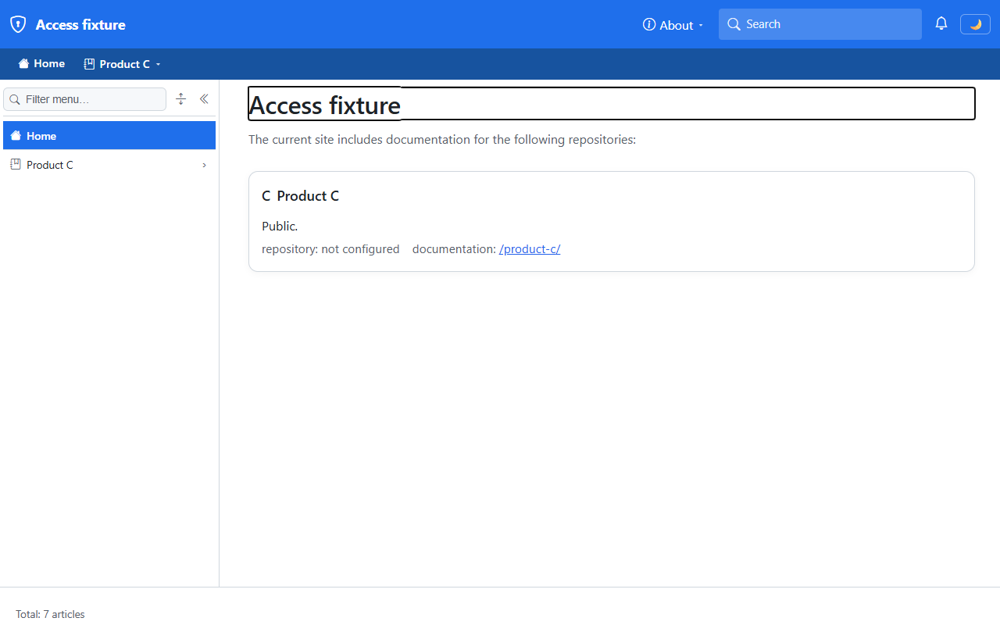
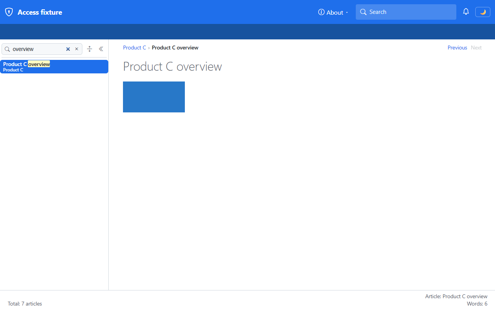
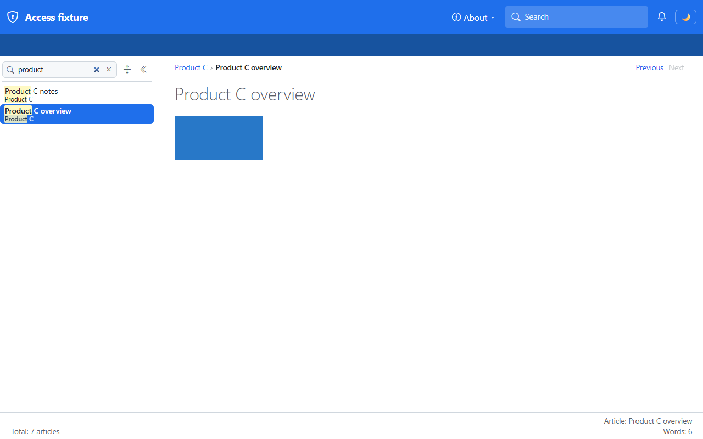
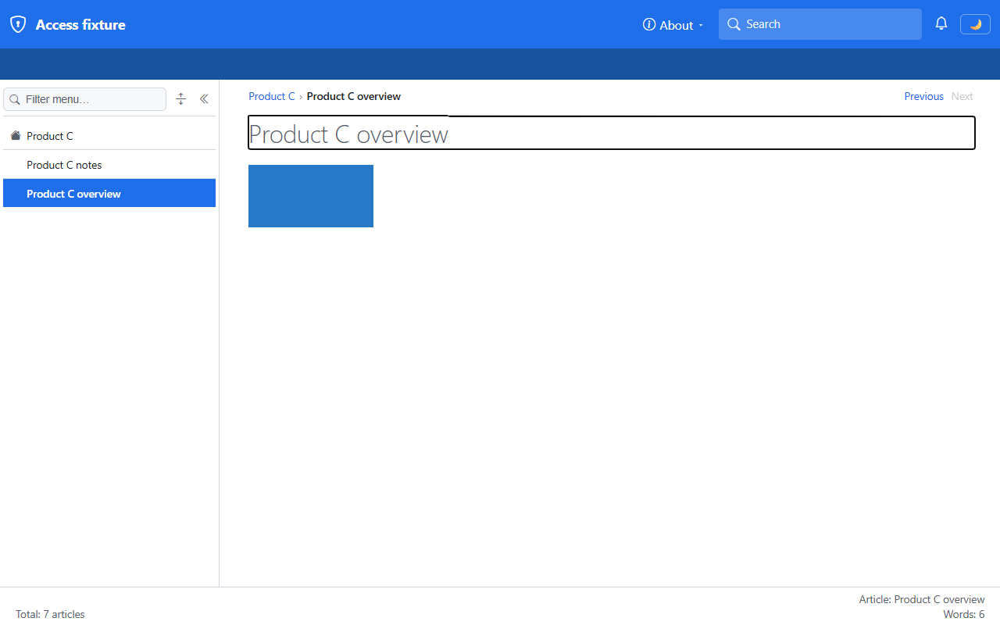
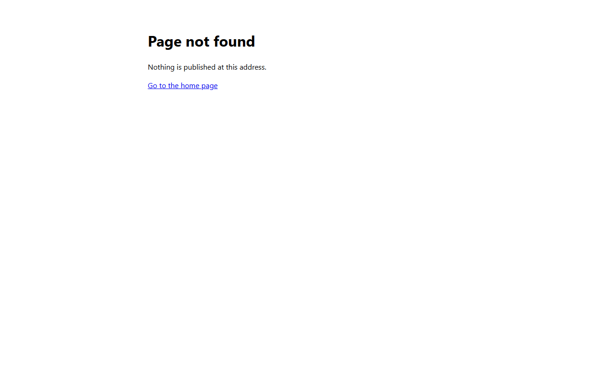
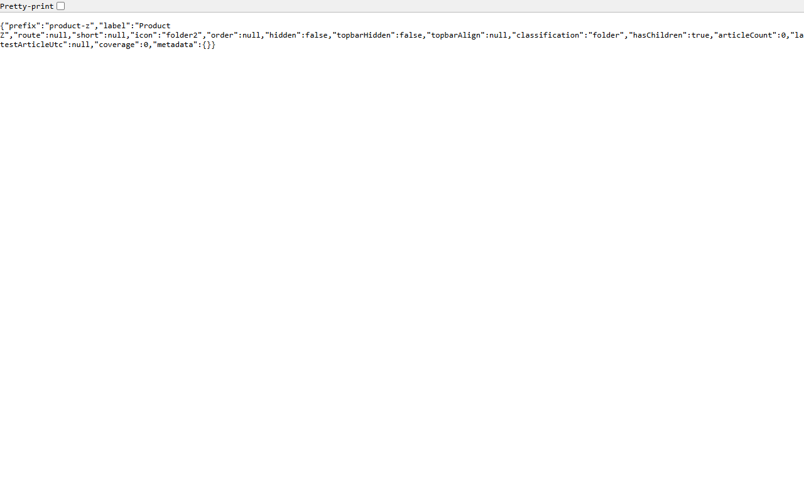
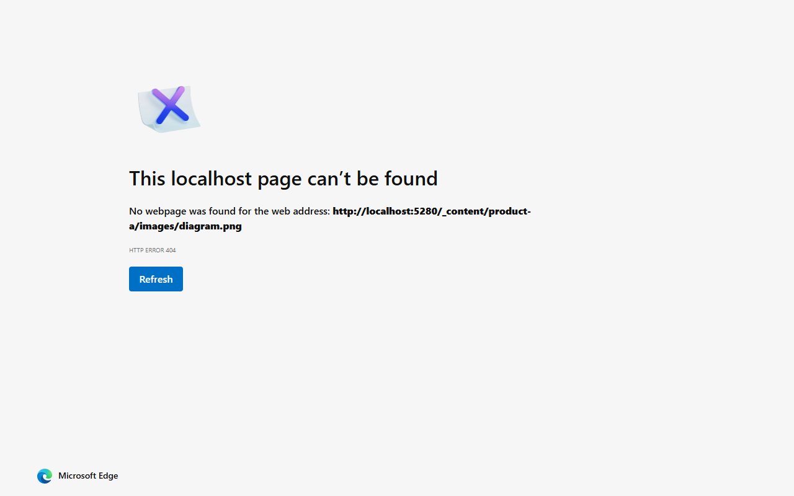
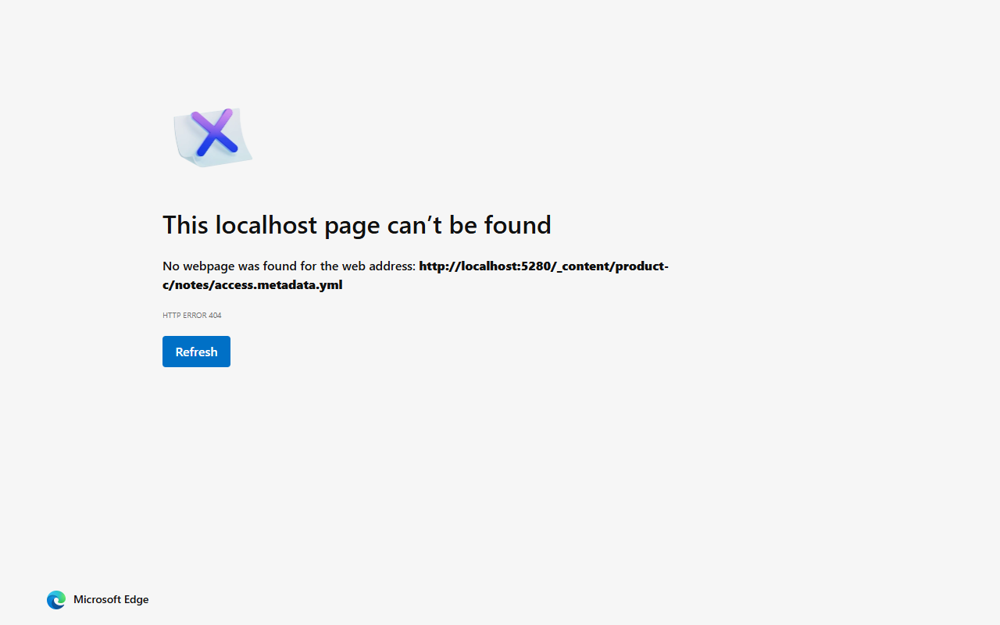
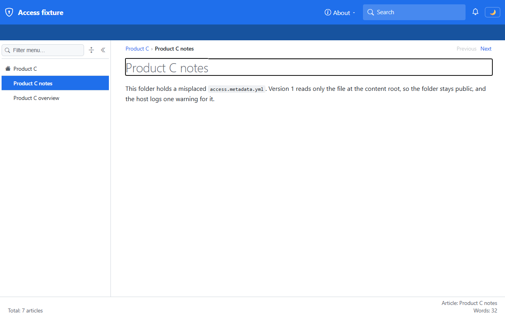
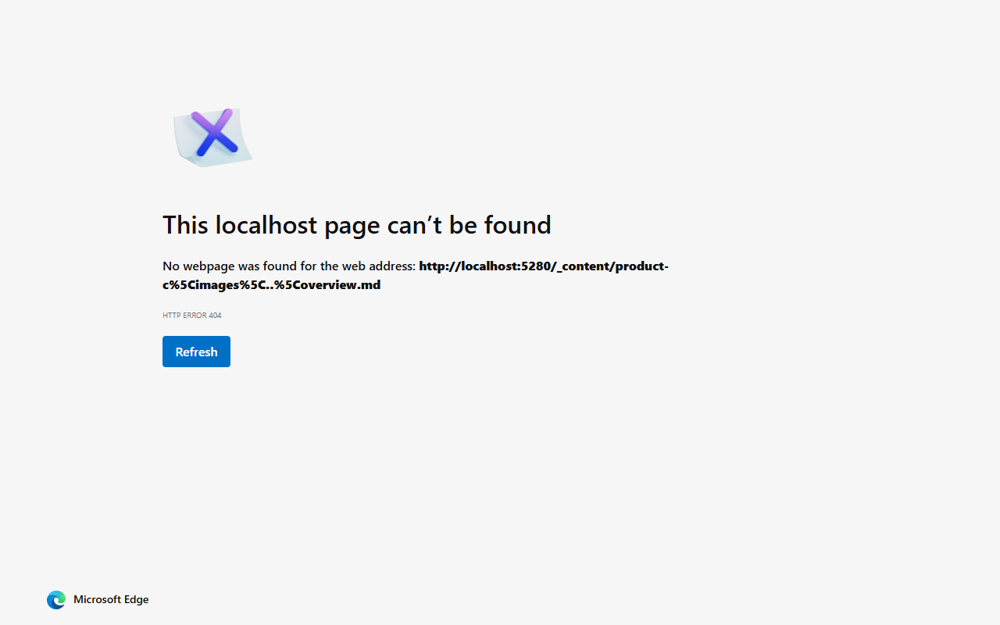

# Validation sequence — anonymous reader on the access fixture

This run validates `B14-validate-anonymous` of [the implementation plan](../01-roles-permissions-support.plan.md): an anonymous reader of the access fixture sees only the public space `product-c` on every surface, and every route, page, folder record, asset, and access file of `product-a`, `product-b`, and `product-d` answers exactly as a node that doesn't exist. A passing run proves that the WS-B check covers each surface in the plan's inventory that this work stream owns, before entity tags and with the caching headers of `D10-response-policy`.

## Environment

| Item | Value |
|---|---|
| URL | `http://localhost:5280/` |
| Build | `dotnet build src/Diginsight.SmartDocs.slnx -c Debug` → Build succeeded, 0 warnings, 0 errors |
| Run | `dotnet run --launch-profile "https - access"` from `src/Diginsight.SmartDocs.Web`, in a visible PowerShell console window titled *SmartDocs https - access* |
| Browser | Visible headed Microsoft Edge window driven by Playwright, viewport 1280×800 |
| Date | 2026-10-28 |

The fixture serves four prefixed spaces, so the site root is unclaimed and shows the generated space index. `product-a` requires `ProductA.Read` and sets `AccessFileRequired`; `product-b` requires `ProductB.Read`; `product-c` has no access file at its root and a misplaced one in `notes/`; `product-d` has no access file and the floor `authenticated`. Sign-in isn't wired yet, so every request is anonymous.

## Sequence and results

| # | Precondition | Action | Expected | Observed | Result |
|---|---|---|---|---|---|
| 1 | Server running, anonymous | Open `/` and read the sidebar, top bar, space index, and the prerendered HTML | Only `product-c` appears; the HTML names no hidden space | Sidebar `["Home", "Product C"]`; top bar `["Home", "Product C ▾"]`; one card `C Product C Public. repository: not configured documentation: /product-c/`; raw HTML of `/` (`200`, `private, no-store`) contains `product-a` 0 times, `product-b` 0, `product-d` 0, `Product A` 0, `Product B` 0, `Product D` 0, `SECRET` 0, `product-c` 10 | PASS |
| 2 | On `/product-c/overview`, WebAssembly hydrated | Type `overview`, then `product`, into **Filter menu**; read `/_nav/index` | Results list only `product-c` pages | `overview` → `Product C overview Product C -> /product-c/overview`; `product` → `Product C notes … -> /product-c/notes`, `Product C overview … -> /product-c/overview`; `/_nav/index` `200`, `private, no-cache`, two leaves, both under `product-c` | PASS |
| 3 | Same page | Read the breadcrumb's prev and next links on `/product-c/overview` and `/product-c/notes` | Prev and next stay inside `product-c` | Overview: `A:Previous:/product-c/notes`, `SPAN:Next:` (disabled); notes: `SPAN:Previous:` (disabled), `A:Next:/product-c/overview` | PASS |
| 4 | Anonymous | Navigate to each hidden route and to the missing `/product-z`, `/product-z/overview` | Every hidden route answers like a missing one | `/product-a`, `/product-a/overview`, `/product-a/guides`, `/product-a/guides/getting-started`, `/product-b`, `/product-b/release-notes`, `/product-d`, `/product-d/overview`, `/product-z`, `/product-z/overview`: all `404`, `Cache-Control: no-cache`, 455 bytes, text `Page not found Nothing is published at this address. Go to the home page`; the screenshots of `/product-a/overview` and `/product-z/overview` have the same SHA-256 | PASS |
| 5 | Anonymous | Fetch `/_page`, `/_nav/folder`, `/_nav/children`, and `/_content` for hidden and missing nodes | Hidden answers equal missing answers | `/_page/product-a/overview`, `/_page/product-b/release-notes`, `/_page/product-d`, `/_page/product-z/overview`: all `204`, `private, no-cache`, empty. `/_nav/folder?prefix=product-a` and `?prefix=product-z`: `200`, `private, no-cache`, 266 bytes, identical except the name (`"classification":"folder"`, `"route":null`, `"articleCount":0`, `"coverage":0`, `"metadata":{}`); same for `product-a/guides` vs `product-z/guides` (268 bytes). `/_nav/children?prefix=product-a` and `?prefix=product-z`: same entity tag `"5953C0D3E7E05FDC44AD362147660524"`, 28 bytes. `/_content/product-a/images/diagram.png`, `/_content/product-a/overview.md`, `/_content/product-z/images/diagram.png`: `404`, no `Cache-Control`, empty. Control: `/_content/product-c/images/chart.png` `200`, `public, max-age=300` | PASS |
| 6 | Anonymous | Fetch `diagram.png` with `If-None-Match: *`; navigate to it | `404`, never `304` | Hidden `diagram.png` with `If-None-Match: *`: `404`, no entity tag; missing `product-z` PNG: `404`; control `chart.png` with the same header: `304`. Navigating shows Edge's *HTTP ERROR 404* page | PASS |
| 7 | Anonymous | Fetch the access files, including spellings that a file system may resolve to the same file | `404` for every one | `/_content/product-a/access.metadata.yml`, `/_content/product-b/access.metadata.yml`, `/_content/product-c/notes/access.metadata.yml`, `…/ACCESS.METADATA.YML`, `…/access.metadata.yml.`, `…/./access.metadata.yml`: all `404`, empty | PASS |
| 8 | Anonymous | Open `/product-c/notes`; read the server log | `notes/` stays visible; one `Warning` for its misplaced file | Page title `Product C notes`; sidebar `["Product C notes", "Product C overview"]`; `/_nav/folder?prefix=product-c/notes` `200` with `"coverage":2`. Log: exactly one `WARN` line for `notes/access.metadata.yml` (quoted below) | PASS |
| 9 | Anonymous | Open `/robots.txt` | Names only `product-c` | `200`, `public, max-age=300`; the only space line is `Disallow: /product-c/` under `User-agent: GPTBot` | PASS |
| 10 | Server started | Read the server log | One `Information` summary each for `product-a` and `product-b` | Exactly one `INFO` line per space (quoted below) | PASS |
| 11 | After the security-review fix, server rebuilt and restarted | Fetch keys and prefixes whose `..` segments are encoded with `%5C`, which Kestrel doesn't remove | Each is refused as a missing node; a plain key still works | `/_content/product-c%5Cimages%5C..%5Coverview.md` `404` (before the fix: `200`, 96 bytes); `/_page/product-c%5Cimages%5C..%5Coverview` `204` (before: `200`); `/_content/product-c%5C..%5Cproduct-a%5Coverview.md` `404`; `/_page/product-c%5C..%5Cproduct-a%5Coverview` `204`; `/_content/product-c/images%5C..%5Coverview.md` `404`; `/_nav/folder?prefix=product-c/../product-a` `200` with the missing-folder record (`"classification":"folder"`, `"articleCount":0`, `"coverage":0`, `"metadata":{}`); `/_nav/children?prefix=product-c/../product-a` `{"children":[],"folders":[]}`. Control: `/_content/product-c/overview.md` `200`, 96 bytes | PASS |

## Evidence

| Step | Screenshot |
|---|---|
| **Step 1**: the generated index and the menus show only Product C |  |
| **Step 2**: the menu filter finds only Product C pages |  |
| **Step 2**: a broader filter still finds only Product C pages |  |
| **Step 3**: prev and next stay inside Product C |  |
| **Step 4**: a hidden route renders the shared 404 page |  |
| **Step 4**: a missing route renders the same page |  |
| **Step 5**: the folder record of a hidden space |  |
| **Step 5**: the folder record of a missing folder has the same shape |  |
| **Step 6**: the hidden image answers 404 |  |
| **Step 7**: a misplaced access file answers 404 |  |
| **Step 8**: the folder holding the misplaced file stays visible |  |
| **Step 9**: robots.txt names only Product C |  |
| **Step 11**: a key with an encoded dot segment is refused |  |

**Console-only evidence (steps 8 and 10).** These records produce no page, so no screenshot exists. The overlay enables console logging at the levels below, and the same records reach the Diginsight log file, `%USERPROFILE%\LogFiles\Diginsight\Diginsight.SmartDocs.Web.20261028.log`, from which they're quoted. Searching that file for the run's start time found these lines and no others about access files:

```text
2026-10-28T17:16:33.068 Diginsight.SmartDocs.Web.Program  INFO  Site 'Access fixture' publishes 4 space(s): product-a @ /product-a, product-b @ /product-b, product-c @ /product-c, product-d @ /product-d
2026-10-28T17:16:35.650 …cs.Web.Authorization.AccessFileProvider INFO  Space 'product-a' access file 1dbbdf891a6fe975ee6de41eb9b49ff68c8546ef85ee05cb92abaad23633afaa is valid. Requires: ProductA.Read. Roles: Admin -> [ProductA.Read, ProductA.Write]; Contributor -> [ProductA.Read, ProductA.Write]; Reader -> [ProductA.Read].
2026-10-28T17:16:35.650 …cs.Web.Authorization.AccessFileProvider INFO  Space 'product-b' access file 2bc477fdc787ee4a287b45890367d457b4583a819cab61d1a2c8afeacb6539c7 is valid. Requires: ProductB.Read. Roles: Admin -> [ProductB.Read]; Contributor -> [ProductB.Read]; ProductB.Reader -> [ProductA.Read, ProductB.Read].
2026-10-28T17:16:38.570 …ontentSources.SpaceMountedContentSource WARN  Space 'product-c' has access.metadata.yml at 'notes/access.metadata.yml', below its content root. Version 1 reads only the file at the content root, so this one restricts nothing. It is never served.
```

The restart for the security-review rerun logged the same four records once more, at `17:43:04.850`, `17:43:08.617` (twice), and `17:43:11.445`, with the same fingerprints.

## Security-review rerun

`/security-review` reported one finding, HIGH with confidence 8/10: Kestrel removes dot segments before it decodes `%5C`, so a key such as `product-c\..\product-a\overview.md` reached the access check, which placed it in the public `product-c`, and the store, where the blob SDK would collapse `..` and read another container. The file-system fixture contained it, but `product-c%5Cimages%5C..%5Coverview.md` answered `200`, which showed the dot segments reaching the store. The fix refuses keys with dot, empty, or `%` segments in `AccessRequirementResolver` and `SpaceMountedContentSource`, and in `BlobContentSource` as a second layer. After rebuilding and restarting, steps 1 to 9 were rerun in the same visible Edge window, and every observed value matched the first run; step 11 records the finding's probes. The screenshots above are from the rerun.

## Notes

- **Browser.** The VS Code integrated browser pane measured 555×346 pixels and ignored viewport changes, so SmartDocs used its narrow layout and the header covered the sidebar controls. The run therefore used a separate, headed Edge window at 1280×800, driven by Playwright from the session folder.
- **Hydration.** The menu filter is interactive only after WebAssembly hydrates; the run waited for it and typed with key events.
- **Header search.** The header's **Search** overlay is a placeholder that says search is being wired to the server. It reads no content, so it can't leak; full-text search is parked as `PL-4-search-trimming`.
- **Not covered by this run:**
  - Counts. The footer reads `Total: 7 articles`, which still includes the hidden spaces' articles, and the root folder record and `/_nav/total` aren't composed per reader yet. `C2-reader-counts` owns them, and `C4-validate-counts-and-push` validates them.
  - The nav hub. It still broadcasts folder records to every connection until `C3-push-per-group`.
  - Signed-in readers, role expansion, and the 404 page's **Sign in** link, which need `WS-E-sign-in-and-role-expansion`.
  - Unreadable and invalid access files, a missing file where `AccessFileRequired` is on, and the mount-route divergence with a root-mounted `home` space: `F5-unreadable-access-file` and `F6-mount-route-divergence`.
  - Byte-for-byte comparison with the baseline commit: `F4-regression`.
