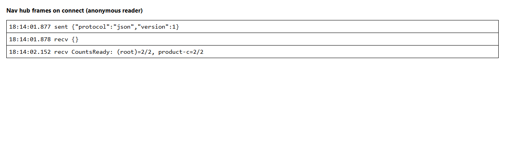
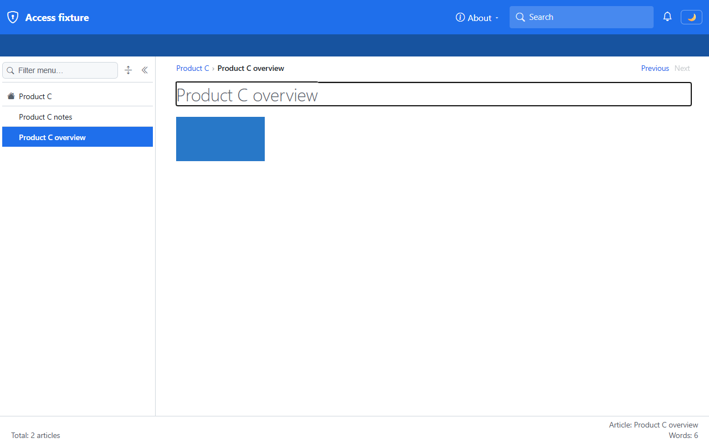
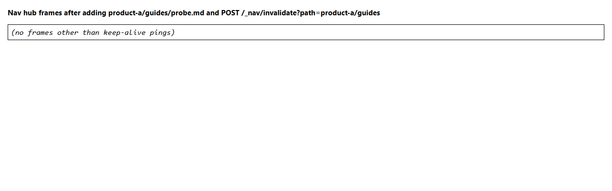
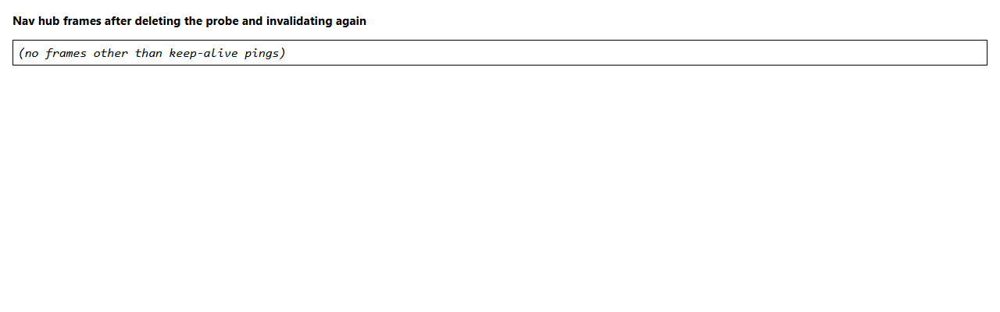
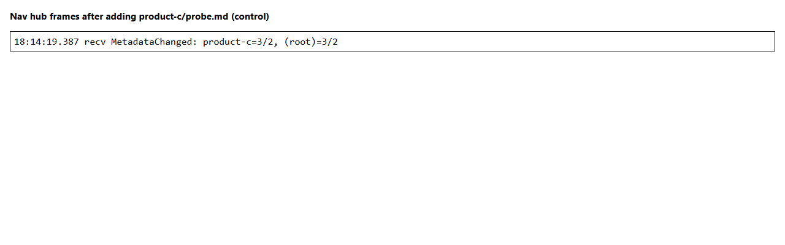
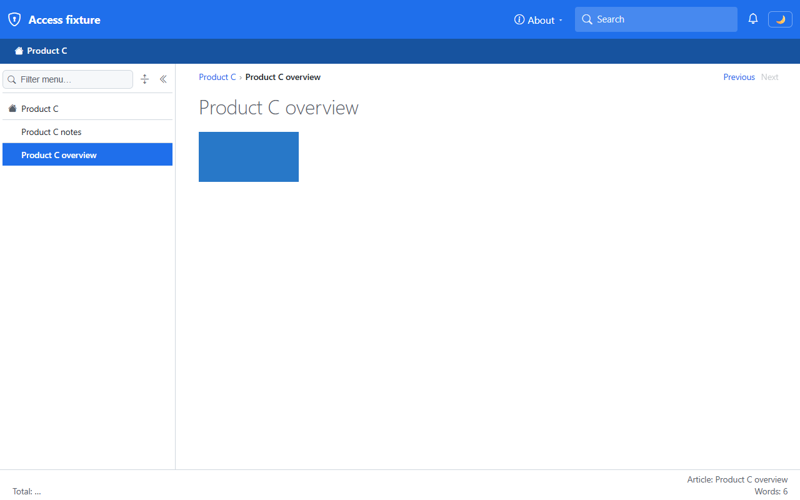
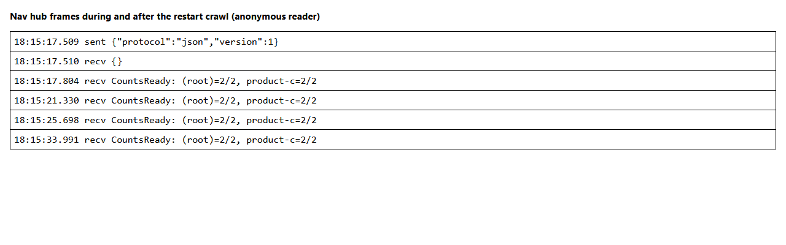

# Validation sequence — counts and push for an anonymous reader

This run validates `C4-validate-counts-and-push` of [the implementation plan](../01-roles-permissions-support.plan.md): an anonymous reader of the access fixture sees counts that cover `product-c` only, before and after the crawl settles; a change in a hidden space sends their window no frame; and a change in a visible space reaches it with a root record composed for them. A passing run proves that the per-space cells, the per-reader composition, and the per-group push of `WS-C-counts-and-push` hold for the one reader this plan can sign in today. Signed-in role sets are validated in sequences 03 and 04.

## Environment

| Item | Value |
|---|---|
| URL | `http://localhost:5280/` |
| Build | `dotnet build src/Diginsight.SmartDocs.slnx -c Debug` → Build succeeded, 0 warnings, 0 errors |
| Run | `dotnet run --launch-profile "https - access"` from `src/Diginsight.SmartDocs.Web`, in a visible PowerShell console window titled *SmartDocs https - access*; the final two starts are the runs recorded below |
| Browser | Visible headed Microsoft Edge window driven by Playwright, viewport 1280×800 |
| Date | 2026-10-28 |

The fixture serves four prefixed spaces, so the site root is unclaimed and `/` serves the generated index. Their counts, as the index holds them: `product-a` 3 (`guides` 2), `product-b` 1, `product-c` 2, `product-d` 1, root 7, and the root-own cell 0, because no space is root-mounted. The overlay in `smartdocs.internal` now also logs `Diginsight.SmartDocs.Web.Navigation.FolderMetricsIndex` at `Information`, so the console says when it ignores a snapshot. Sign-in isn't wired yet, so every request is anonymous.

**How frames were watched.** The headed Edge window's WebSocket traffic was read from Playwright's `framesent` and `framereceived` events on `/_nav/hub`, which is the data the browser's network panel shows for that connection. The `Observed` column quotes each frame as `target: prefix=articleCount/coverage`. A frame log image is the same list rendered into a page, because the panel itself isn't capturable.

## Sequence and results

| # | Precondition | Action | Expected | Observed | Result |
|---|---|---|---|---|---|
| 1 | The previous run's snapshot is in the old format, a bare map of folders | Start the host | The console says it ignored the snapshot, and the crawl rebuilds it | `INFO …Web.Navigation.FolderMetricsIndex Nav metrics snapshot ignored: it is in format 0, this build reads format 2. The crawl rebuilds it.` The run then wrote a format 2 snapshot with a `rootOwn` entry | PASS |
| 2 | Anonymous, hub connected | Open `/product-c/overview`; wait for the hub's `CountsReady`; read the footer and the count surfaces | Every count covers `product-c` only | Footer `Total: 2 articles`. Frames: `recv CountsReady: (root)=2/2, product-c=2/2`. `/_nav/total` `200`, `private, no-cache`, `count` 2, `coverage` 2; `/_nav/folder?prefix=` `articleCount` 2, `coverage` 2; `/_nav/folder?prefix=product-c` 2/2. `?prefix=product-a` and `?prefix=product-z` both `0`/`0` | PASS |
| 3 | Same window | Add `product-a\guides\probe.md`, call `POST /_nav/invalidate?path=product-a/guides` (`200`), wait 6 s | No `MetadataChanged` frame; counts unchanged | Frames after the call: none besides keep-alive pings. Footer `Total: 2 articles`; `/_nav/total` `count` 2 | PASS |
| 4 | Same window | Delete the probe and invalidate again, wait 6 s | Still no frame | Frames: none besides keep-alive pings. Footer `Total: 2 articles` | PASS |
| 5 | Same window, a *control* | Add `product-c\probe.md`, call `POST /_nav/invalidate?path=product-c`, wait 6 s; then delete it and invalidate again | A visible change reaches the window, with the root composed for this reader | `recv MetadataChanged: product-c=3/2, (root)=3/2`, footer `Total: 3 articles`; after the delete `recv MetadataChanged: product-c=2/2, (root)=2/2`, footer `Total: 2 articles`. The root is 3, not the 8 that every space holds then | PASS |
| 6 | Snapshot from this run on disk, host stopped | Restart; poll `/_nav/total` every 150 ms from the first answer for 60 s; open the page once the total answers | The total never includes `product-a`, `product-b`, or `product-d`, before or after the crawl settles | `204` for 0.4 s, until the snapshot loaded, then `count=2 coverage=2` for the rest of the 60 s, with no other value. The first prerendered footer was `Total: …`, the unknown marker; it settled at `Total: 2 articles`. Frames: four `CountsReady`, each `(root)=2/2, product-c=2/2`. Console: `Nav metrics seeded from snapshot: 6 folders` | PASS |
| 7 | An earlier build of this step, before the fix below | Request `/_nav/folder?prefix=product-z`, then run step 3 | No frame | **FAIL.** `recv MetadataChanged: product-z=0/2, (root)=2/2` arrived with no visible change after the hidden one. Fixed in `FolderMetricsIndex` and `FolderRecordProvider`; steps 2 to 6 were rerun on the fixed build, and step 3 ran after the same `product-z` request | PASS after fix |

## Evidence

| Step | Screenshot |
|---|---|
| **Step 2**: the footer total covers `product-c` only |  |
| **Step 2**: the frames of the hub connection |  |
| **Step 3**: the footer after a hidden change |  |
| **Step 3**: no frame after the hidden change |  |
| **Step 4**: no frame after deleting the probe |  |
| **Step 5**: the footer after a visible change |  |
| **Step 5**: the frame of the visible change |  |
| **Step 6**: the first prerendered footer after the restart |  |
| **Step 6**: the settled footer after the restart |  |
| **Step 6**: the frames during and after the restart |  |

**Console-only evidence (steps 1 and 6).** These records produce no page.

```text
2026-10-28T18:12:00.670 …tDocs.Web.Navigation.FolderMetricsIndex INFO  Nav metrics snapshot ignored: it is in format 0, this build reads format 2. The crawl rebuilds it.
2026-10-28T18:15:03.017 …tDocs.Web.Navigation.FolderMetricsIndex INFO  Nav metrics seeded from snapshot: 6 folders
```

**Counts a hidden change did move (step 3).** A run with `Testing__ContentMutationEnabled=true`, which exposes `/_nav/metrics`, read the index's own values after the same hidden probe and invalidate: `(root)` 8, `product-a` 4, `product-a/guides` 3, `product-b` 1, `product-c` 2, `product-d` 1. The anonymous total stayed `count` 2 and the window received no frame. After the probe was deleted and invalidated, the index read 7, 3, 2, 1, 2, 1 again. This shows the drain folded the hidden change, so the silence in step 3 isn't a missed event.

## Finding fixed during the run

Step 7 failed on the first build. `FolderRecordProvider` registers an invalidation callback for every prefix it serves, including a prefix that no content has, such as `/_nav/folder?prefix=product-z`. The publisher clears every folder record on each push, which ran those callbacks, and the callback for `product-z` called `FolderMetricsIndex.Invalidate`, which created a cell for the unknown prefix. The next drain folded it from nothing to an empty, complete total and pushed its record, so a reader who requested an unknown prefix saw a frame timed by a change in a hidden space.

`FolderMetricsIndex.InvalidateIfTracked` now backs the callback, and a prefix that the index doesn't track stays untracked. A folder created after the crawl still gets its cell when its parent folds, because a content change names it through `PublishChangeAsync`. The fix belongs to `C1-counts-per-space` and `C3-push-per-group`; step 7 records it, and steps 2 to 6 are from the fixed build.

## Notes

- **Browser.** The VS Code integrated browser pane measured 555×346 pixels and ignored viewport changes, as in sequence 01, so this run used a separate headed Edge window at 1280×800. Its first attempt waited 2.5 s, which was too short for the hub to connect after WebAssembly booted, so the run now waits for the hub's first `CountsReady` before the hidden-change step.
- **Frames.** The two empty frame logs (steps 3 and 4) say "no frames other than keep-alive pings" because a SignalR connection sends a type-6 ping every few seconds, and the log leaves them out. A control (step 5) proves the same connection receives pushes.
- **`/_nav/metrics`.** The index dump answers with every space's counts when `Testing:ContentMutationEnabled` is on. It's off in the fixture overlay and was enabled only for the supplementary read above; no deployed overlay may enable it.
- **Persisted-state errors.** The console logs `There was an error executing a callback while pausing the application` (`There is already a persisted object under the same key`) on most first page loads, followed by `Headers are read-only, response has already started` from `NavigationBootstrapMiddleware`. The page renders and hydrates anyway. The Diginsight log shows the same error from 08:36 on 2026-10-28, before `WS-B-enforcement`, and nothing in `WS-C-counts-and-push` touches persistent state, so it isn't caused by this run. It isn't in the plan's scope.
- **Not covered by this run:**
  - Signed-in readers and role sets, which need `WS-E-sign-in-and-role-expansion`; sequence 03 covers the *reader*, *multi*, and *none* counts, and sequence 04 covers the hub for each.
  - A connection that outlives its session (`CloseOnAuthenticationExpiration` and `DS-4-hub-expiry`), which needs a cookie session: `F2-revocation`.
  - A root-mounted space's own articles through the root-own cell with a reader who sees it: the fixture mounts no root space until `F6-mount-route-divergence`, so the root-own cell is 0 here.
  - Byte-for-byte comparison with the baseline commit: `F4-regression`.
