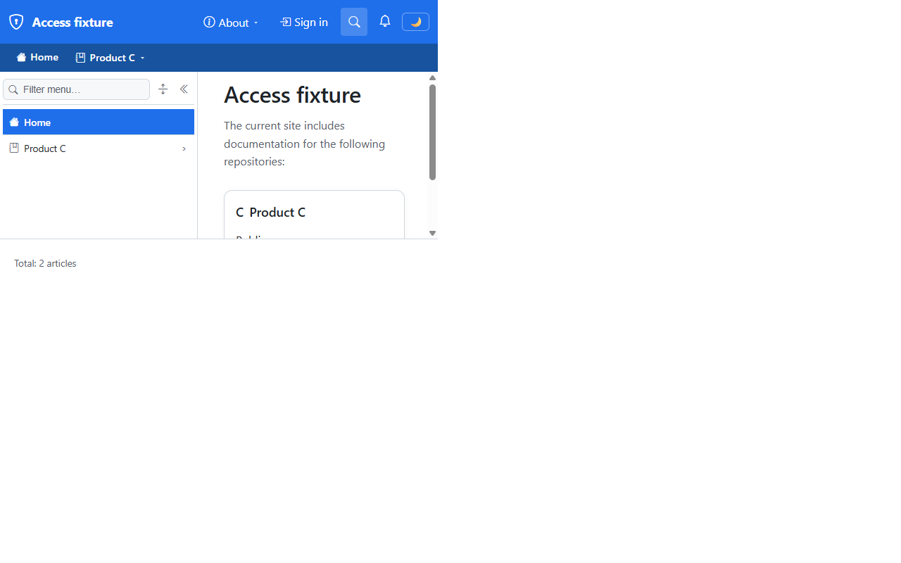
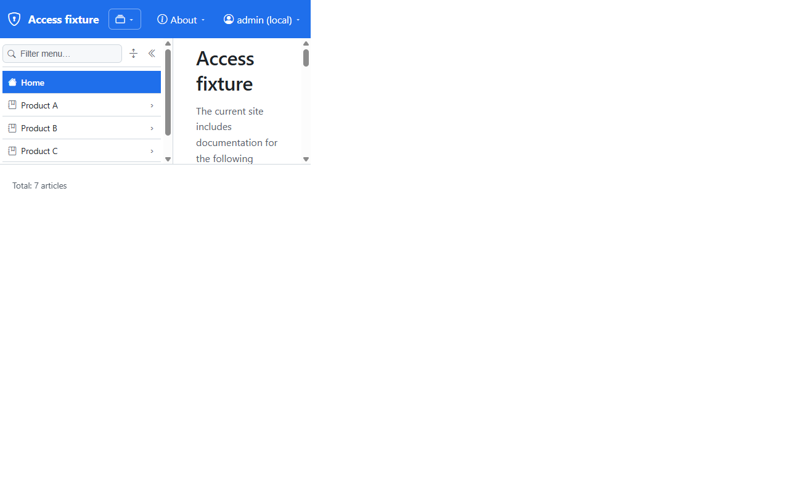
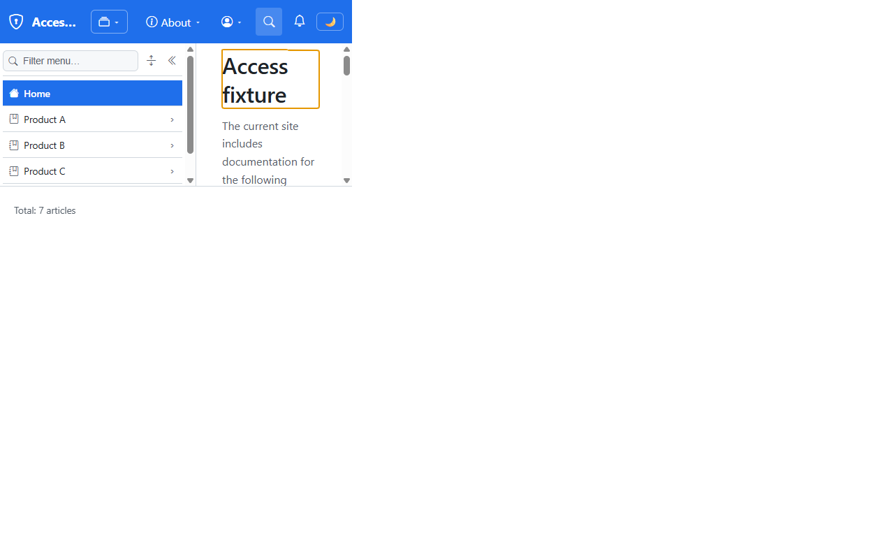
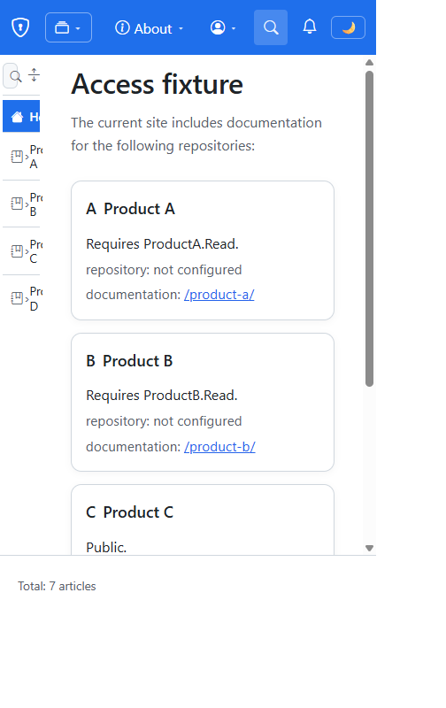
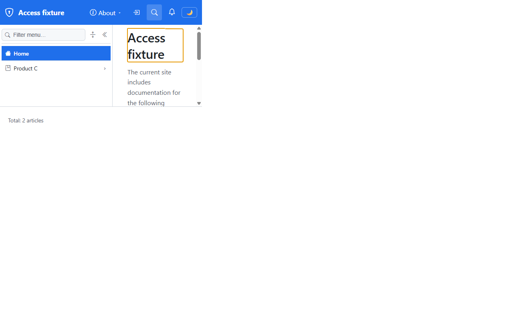
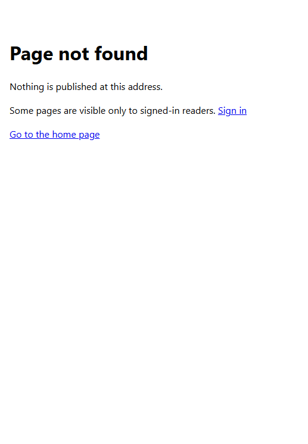

# Validation sequence — sign-in and role expansion

This run validates `E7-validate-sign-in` of [the implementation plan](../01-roles-permissions-support.plan.md). Signed in as each account role in turn, a reader sees exactly the spaces their roles open, space by space: the *multi* account's two roles combine by union, and a role that one space's file maps opens nothing in another. A mapping removed from an access file applies to open sessions at their next reload, **Sign out** returns the anonymous view, and a crafted path can't inject markup into the 404 page. A passing run proves `E1-identity-web` to `E6-not-found-sign-in` against the development registration of `WS-D-entra-provisioning`. The run also resolved `DS-2-client-credential`.

## Environment

| Item | Value |
|---|---|
| URL | `https://localhost:7280/` |
| Build | `dotnet build src/Diginsight.SmartDocs.slnx -c Debug` → Build succeeded, 0 warnings, 0 errors, after each of the four fixes below |
| Run | `dotnet run --launch-profile "https - access"` from `src/Diginsight.SmartDocs.Web`, in a visible PowerShell console window titled *SmartDocs https - access (sign-in)*, restarted after each rebuild. The console logged `Reader sign-in is enabled` |
| Browser | Visible headed browser window driven by Playwright, viewport 504×300 for most of the run; the top bar was also measured at 1280, 504, and 375 px |
| Date | 2026-10-28 |

The internal overlay sets `AzureAd:TenantId` and `AzureAd:ClientId` to the development tenant and the development registration, which the internal alias registry resolves. The host has no client secret. `DS-3-test-accounts` took its negative branch, so one account plays *none*, *reader*, *multi*, and the *Contributor* holder by changing its memberships with `az ad group member add` and `remove`. Expected counts follow from the fixture: `product-a` 3, `product-b` 1, `product-c` 2, `product-d` 1.

**How each new sign-in was taken.** The owner completed the first sign-in on the Entra page. After each membership change, the next sign-in opened `/_auth/signin?returnUrl=%2F` while still signed in. A challenge runs the full OpenID Connect round trip even for a signed-in reader, and its callback replaces the application cookie with the new principal. Entra's own session answered without a prompt, so nobody typed a credential. The plan's "sign out and in again" is otherwise the same: a new ID token, issued after the change. **Sign out** itself has its own step, 9.

**How state was read.** Each step read the live DOM and called `/_site`, `/_nav/total`, and the four mount routes from the page, with the reader's cookie. The `Observed` column quotes them as *spaces*, *total* (`count/coverage`), *footer*, and *routes*.

## Sequence and results

| # | Precondition | Action | Expected | Observed | Result |
|---|---|---|---|---|---|
| 1 | Anonymous | Open `/` | Only `product-c`; **Sign in** in the top bar | Spaces `["product-c"]`, `signInEnabled: true`; total 2/2; footer `Total: 2 articles`; **Sign in** → `/_auth/signin?returnUrl=%2F` | PASS |
| 2 | Anonymous | Click **Sign in** | The development tenant's sign-in page | `login.microsoftonline.com/<development tenant>/oauth2/v2.0/authorize` with `response_type=id_token`, `response_mode=form_post`, and `redirect_uri=https://localhost:7280/signin-oidc` | PASS |
| 3 | The account in no group (*none*) | The owner completes the sign-in | Back on `/`; `product-c` and `product-d` | No `AADSTS` error, so `DS-2-client-credential` takes its positive branch. Spaces `["product-c","product-d"]`; total 3/2; footer `Total: 3 articles`; routes `a 404, b 404, c 200, d 200`. **FAIL** before fix 1: the top bar said *admin (local)* when prerendered and **Sign in** after hydration. After fix 1, *admin (local)* both before and after hydration | PASS after fix 1 |
| 4 | Add to *SmartDocs readers* (*reader*) | Sign in again | `product-a`, `product-c`, `product-d` | **FAIL** before fix 2: still `product-c` and `product-d`, with no `Warning`, although the ID token carried `roles: ["Reader"]`. After fix 2: spaces `["product-a","product-c","product-d"]`; total 6/2; footer `Total: 6 articles`; routes `a 200, b 404, c 200, d 200` | PASS after fix 2 |
| 5 | Add *Product B readers* (*multi*) | Sign in again | All four, by the union of two roles | Spaces `["product-a","product-b","product-c","product-d"]`; total 7/2; footer `Total: 7 articles`; every route 200 | PASS |
| 6 | *multi*, signed in | Remove `ProductB.Reader` from `product-b`'s access file, `POST /_nav/invalidate` without a path (`200`); reload without signing in again | Loses `product-b`, keeps `product-a`; one `Warning` names `ProductB.Reader` | Spaces `["product-a","product-c","product-d"]`; total 6/2; route `b 404`. Console, once: `WARN …Authorization.SpaceVisibilityEvaluator The role 'ProductB.Reader' is mapped by no space with a valid access file, so it grants nothing; the reader's other roles still count`. File restored, its SHA-256 back to `2bc477fd…`, and invalidated again (`200`) | PASS |
| 7 | Remove *SmartDocs readers* (`ProductB.Reader` only) | Sign in again | `product-b`, `product-c`, `product-d`, not `product-a`, although `product-b` maps the role to a permission named `ProductA.Read` | Spaces `["product-b","product-c","product-d"]`; total 4/2; footer `Total: 4 articles`; routes `a 404, b 200, c 200, d 200`. Membership restored and signed in again: all four, total 7/2 | PASS |
| 8 | Back to no group, then add *SmartDocs contributors* | Sign in again | All four spaces | Spaces `["product-a","product-b","product-c","product-d"]`; total 7/2; footer `Total: 7 articles`; every route 200. Membership removed again; the account ended in none of the four groups | PASS |
| 9 | Signed in | Submit the sign-in menu's **Sign out** form | Entra signs the session out and `/` shows the anonymous view | **FAIL** before fix 3: `POST /_auth/signout` answered `400`, because the form had no antiforgery field. After fix 3: the form carried `__RequestVerificationToken` (198 characters); `302` to `<development tenant>/oauth2/v2.0/logout`, titled *Sign out*; back on `/`. Spaces `["product-c"]`; total 2/2; routes `a 404, b 404, c 200, d 404`; **Sign in** shown; the bootstrap record's `Reader` is `null` | PASS after fix 3 |
| 10 | Signed in, four spaces | Measure the top bar at 1280, 504, and 375 px | The controls fit within the viewport | **FAIL** before fix 4: at 504 px the bar's content was 633 px wide and the theme toggle ended at 594 px, off-screen. After fix 4: 1280 px fits; 504 px fits, theme toggle ending at 492 px; 375 px overflows by 15 px, as it did before this work item (`SIG-2` of [the signals page](../02-signals.md)) | PASS after fix 4 at the widths the run targets |
| 11 | Anonymous | Open `/x%22%3E%3Cb%3Einjected%3C%2Fb%3E`; repeated with `curl` on the final build | 404 page, the link's markup intact, no injected element | Status 404, `Cache-Control: private, no-cache`. Live DOM: 0 `<b>` elements; two links, **Sign in** → `/_auth/signin?returnUrl=%2Fx%22%3E%3Cb%3Einjected%3C%252Fb%3E` and **Go to the home page** → `/`. The final build's body has the same link and no `<b>injected` | PASS |

## Fixes made during the run

1. **The browser didn't restore the sign-in state.** This host never emits the framework's persisted-state payload; [`SIG-1`](../02-signals.md) records why. So `AddAuthenticationStateDeserialization` received nothing and the client fell back to anonymous. `NavigationBootstrapMiddleware` now writes the reader's display name into the host's own `smartdocs-bootstrap` record, and the client's new `BootstrapAuthenticationStateProvider` reads it. The framework serialization calls, and the `Microsoft.AspNetCore.Components.WebAssembly.Authentication` package they needed, were removed in favor of `Microsoft.AspNetCore.Components.Authorization`.
2. **Roles weren't collected.** Entra's `roles` claim reached the principal under `ClaimTypes.Role`, renamed by inbound claim mapping despite `MapInboundClaims = false` on the OpenID Connect options. `RoleSet.FromPrincipal` was reading only `roles` and the identity's role claim type, which was set to `roles`. It now also reads `ClaimTypes.Role`, from authenticated identities only.
3. **Sign-out failed antiforgery.** `<AntiforgeryToken />` gets its token from the same persisted state, so the hydrated form had none. For a signed-in reader on a page request, the middleware now also writes the antiforgery request token into the bootstrap record, which is `private, no-store`, and the menu renders it as a hidden field.
4. **The account control pushed the theme toggle off-screen at narrow widths.** Below 860 px, the sign-in name and label now hide like the search label. The button keeps its icon, and a `title` and `aria-label` carry the name. The site title also shrinks with an ellipsis instead of pushing the controls past the edge.

## Evidence

| Step | Screenshot |
|---|---|
| **Step 1**: the anonymous view |  |
| **Step 2**: the Entra sign-in page | Stored in `_internal/s03-01-entra-sign-in.png`, because it belongs to the development tenant |
| **Step 3**: *none* |  |
| **Step 4**: *reader* |  |
| **Step 5**: *multi* |  |
| **Step 6**: a mapping removed from `product-b` |  |
| **Step 7**: `ProductB.Reader` only |  |
| **Step 8**: *Contributor* |  |
| **Step 10**: the top bar at 504 px after fix 4 |  |
| **Step 10**: the same width, measured |  |
| **Step 9**: after **Sign out** |  |
| **Step 11**: the 404 page for the crafted path |  |

## Notes

- The ID token was decoded only to diagnose step 4. Its claim names and `roles` value were read inside the page and never stored.
- Playwright couldn't click the top bar's dropdown buttons in this integrated browser. It reported that `header.topbar` intercepts pointer events, for the existing **About** button too, so it's a property of the browser host, not of the sign-in menu. Step 9 submitted the menu's real form with `requestSubmit()`, which sends the same POST a click would.
- `DS-4-hub-expiry`, revocation after the session lifetime, and pushes per role set aren't covered here; session 5 validates them in sequence 04.
- The `ComponentStatePersistenceManager` `Error` that the console logs on every page predates this work item, and is `SIG-1` of [the signals page](../02-signals.md).
