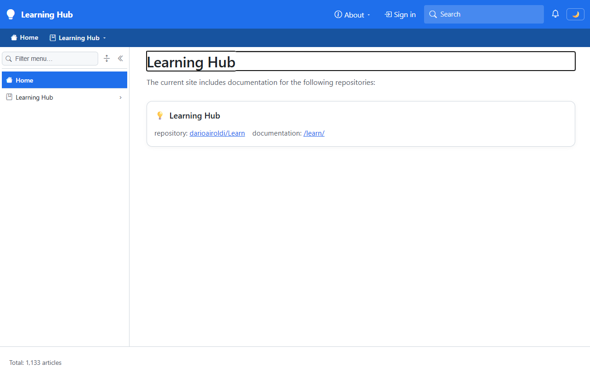
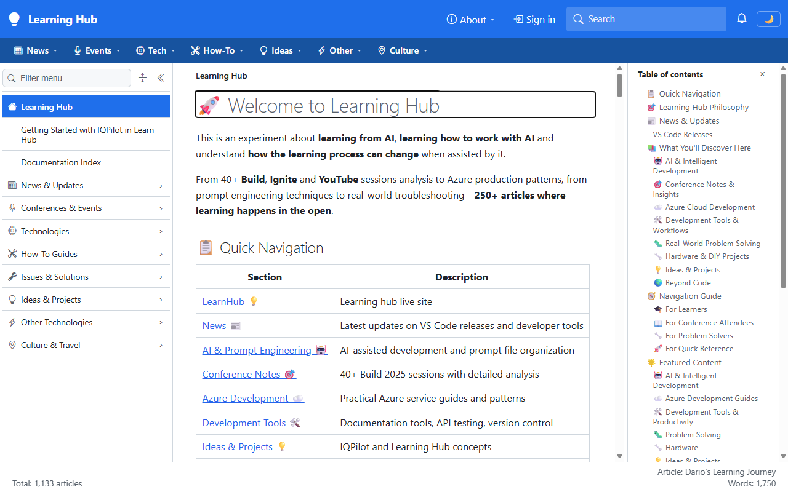
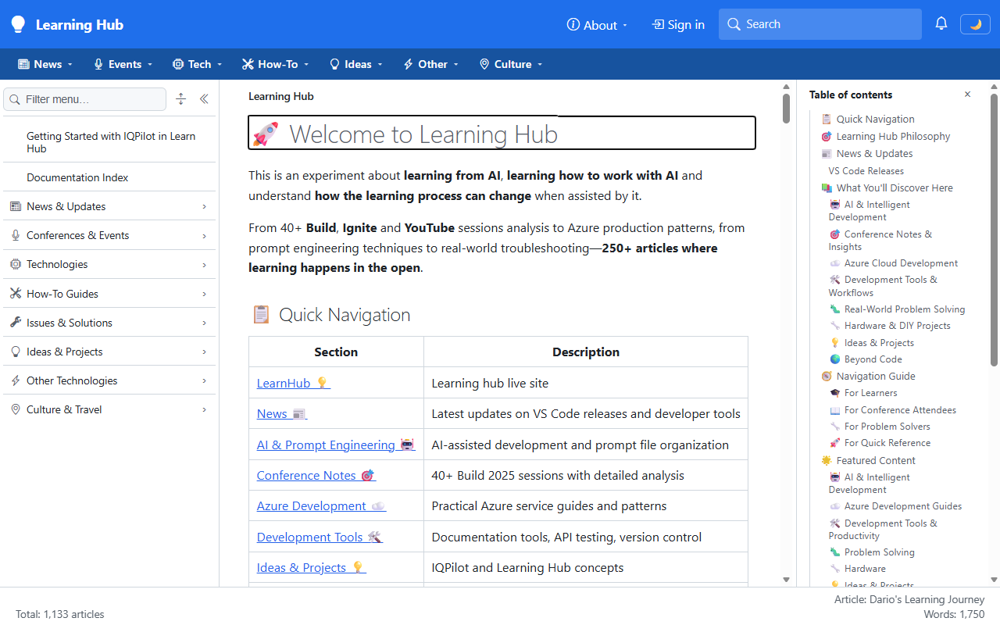
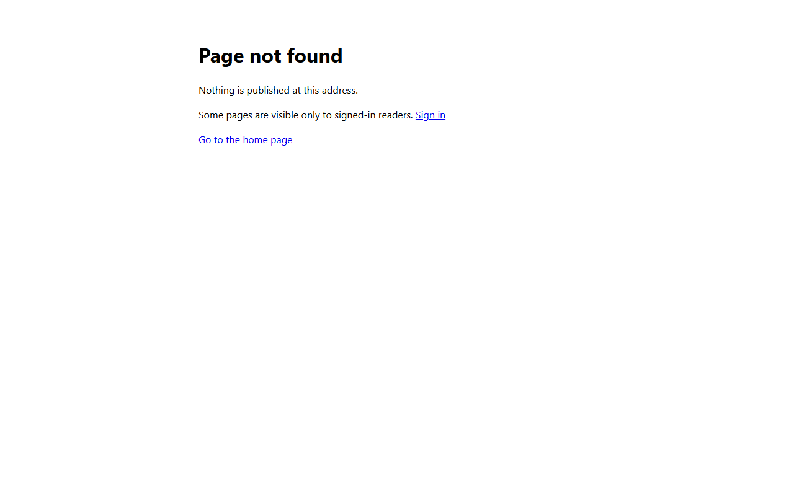

# Validation sequence — Learning Hub public and internal spaces

**Validation scope: partial.** `PASS` describes the recorded anonymous-browser, sign-in-start, and offline permission checks. It is not end-to-end acceptance of the four accounts, sign-out, or a cloud deployment.

This run validates the local `devlearn` profile after it changed from one root-mounted Learning Hub to two spaces:

- **Public Learning Hub** at `/learn`, readable without signing in.
- **Internal Learning Hub** at `/learn-internal`, open only to signed-in readers whose app role grants `Read`.

A passing run proves four things:

- The site root lists only the public space to an anonymous reader.
- The internal space is indistinguishable from a page that doesn't exist.
- Sign-in reaches Entra with the Learn reader app registration and a valid request.
- The internal space's access file gives each role its intended permissions.

Tenant, registration, account, and content-root identifiers are named by role. They live only in the private overlay and the internal alias registry.

## 📚 Table of contents

- [Environment](#-environment)
- [Sequence and results](#-sequence-and-results)
- [Evidence](#-evidence)
- [Independent recheck](#-independent-recheck)
- [Notes](#-notes)
- [References](#-references)

## ⚙️ Environment

| Item | Value |
|---|---|
| URL | `https://localhost:7280/` |
| Build | `dotnet build src/Diginsight.SmartDocs.slnx -c Debug` → Build succeeded, 0 warnings, 0 errors |
| Run | `dotnet run --launch-profile "https - devlearn"` from `src/Diginsight.SmartDocs.Web`, in a visible PowerShell console window. The profile reads the private overlay through `ExternalConfigurationFolder` |
| Browser | Visible headed Microsoft Edge window driven by Playwright, viewport 1280×800, fresh context with no Entra session |
| Date | 2026-11-02 |

**Entra state before the run.** The Learn reader app registration was empty when the run started. It now declares three app roles, each with allowed member type `User`: `Admin`, `Contributor`, and `Reader`. It also accepts ID tokens and lists `https://localhost:7280/signin-oidc` and `/signout-callback-oidc` as redirect URIs.

Roles are assigned directly to users on its enterprise application:

| Test account | App role |
|---|---|
| Admin test account | `Admin` |
| Contributor test account | `Contributor` |
| Reader test account | `Reader` |
| Unassigned test account | none |

Assignment isn't required, so the unassigned account can still sign in. It holds `authenticated` and nothing else.

## 🧪 Sequence and results

| # | Precondition | Action | Expected | Observed | Result |
|---|---|---|---|---|---|
| 1 | Host started, anonymous browser | `GET /_site` | One space, `learn` at `/learn`; sign-in offered | `"spaces":[{"id":"learn","routeBase":"/learn",…}]`, `"signInEnabled":true` | PASS |
| 2 | Anonymous | Open `/` | Generated space index with only the public space; **Sign in** in the top bar; no mention of the internal space | Heading *Learning Hub*; one card *Learning Hub*, with links `darioairoldi/Learn` and `/learn/`; **Sign in** visible; the page text contains no "internal"; footer *Total: 1,133 articles* | PASS |
| 3 | Anonymous | Open `/learn` | Public Learning Hub renders | `200`; title *Dario's Learning Journey*; heading *🚀 Welcome to Learning Hub*; sidebar and top bar contain no internal entry | PASS |
| 4 | Anonymous | Open `/learn-internal` | The same answer as a missing page | `404`; heading *Page not found*; text *Some pages are visible only to signed-in readers.* | PASS |
| 5 | Anonymous | `GET /_content/learn-internal/access.metadata.yml` and `GET /_content/learn/access.metadata.yml` | The access file is never served | `404` and `404` | PASS |
| 6 | Anonymous, on `/learn` | Select **Sign in** | Redirect to Entra with the Learn reader app registration, and the request accepted | `login.microsoftonline.com/<development tenant>/oauth2/v2.0/authorize` with `client_id=<Learn reader app registration>`, `redirect_uri=https://localhost:7280/signin-oidc`, `response_type=id_token`, `response_mode=form_post`, `scope=openid profile`; the page asks for an account; no `AADSTS` code | PASS |
| 7 | Production assemblies, merged overlays | Bind `Site` as the host does, then parse the internal content root's access file with `AccessFile.Parse` | Two spaces with existing roots; access file valid; requirement `authenticated, Read` | `2 space(s)`: `learn @ /learn access=''` and `learn-internal @ /learn-internal access='authenticated' required=True`, both `exists=True`; `Access file: Valid`; `Requirement: learn-internal: authenticated, Read` | PASS |
| 8 | Same requirement | Evaluate each role set with `RoleSet` and `AccessRequirement.IsCoveredBy` | Only `Reader`, `Contributor` and `Admin` see the internal space; only `Contributor` and `Admin` hold `Write` | See the console output under Evidence | PASS |

## 📷 Evidence

| Step | Screenshot |
|---|---|
| **Row 2**: the anonymous site root |  |
| **Row 3**: the public space at `/learn` |  |
| **Row 4**: the internal space, anonymously |  |
| **Row 6**: the Entra sign-in page | Stored in `_internal/s05-04-entra-sign-in.png`, because it belongs to the development tenant |

**Rows 7 and 8 are console-only.** They render no page. A scratch console referenced the built `Diginsight.SmartDocs.Web` and `Diginsight.SmartDocs.Web.Shared` assemblies, and bound configuration in the worst-case order: base, `Development`, then both `devlearn` overlays.

It parsed the real access file with `AccessFile.Parse`. It then combined the space floor with the file's `requires`, as `AccessRequirementResolver` does, and the grants of each role set, as `SpaceVisibilityEvaluator` does. Identifiers and paths are shown here by role:

```text
Site 'Learning Hub' default requirement='', 2 space(s):
  learn @ /learn access='' required=False source=FileSystem root='<public Learn working tree>' exists=True
  learn-internal @ /learn-internal access='authenticated' required=True source=FileSystem root='<internal Learn library>' exists=True
Access file: Valid
  permissions=[Read, Write] requires=[Read]
  role Admin -> [Read, Write]
  role Contributor -> [Read, Write]
  role Reader -> [Read]
Requirement: learn-internal: authenticated, Read
  anonymous                            holds [] -> sees learn-internal: False; Write: False
  unassigned test account (no role)    holds [authenticated] -> sees learn-internal: False; Write: False
  reader test account (Reader)         holds [authenticated, Read] -> sees learn-internal: True; Write: False
  contributor test account (Contributor) holds [authenticated, Read, Write] -> sees learn-internal: True; Write: True
  admin test account (Admin)           holds [authenticated, Read, Write] -> sees learn-internal: True; Write: True
```

The harness labelled each row with the account's sign-in name. Here, those names are replaced by the role aliases from the Environment section.

## 🔎 Independent recheck

On November 2, 2026, the Web project and its client dependencies were rebuilt with `dotnet build src\Diginsight.SmartDocs.Web\Diginsight.SmartDocs.Web.csproj -c Debug --no-restore`: **zero warnings, zero errors**. The `https - devlearn` profile then rebuilt through `dotnet run` in a visible PowerShell console. A fresh, headed Edge context at 1280×800 produced these results:

| Precondition | Action | Expected | Exact observation | Result |
|---|---|---|---|---|
| Anonymous | Read `/_site` | Only public Learn; sign-in enabled | Space pair `["learn", "/learn"]`; `signInEnabled=true` | PASS |
| Anonymous | Open `/` | Public space index | `200`; H1 `Learning Hub`; **Sign in** visible; no internal navigation link | PASS |
| Anonymous | Open `/learn` | Public content | `200`; H1 `🚀 Welcome to Learning Hub`; **Sign in** visible | PASS |
| Anonymous | Open `/learn-internal` | No internal content | `404`; H1 `Page not found`; **Sign in** visible | PASS |
| Anonymous | Open `/no-such-learn-space` | Same denial presentation | `404`; H1 `Page not found` | PASS |
| Anonymous | Request internal `index.md` and either space's `access.metadata.yml` through `/_content` | No content disclosed | All three responses `404` | PASS |
| Anonymous, public Learn open | Select **Sign in** | Correct tenant/application, accepted request | Email prompt visible; requested tenant/client and localhost callback matched; `id_token`/`form_post`; no `AADSTS` error | PASS |

| Step | Screenshot |
|---|---|
| Site index |  |
| Public Learn |  |
| Internal Learn denied |  |

The API assertions produce no rendered page. The sign-in prompt matched the original capture. Graph independently returned the same three enabled roles and direct assignments; no additional registration changes were made. No account session or sign-out was tested.

## ⚠️ Notes

**Not covered by this run:**

- **Signing in as each test account.** Completing an Entra sign-in needs the account's credentials, and the owner wasn't available to enter them. Rows 7 and 8 prove the configuration and the role-to-permission mapping. The read-back of the Entra assignments proves that each account holds the intended role. What remains unproven end to end is the ID token's `roles` claim reaching the host. Sequence 03 proved that path for a different registration in the same tenant. The internal companion lists the four sign-ins to run.
- **Sign-out**, which needs a signed-in session.
- **`Write`.** The access file declares it for `Contributor` and `Admin`, but SmartDocs has no editing feature, so it currently grants nothing beyond `Read`.
- A deployed host. The separate `Testmc` overlay contains one Blob-backed public space at `/`; it was neither changed nor deployed. Reading that local overlay does not establish a deployed host's current state. The requested `devlearn` profile reads local filesystem roots, not cloud content stores.
- Phone widths. Every screenshot is at 1280×800.

**Deviations and observations:**

- **The site root changed meaning.** No space is mounted at `/` in `devlearn`, so `/` serves the generated space index. Links to `/<path>` from before the change now need `/learn/<path>`. Mounted-path cache keys also change; matching space identifiers do not preserve those keys across different routes.
- **Startup's space and sign-in log lines didn't appear.** `Program` writes *Site '…' publishes N space(s)* and *Reader sign-in is enabled* through its bootstrap logger. In this profile, neither the console nor the log4net file showed them. Rows 1 and 7 established the same facts.
- **The first build failed with `NU1403`.** This was unrelated to the change. The local NuGet cache held `Microsoft.NET.Sdk.WebAssembly.Pack` 10.0.14 from the SDK's `library-packs` folder, and its content hash differed from the committed lock file. The cached copy was moved aside and restored from nuget.org with `-p:DisableImplicitLibraryPacksFolder=true`. Its hash then matched the lock file, and no lock file changed.
- **The access file lives in a synced document library**, so it reaches the library's other copies. It needs no SmartDocs deployment to take effect.
- **Nothing was undone.** The Entra roles, the assignments, the overlays and the access file are the deliverable, not probes. The host was stopped at the end of the run.

## 📚 References

- [Implementation plan](../01-roles-permissions-support.plan.md): the access model this configuration uses.
- [Reader access provisioning](../02-reader-access-provisioning.md): the registration, overlay, and access-file steps followed here.
- [Sequence 03](20261028.03-validation-sequence.md): the sign-in path proven end to end against the development tenant.
- Internal companion, which adds the real identifiers, the Entra changes as executed, the assignment read-back, and the steps for the signed-in re-run: `src/docs/90.00-issues/202610/20261027.01-smartdocs-authentication/_validation/20261102.05-validation-sequence.internal.md` in the internal peer.
