# Validation sequence — per-space theme defaults

This run proves that explicit space defaults stay distinct across navigation and that manual choices persist separately. Public Learn is configured with `cosmo`; internal Learn uses `sandstone`. Tests exercised the rebuilt application with synthetic content, not the protected Learn library or an impersonated user.

## 📚 Table of contents

- [Environment](#-environment)
- [Sequence and results](#-sequence-and-results)
- [Evidence](#-evidence)
- [Console checks](#-console-checks)
- [Notes](#-notes)
- [References](#-references)

## ⚙️ Environment

| Item | Value |
|---|---|
| URL | `http://localhost:5480` |
| Build | `dotnet build src\Diginsight.SmartDocs.Web\Diginsight.SmartDocs.Web.csproj -c Debug --no-restore --artifacts-path <session-artifacts>`: zero warnings and zero errors |
| Run | Visible PowerShell console; `dotnet run --no-launch-profile --no-restore --artifacts-path <session-artifacts> --urls http://localhost:5480`; no `--no-build` |
| Fixture | Session-local external overlay: `/learn` with Cosmo, `/learn-internal` with Sandstone, and `/legacy` with no space default; all serve only synthetic content |
| Browser | Visible headed Edge, fresh browser contexts, viewport 1280×800 |
| Isolation | Separate output directory and port; the owner's existing debug host was not stopped, rebuilt in place, or reused |
| Date | November 2, 2026 |

The fixture intentionally contains no protected content and needs no authentication. Its open routes do not change the actual internal Learn space's `authenticated` floor or required access file. A production-assembly check bound the real `devlearn` overlay and verified both theme values and the unchanged access settings.

## 🧪 Sequence and results

Each row's theme is the exact `.page` CSS class suffix read from the live DOM. The first three palette checks also read the computed top-bar background color.

| # | Precondition | Action | Expected | Observed | Result |
|---|---|---|---|---|---|
| 1 | Fresh storage | Open internal fixture directly | Sandstone default, no saved override | `theme-sandstone`; `rgb(47, 111, 125)`; scoped storage key absent | PASS |
| 2 | Internal fixture open | Follow Public fixture link | Cosmo without document reload | `theme-cosmo`; `rgb(31, 111, 235)`; JavaScript navigation marker retained; no saved override | PASS |
| 3 | Internal fixture open again | Select Minty from About | Internal-only preference | `theme-minty`; `rgb(24, 181, 140)`; `lh-theme:learn-internal=minty` | PASS |
| 4 | Internal Minty saved | Follow Public fixture link | Public default unchanged | `theme-cosmo`; `rgb(31, 111, 235)` | PASS |
| 5 | Public Nord selected | Return to internal fixture | Restore its own choice | `theme-minty` | PASS |
| 6 | Internal Minty saved | Reload | Preference survives hydration | `theme-minty` | PASS |
| 7 | Internal Minty active | Select Reset theme | Configured default, override removed | `theme-sandstone`; `lh-theme:learn-internal` absent | PASS |
| 8 | Internal default active | Toggle dark, then light | Return to Sandstone | `theme-github-dark`, then `theme-sandstone` | PASS |
| 9 | Internal fixture open | Follow Nested article | Keep active-space palette | `theme-sandstone` at `/learn-internal/article`; heading `Nested theme fixture` | PASS |
| 10 | Global `lh-theme=nord` | Open inherited fixture | Preserve legacy global choice | `theme-nord` | PASS |
| 11 | Global Nord saved | Open internal fixture | Explicit space default stays independent | `theme-sandstone` | PASS |
| 12 | Internal saved value is `removed-theme` | Reload | Fall back to the space default | `theme-sandstone` | PASS |
| 13 | Public Nord saved earlier | Return to public fixture | Internal changes don't erase it | `theme-nord` | PASS |
| 14 | Public Nord active | Select Reset theme | Restore Cosmo, preserve global preference | `theme-cosmo`; scoped key absent; global key remains `nord` | PASS |
| 15 | Theme storage throws `SecurityError` in a fresh context | Open internal fixture, then choose Minty | Usable default and manual selection; explicit diagnostics | `theme-sandstone`, then `theme-minty`; read and save warnings; no unhandled browser errors | PASS |

## 📷 Evidence

| Step | Screenshot |
|---|---|
| 1: Internal default | 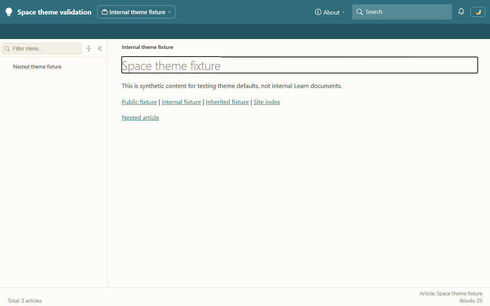 |
| 2: Public default | 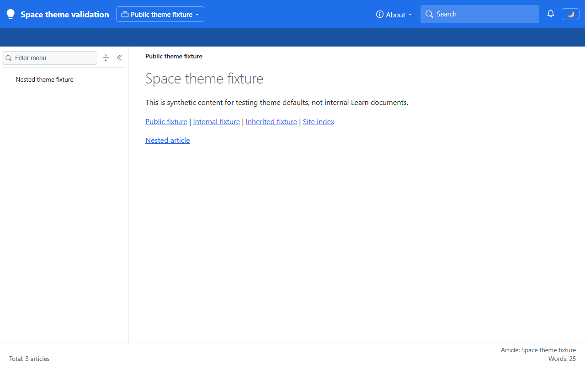 |
| 3: Manual internal choice | 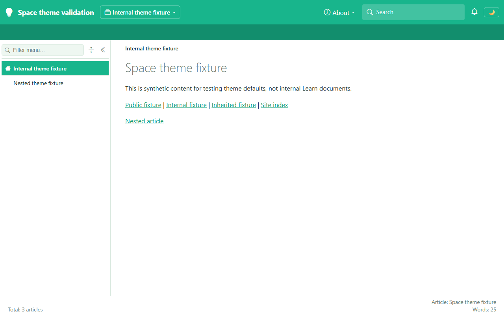 |
| 4: Public isolation | 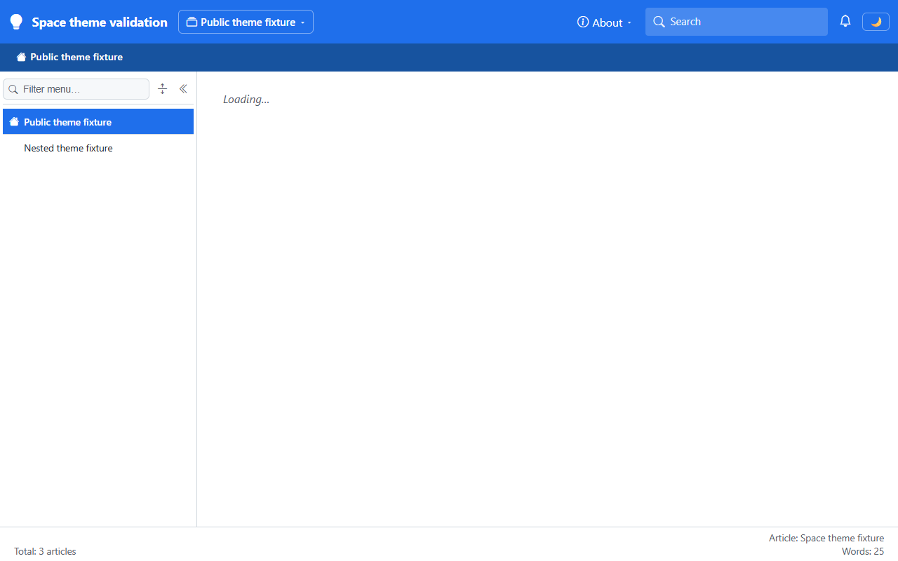 |
| 5: Restored internal choice | 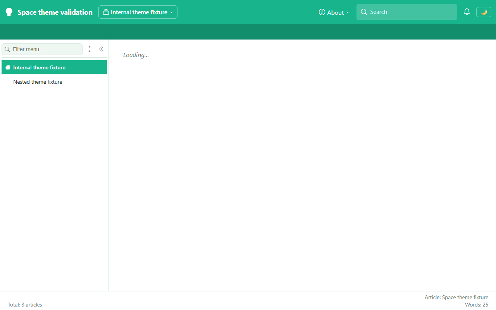 |
| 6: Reload | 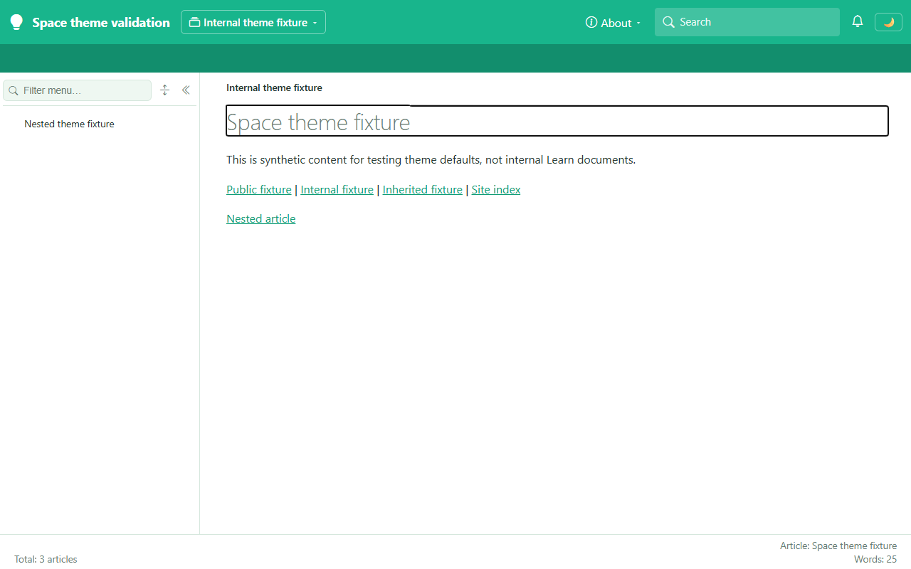 |
| 7: Internal reset | 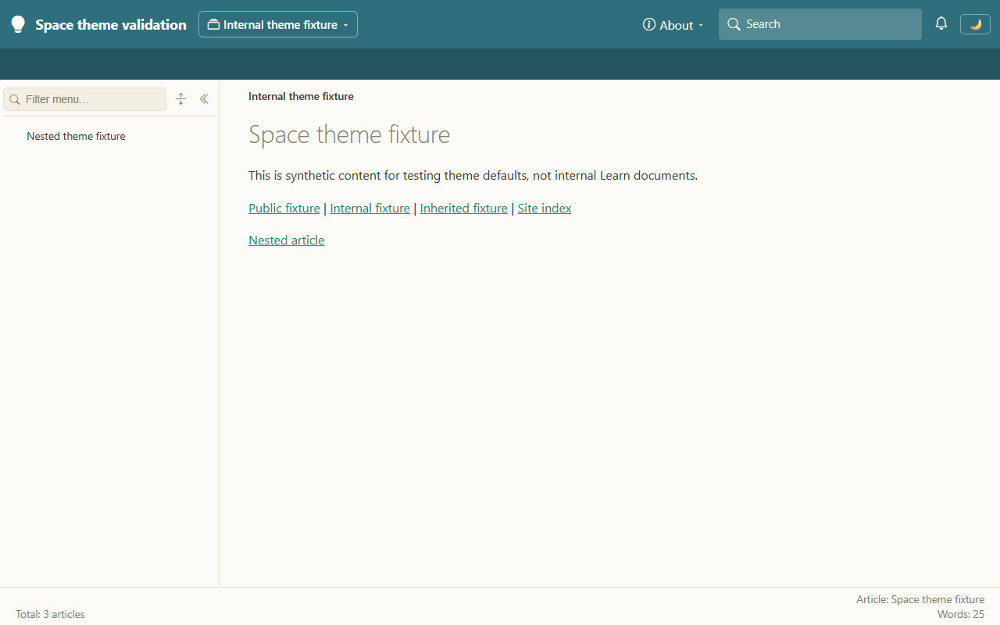 |
| 8: Dark round trip | 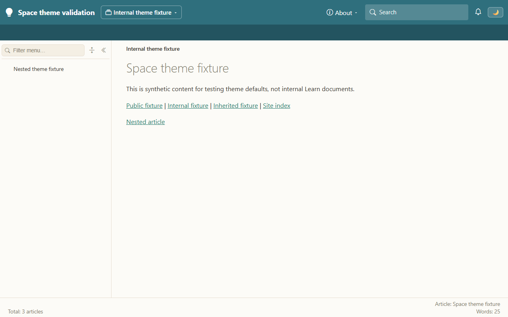 |
| 9: Nested page | 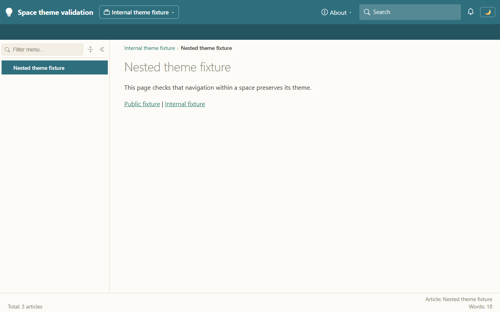 |
| 10: Legacy compatibility | 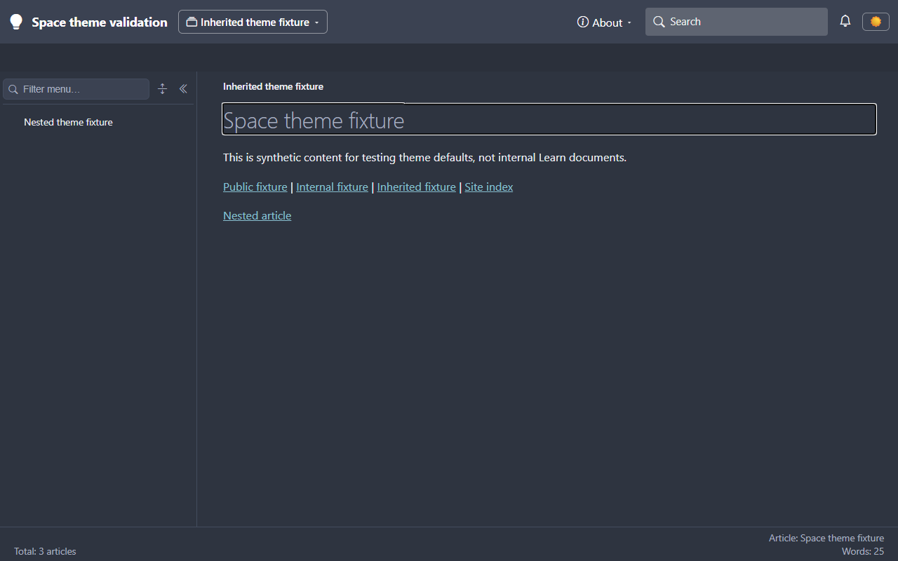 |
| 11: Global isolation |  |
| 12: Stale preference |  |
| 13: Public preference retained |  |
| 14: Public reset |  |
| 15: Storage unavailable | 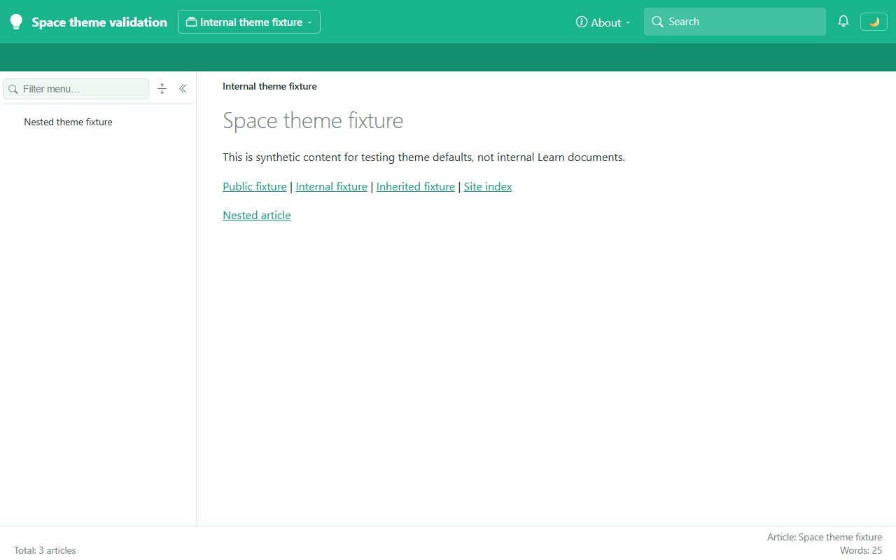 |

## 🔬 Console checks

These checks do not render pages, so their evidence is console output:

```text
Build succeeded.
    0 Warning(s)
    0 Error(s)
15 checks passed.
PASS: shell payload carries defaults; direct internal prerender is Sandstone
PASS: unknown per-space theme fails startup explicitly
```

The 15 production-assembly assertions covered default application without persistence, light/dark return, manual preference notification, scope switches, saved overrides, reset/removal, removed palettes, legacy fallback, custom dark catalogs, actual `devlearn` shell mapping, route-segment boundaries, and unchanged internal access settings.

A separate startup invocation with an invalid space theme exited before serving:

```text
System.InvalidOperationException: Space 'learn-internal' DefaultTheme 'unknown-palette' is not in the site's theme catalog.
```

When storage was blocked, the browser logged:

```text
Unable to read the saved theme; using the configured default
Unable to save the theme preference; the selection applies only to this page session
```

## ⚠️ Notes

- No Entra roles, grants, access files, or deployed overlays changed.
- The browser run did not use an authenticated real internal Learn session. It validates theme behavior independently of authentication, with the same production host/client components.
- The old global `lh-theme` preference is retained for the site index and spaces without an explicit default. It is intentionally not migrated into the two Learn space preferences.
- The server renders a space's default before browser storage is available; hydration restores a saved override. Defaults are not automatically written to storage.
- The owner's existing debug session still uses its previously built binaries. Restart it with a normal rebuild to load the changed host and WebAssembly client.
- Initial automation attempts used an incorrect toggle selector and a `.md` URL instead of the renderer's extensionless route. Corrected selectors and routes passed the final full run.
- No mobile layout, cloud deployment, or authentication-flow regression was included. Theme colors don't enforce access.

## 📚 References

- **[Reader provisioning: space colors](../02-reader-access-provisioning.md#space-colors-optional)** 📘 [Official repository source]. Describes configuration, preference scope, reset, and compatibility behavior.
- **[Theme state](../../../../../Diginsight.SmartDocs.Web.Shared/ThemeState.cs)** 📘 [Official repository source]. Defines default restoration, explicit preference changes, and light/dark behavior.
- **[Learn overlay](../../../../../Diginsight.SmartDocs.Web/appsettings.devlearn.json)** 📘 [Official repository source]. Configures the two requested palettes without changing authorization.
