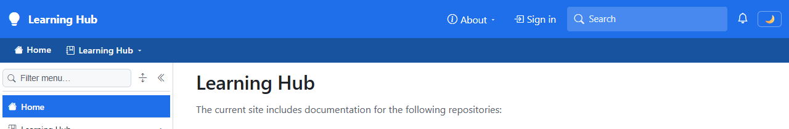
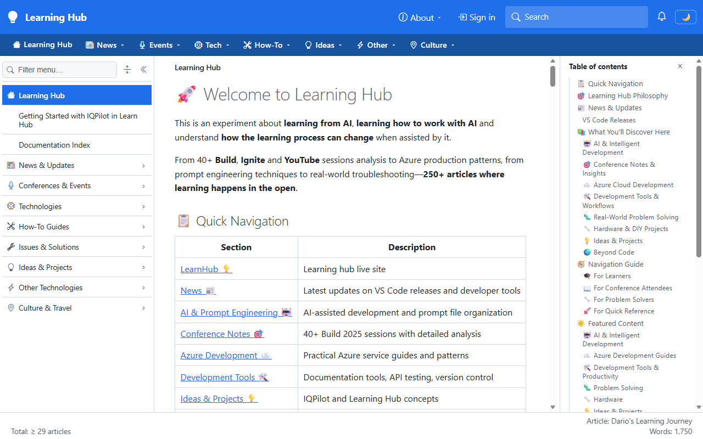
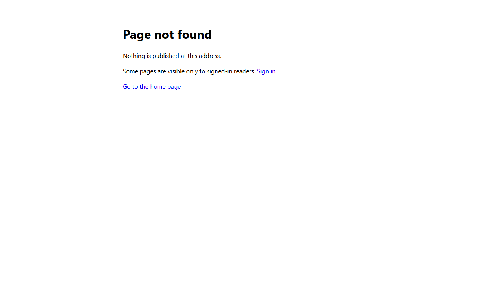
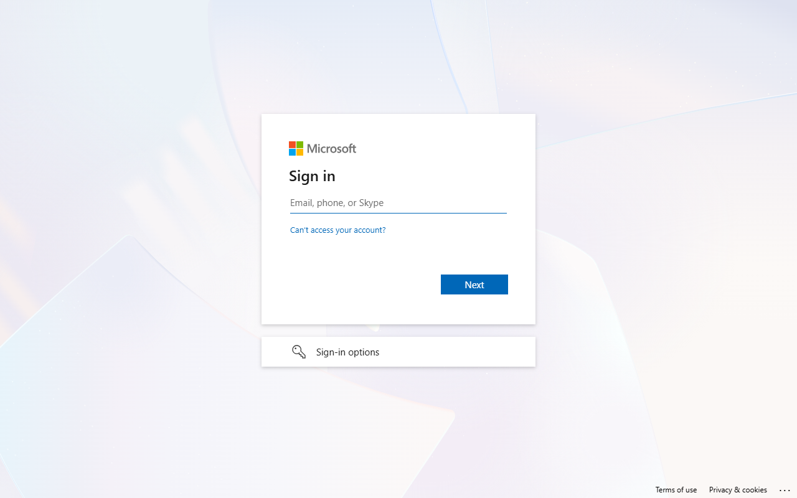

# Validation sequence - Blob-backed Learn App Service configuration

The deployed configuration now mounts public Learn at `/learn` and internal Learn at `/learn-internal`, using separate private Blob containers. This run proves public reading, anonymous internal denial, and the Entra sign-in prompt. It doesn't establish authenticated role acceptance or the internal theme.

## 📚 Table of contents

- [⚙️ Environment](#-environment)
- [🧪 Sequence and results](#-sequence-and-results)
- [📷 Evidence](#-evidence)
- [🔬 Console checks](#-console-checks)
- [⚠️ Notes](#-notes)
- [📚 References](#-references)

## ⚙️ Environment

Validation used the actual managed test host, not a local fixture.

| Item | Value |
|---|---|
| URL | Testmc Learn HTTPS origin |
| Build | Existing deployed host and client; authentication support confirmed before configuring internal storage |
| Run | App Service settings update and automatic recycle; no local server or binary deployment |
| Browser | Visible headed Edge, fresh context, 1280x800 |
| Date | November 2, 2026 |

## 🧪 Sequence and results

All four browser scenarios passed without an unhandled page error.

| # | Precondition | Action | Expected | Observed | Result |
|---|---|---|---|---|---|
| 1 | Anonymous | Open `/` | Public-only index | `Learning Hub`, `Sign in`, zero internal links, `page theme-cosmo` | PASS |
| 2 | Anonymous | Open `/learn` | Public article | HTTP 200; `🚀 Welcome to Learning Hub`; top bar `rgb(31, 111, 235)` | PASS |
| 3 | Anonymous | Open `/learn-internal` | No protected content | HTTP 404; `Page not found`; `Sign in` | PASS |
| 4 | Anonymous | Open sign-in | Provider prompt | `Sign in`, empty username input, no AADSTS error | PASS |

## 📷 Evidence

Screenshots omit browser chrome. The index capture is cropped to exclude repository identity.

| Step | Screenshot |
|---|---|
| 1: Index |  |
| 2: Public article |  |
| 3: Internal denial |  |
| 4: Provider |  |

## 🔬 Console checks

Protocol checks don't render pages:

```text
30 app settings verified; six unused legacy settings removed
Unrelated settings and the invalidation credential preserved
Both containers private; existing host Blob Data Reader grant retained
/_site: only public Learn; signInEnabled=true
Internal raw content and access-file requests: 404
Internal page resolution: 204; navigation children empty
POST /_nav/invalidate without key: 401
Sign-in: expected tenant/client/cloud callback; id_token, form_post
App Service: Running, HTTPS-only
```

## ⚠️ Notes

- Internal access requires authentication **and** a valid root access file; missing or invalid policy keeps the space hidden.
- The Azure tool blocked direct blob-policy inspection. Its contents and real-account role acceptance remain unverified.
- Cosmo and Sandstone defaults are saved. The deployed binary predates per-space themes; deploy that pending implementation to activate internal Sandstone.
- This test configuration reuses the existing credential-free registration. It doesn't validate a production certificate/code flow or sign-out.
- Cloud callback URLs were added without removing localhost callbacks or changing roles.
- The private overlay is updated locally but remains uncommitted. Live environment settings already persist the change.

## 📚 References

- **[Reader provisioning](../02-reader-access-provisioning.md)** 📘 [Official repository source]. Describes policy, Blob settings, and deployment validation.
- **[App Service configuration](https://learn.microsoft.com/azure/app-service/configure-common)** 📘 [Official]. Explains environment settings and restarts.
- Internal companion: `smartdocs.internal/src/docs/90.00-issues/202610/20261027.01-smartdocs-authentication/_validation/20261102.07-validation-sequence.internal.md`. Contains resource identities, full captures, applied settings, and deployment evidence.
