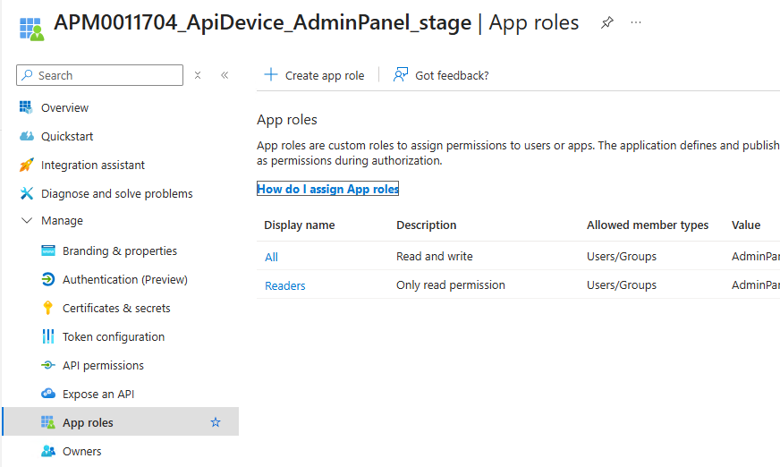

lets analyze how authentication may work in smartdocs .

an appregistration can be defined in Entra ID 

that can include different roles 
users can be assigned to these roles to control their access within the application.