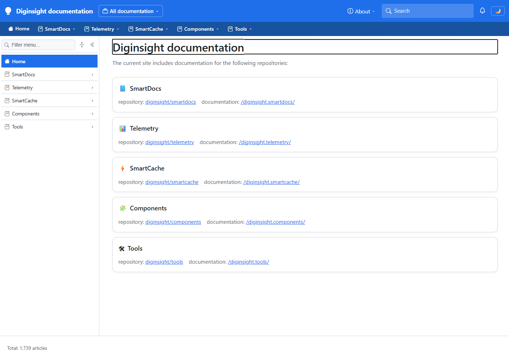
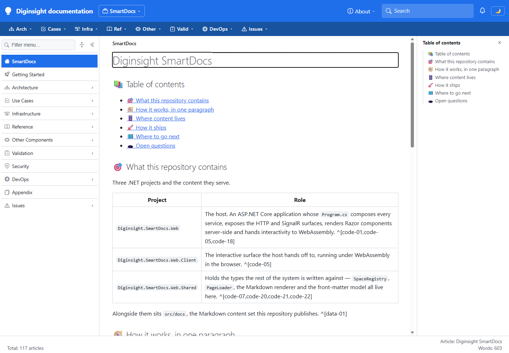
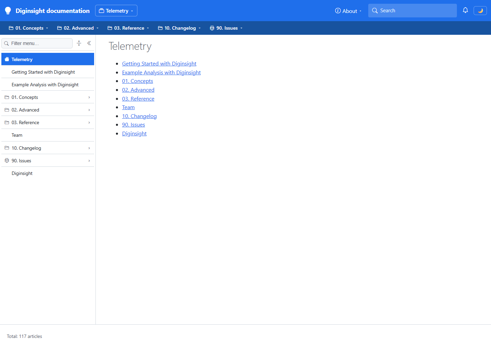
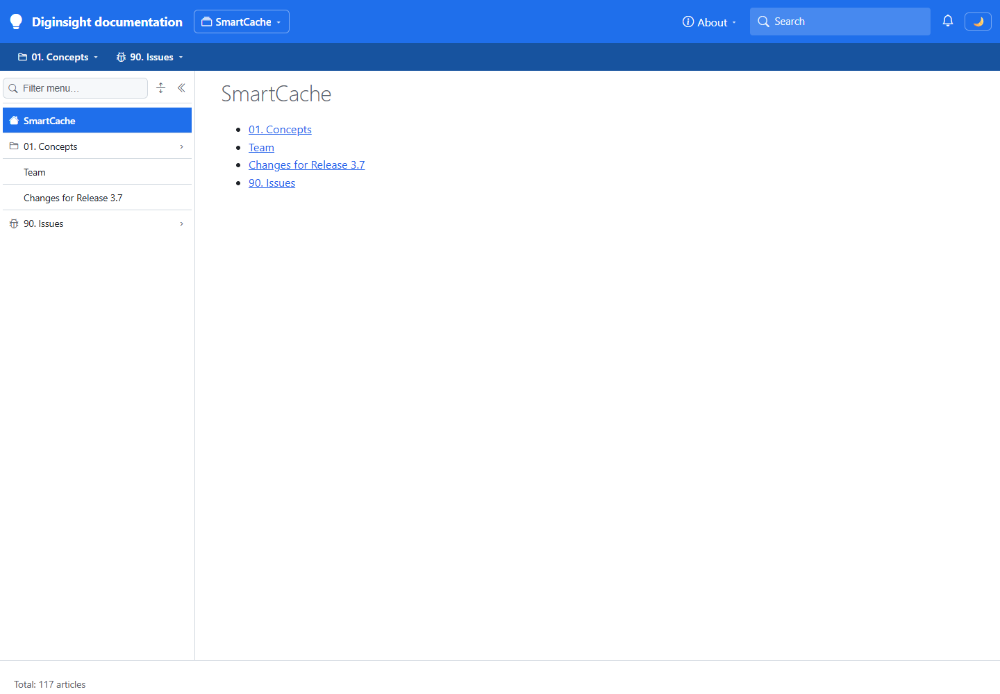
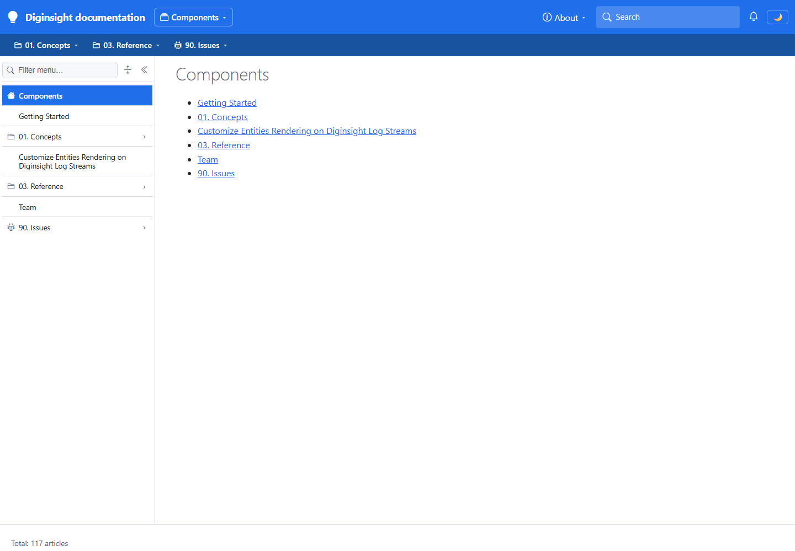
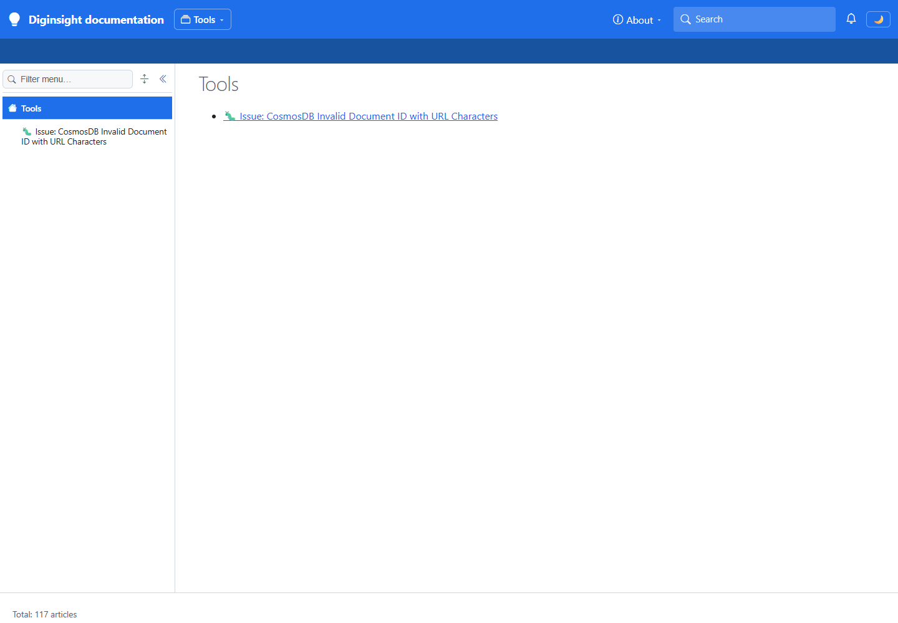

# Storage and filesystem profile validation

Official environment overlays now declare Blob sources; Development-only local siblings select filesystem sources. Local composition and rendering passed. The overall result remains FAIL because live storage access was blocked, so this run doesn't prove deployed Blob rendering.

## 📚 Table of contents

- [Environment](#️-environment)
- [Sequence and results](#-sequence-and-results)
- [Evidence](#-evidence)
- [Notes and limits](#️-notes-and-limits)
- [Conclusion](#-conclusion)
- [References](#-references)

## 🖥️ Environment

The documentation profile ran in a visible foreground PowerShell console and an independent headed browser.

| Item | Value |
|---|---|
| URL | `http://localhost:5283/` |
| Build | `dotnet build src/Diginsight.SmartDocs.Web/Diginsight.SmartDocs.Web.csproj --no-restore -c Debug -v minimal` succeeded with zero warnings and errors |
| Run | `dotnet run --launch-profile 'https - devdocs' --urls 'http://localhost:5283'`; rebuilt before serving |
| Browser | Visible Microsoft Edge window; 1440 x 1000 viewport; fresh anonymous context |
| Date | November 8, 2026 |

## ✅ Sequence and results

The following values were read from the live DOM, not inferred from compilation or screenshots.

| # | Precondition | Action | Expected | Observed | Result |
|---|---|---|---|---|---|
| 1 | Local documentation profile, anonymous | Open `/` | Five product cards | `SmartDocs`, `Telemetry`, `SmartCache`, `Components`, `Tools`; title `Diginsight documentation`; HTTP 200 | PASS |
| 2 | Same | Open `/diginsight.smartdocs` | Rendered SmartDocs Markdown | Title and heading `Diginsight SmartDocs`; HTTP 200 | PASS |
| 3 | Same | Open `/diginsight.telemetry` | Telemetry navigation | Heading `Telemetry`; link `Getting Started with Diginsight`; HTTP 200 | PASS |
| 4 | Same | Open `/diginsight.smartcache` | SmartCache navigation | Heading `SmartCache`; link `Changes for Release 3.7`; HTTP 200 | PASS |
| 5 | Same | Open `/diginsight.components` | Components navigation | Heading `Components`; link `Getting Started`; HTTP 200 | PASS |
| 6 | Same | Open `/diginsight.tools` | Tools navigation | Heading `Tools`; link `🐛 Issue: CosmosDB Invalid Document ID with URL Characters`; HTTP 200 | PASS |
| 7 | Existing storage identity and network path | Read documentation storage | Authorized Blob read | HTTP 403 `AuthorizationFailure`; CLI reads also reported storage network-rule errors | FAIL |

## 📷 Evidence

The screenshots below were checked for private identifiers and personal attribution before being placed in this public tree.

| Step | Screenshot |
|---|---|
| 1 — Five product cards |  |
| 2 — SmartDocs Markdown |  |
| 3 — Telemetry navigation |  |
| 4 — SmartCache navigation |  |
| 5 — Components navigation |  |
| 6 — Tools navigation |  |

Step 7 was a storage-tool failure, not a rendered page. Its exact non-identifying response was:

```text
Status: 403
ErrorCode: AuthorizationFailure
```

## ⚠️ Notes and limits

- The actual host configuration assembly passed 271 assertions across six Development and six staged Production compositions. Staged deployment configurations contain no filesystem sections; local configurations select FileSystem.
- Ten publishing-source resolution checks passed without cloud operations. Publishing destinations still resolve from official environment files only.
- All thirteen private JSON files parsed and passed file-level source-separation checks.
- The broader local run observed sixteen passing browser scenarios: the six above, four additional product articles, the public learning index/article, three anonymous refusals, and the protected deployment's filtered index. Detailed observations and captures containing private information remain in the internal record.
- Adding the shared external local settings file resolved the current loader's failure to discover environment-local siblings after a missing generic file.
- The first documentation attempt encountered an unrelated host on the standard port. Those observations were rejected and replaced by the isolated port-5283 run.
- No deployment, upload, permission assignment, firewall change, or commit was performed. Cloud content layout, root policies in storage, authorized signed-in rendering, and production performance remain unverified.

## 💡 Conclusion

The configuration split and local rendering are verified. Keep official settings and local overrides paired by space index, preserve required access floors, and don't mark cloud validation complete until an authorized storage read and rendered run succeed.

## 📚 References

- 📖 [Configuration composition](../../../../../Diginsight.SmartDocs.Web/Program.cs) and [space options](../../../../../Diginsight.SmartDocs.Web.Shared/Sites/SiteOptions.cs). These define the selected provider and access requirements.
- Internal companion: `src/docs/90.00-issues/202611/20261105.01-smartdocs-authentication-custom/_validation/20261108.01-storage-profiles.validation-sequence.internal.md` in the configured internal peer. It contains the full sixteen-scenario run, private settings references, and internal captures.

<!--
validations:
  grammar: {status: "not_run", last_run: null}
  readability: {status: "not_run", last_run: null}
article_metadata:
  filename: "20261108.01-storage-profiles.validation-sequence.md"
-->
