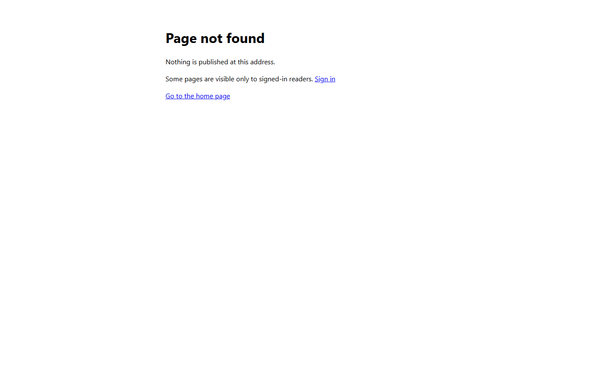
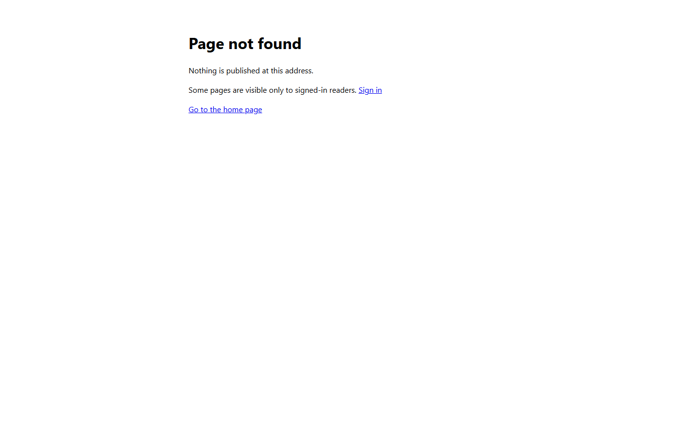

# Validation sequence — additional RBAC conformance

This run checks that the devec4 policy cleanup preserves reader visibility. A complete pass would also establish Testmc conformance and local reader coverage. The completed checks passed, but the overall result is **FAIL**: Testmc storage inspection and publication are blocked, and the local sign-in cases couldn't run. Private resources are named by role.

## 📚 Table of contents

- [🧰 Environment](#-environment)
- [🧪 Sequence and results](#-sequence-and-results)
- [📷 Evidence](#-evidence)
- [📝 Notes](#-notes)
- [💡 Conclusion](#-conclusion)
- [📚 References](#-references)

## 🧰 Environment

| Item | Value |
|---|---|
| URL | Deployed devec4 docs host and Testmc Learn host |
| Build | `dotnet build eng\metadata-checks\MetadataChecks.csproj -c Debug --artifacts-path <isolated-dir>` → zero warnings and errors |
| Run | Existing deployed hosts; no local host was started or stopped |
| Browser | Independent visible Edge windows, viewport 1416 × 874 or 1416 × 908; fresh anonymous and signed-in profiles |
| Date | November 10, 2026 |

## 🧪 Sequence and results

The anonymous after-check ran more than 60 seconds after the two deletions. The Testmc observations bracket the devec4 cleanup only; no Testmc publish was performed. After authentication, both registration role sets and the two designated test-account assignments were checked, but storage remained blocked.

| # | Precondition | Action | Expected | Observed before → after | Result |
|---|---|---|---|---|---|
| 1 | Anonymous devec4 reader | Open the index before and after cleanup | Same public spaces | Two public space cards; complete index text identical | PASS |
| 2 | Anonymous devec4 reader | Open the desktop-client route before and after cleanup | Protected route hidden | `Page not found` → `Page not found` | PASS |
| 3 | Anonymous devec4 reader | Open the model-editor route before and after cleanup | Protected route hidden | `Page not found` → `Page not found` | PASS |
| 4 | Anonymous devec4 reader | Open the gateway and dispatcher routes before and after cleanup | Protected or unavailable routes hidden | `Page not found` → `Page not found` for both | PASS |
| 5 | Anonymous devec4 reader | Open both public pages before and after cleanup | Both pages render | Both expected page headings remained visible | PASS |
| 6 | Anonymous Testmc reader | Open the index, public page, and internal route before and after cleanup | Public library visible; internal route hidden | `Learning Hub` only; public page rendered; internal route `Page not found` → `Page not found` | PASS |
| 7 | Existing devec4 SSO session | Open the index and protected pages | Signed-in spaces render | Three protected pages and both public pages rendered | PASS |
| 8 | Signed-in devec4 reader | Open the dispatcher | Empty source reports missing content | `Not found`; no Markdown source resolved | PASS |
| 9 | Authenticated Testmc CLI; storage endpoint restricted | Planned: inspect all containers | Each container's contents are recorded | Not covered: the storage tool refused the endpoint under its access policy | FAIL — not covered |
| 10 | Local `devlearn`; `Reader` account | Planned: sign in locally | Assigned reader sees the authorized spaces | Not covered: callback port is occupied; token and reader verdict weren't observed | FAIL — not covered |
| 11 | Local `devlearn`; unassigned account | Planned: sign in locally | Unassigned reader receives the configured verdict | Not covered: callback port is occupied; token and reader verdict weren't observed | FAIL — not covered |
| 12 | Local `TestmcAicm`; `Reader` account | Planned: sign in locally | Assigned reader sees the authorized spaces | Not covered: callback port is occupied; token and reader verdict weren't observed | FAIL — not covered |
| 13 | Local `TestmcAicm`; unassigned account | Planned: sign in locally | Unassigned reader receives the configured verdict | Not covered: callback port is occupied; token and reader verdict weren't observed | FAIL — not covered |
| 14 | Local `devec4`; devec4-tenant account | Planned: sign in locally | Signed-in reader sees the protected spaces | Not covered: callback port is occupied | FAIL — not covered |
| 15 | Testmc inspection blocked | Planned: dry run, publish, and compare the internal Learn policy pair | Publication and post-publication visibility pass | Not run: depends on the blocked Testmc inspection | FAIL — not covered |
| 16 | Authenticated Testmc CLI | Read roles on both registrations | Required values are enabled for users and groups | Seven distinct required definitions found, enabled, and permitting `User` assignment | PASS |
| 17 | Authenticated Testmc CLI | Read the two designated test accounts' assignments to the Learn registration | `Reader` assigned to the Reader account; no assignment returned for the unassigned account | Direct `Reader` assignment for the Reader account; none returned for the unassigned account | PASS — preflight only |

The following checks have no rendered page.

| Check | Observation | Result |
|---|---|---|
| Eighteen local roots | Seventeen passed; the deliberate nested-policy fixture failed as expected | PASS |
| Previously unvalidated roots | The `home` fixture passed; the `scale` root is absent | PASS |
| Metadata regression harness | `PASS: 344 metadata assertions.` | PASS |
| devec4 policy pairs | Both canonical files contain access policies and match their local files; both pairs validated with zero failures | PASS |
| Guarded devec4 cleanup | Two backed-up legacy blobs removed with ETag preconditions; canonical files remained unchanged | PASS |
| devec4 readiness | All local roots and every blob name in the six containers are free of legacy access carriers | PASS |
| Testmc registration roles | Seven required enabled role definitions permit users and groups | PASS |
| Test-account assignments | The Reader account has a direct `Reader` assignment; none was returned for the unassigned account | PASS — preflight only |
| Testmc readiness | Container contents remain unverified because storage access is denied | FAIL — not covered |

The metadata harness is console-only; its final output was:

```text
PASS: 344 metadata assertions.
```

The Testmc app-role check is console-only; its final output was `PASS: all seven required role mappings are uniquely defined and enabled.`

The test-account assignment check is also console-only. It included direct-group assignments and used eventual consistency; it didn't inspect a signed-in token.

## 📷 Evidence

The reviewed captures show the generic protected-page response.

| Step | Before | After |
|---|---|---|
| 2 — desktop client |  |  |
| 3 — model editor |  |  |
| 6 — internal Learn |  |  |

## 📝 Notes

- Full public-article DOM text differed in asynchronously populated navigation. Required visibility and headings matched; complete index and protected-page text matched.
- Captured viewport height varied between 874 and 908 pixels; all captures were 1416 pixels wide.
- `devec4` is ready for canonical-only mode by the inspected carrier criterion. `access` isn't ready by design, and Testmc-dependent profiles remain undetermined. No compatibility setting was changed.
- Testmc role definitions and the two designated test-account assignments were checked; other assignments, container contents, publication, post-publication visibility, and local Reader/unassigned-account cases weren't covered. No Entra roles, saved configuration, Testmc content, or other user's process was changed.

## 💡 Conclusion

The devec4 cleanup preserves the observed anonymous and signed-in visibility, and both Testmc registrations define their expected roles. The [additional-fix plan](../04-smartdocs-rebac-metadata-additionalfix.plan.md) remains in progress until the storage access and local callback-port blockers are resolved.

## 📚 References

- **[Additional-fix plan](../04-smartdocs-rebac-metadata-additionalfix.plan.md)** 📘 [Execution plan]. The scope, exit conditions, current blockers, and completed status markers.
- **[Earlier migration validation](20261110.01-rebac-metadata-fix.validation-sequence.md)** 📘 [Validation record]. The local policy conversion and its anonymous baseline.
- **[Microsoft Graph appRole reference](https://learn.microsoft.com/en-us/graph/api/resources/approle?view=graph-rest-1.0)** 📘 [Official]. Explains role values, enablement, and the `User` member type for users and groups.
- **[Microsoft Graph user app-role assignments](https://learn.microsoft.com/en-us/graph/api/user-list-approleassignments?view=graph-rest-1.0)** 📘 [Official]. Describes the direct-user and direct-group assignment query and eventual-consistency requirement.

### Internal sources

Not resolvable from this repository; listed for provenance.

- **`src/docs/90.00-issues/202611/20261105.01-smartdocs-authentication-custom/_validation/20261110.02-rebac-metadata-additionalfix.validation-sequence.internal.md`** — exact resource names, observations, screenshots, backups, and execution evidence.

<!--
validations:
  runtime: {status: "partial", last_run: "2026-11-10", notes: "Hosted anonymous and devec4 sign-in checks passed; Testmc storage and local signed-in cases remain unverified."}
article_metadata:
  filename: "20261110.02-rebac-metadata-additionalfix.validation-sequence.md"
  created: "2026-11-10"
  last_updated: "2026-11-10"
-->
