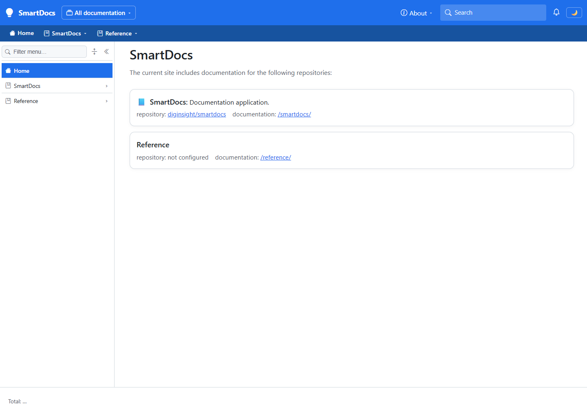
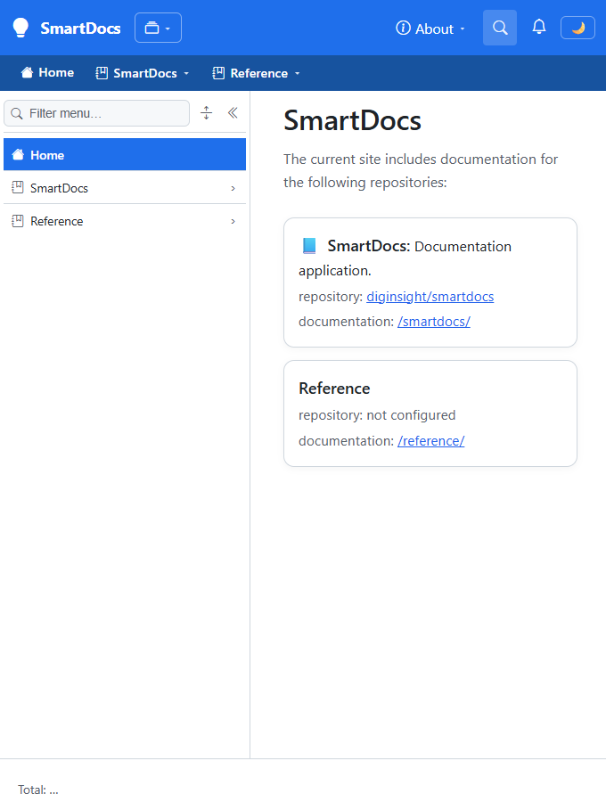

# Inline home-page summaries

The generated application cards now display `Appname: Description` inline. This run checks the literal separator, unchanged typography and link destinations, and natural wrapping when the pane is narrower.

## 📋 Environment

The validation uses public fixture values rather than publisher-specific application names or repository addresses.

| Item | Value |
|---|---|
| URL | `http://localhost:5291/` |
| Build | `dotnet run --no-launch-profile --urls http://localhost:5291 --artifacts-path <session-build-folder>`; rebuild and startup succeeded. |
| Run | Development configuration, overridden through environment variables; server ran in a separate visible foreground PowerShell console. |
| Fixtures | `SmartDocs`, description `Documentation application.`, route `/smartdocs`; `Reference`, no description, route `/reference`. |
| Browser | Headed Chromium, desktop viewport 1440 × 1000 and narrow viewport 680 × 900. |
| Baseline | Computed title and description styles from the existing running home page, compared with the rebuilt fixture page. |
| Date | November 11, 2026 |

## ✅ Sequence and results

The observations below come from the live DOM and element bounding boxes, with screenshots captured in the same headed run.

| # | Precondition | Action | Expected | Observed | Result |
|---|---|---|---|---|---|
| 1 | Desktop viewport; described fixture card. | Open the home page and inspect the summary, literal description text, and element positions. | Name and description share a line, separated by a colon and one space. Typography matches the baseline. | Summary: `📘 SmartDocs: Documentation application.` Description `textContent`: ` Documentation application.` Title bounds: x=335, y=235.78125, width=125.25, height=28.671875. Description bounds: x=460.25, y=239.78125, width=199.734375, height=21. Title: 17.92px, weight 600; description: 16px, weight 400. Both use `-apple-system, BlinkMacSystemFont, "Segoe UI", Roboto, Helvetica, Arial, sans-serif`, color `rgb(31, 35, 40)`, exactly matching the baseline. | PASS |
| 2 | Desktop viewport; both fixture cards. | Inspect card links and the card without a description. | Existing metadata stays below the summary; links retain their destinations. A missing description adds neither a colon nor an empty description element. | Metadata: `repository: diginsight/smartdocs documentation: /smartdocs/`. Title destination: `/smartdocs`; repository destination: `https://github.com/diginsight/smartdocs`; documentation destination: `/smartdocs/`. Second title: `Reference`; description element count: `0`. | PASS |
| 3 | Same page, narrower pane. | Resize the visible browser to 680 × 900. | Text wraps naturally without forcing a separate description block or overflowing the viewport. | Card text: `📘 SmartDocs: Documentation application. repository: diginsight/smartdocs documentation: /smartdocs/`. Card width: `330px`; viewport width: `680px`; card right edge beyond viewport: `false`. | PASS |

## 📷 Evidence

These screenshots show the fixture cards after the live DOM assertions passed.

| Step | Screenshot |
|---|---|
| **Steps 1 and 2** - Inline summary, preserved font contrast, unchanged metadata, and a title without a description. |  |
| **Step 3** - Natural wrapping in the narrower content pane. |  |

## ⚠️ Notes

- Long descriptions may wrap when the available width requires it; no truncation or forced horizontal scrolling was introduced.
- A preliminary 390px-wide check exposed clipping with the existing expanded sidebar. Phone-width sidebar behavior isn't covered by this change or claimed as passing.
- Server logs included an existing duplicate persisted-state-key error during prerendering. This run validates rendered card layout and link attributes, not client hydration.
- Authentication, publisher-specific configuration, dark mode, hover states, and navigation after following a link weren't covered.
- No private configuration or identifiers were included in the screenshots or this record.
