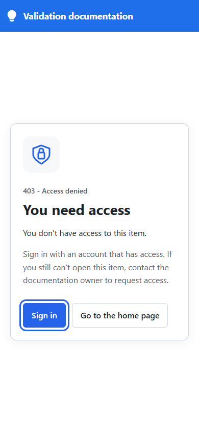
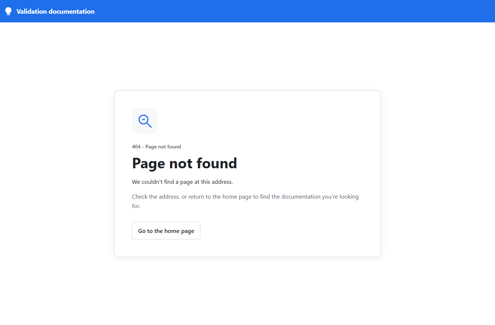
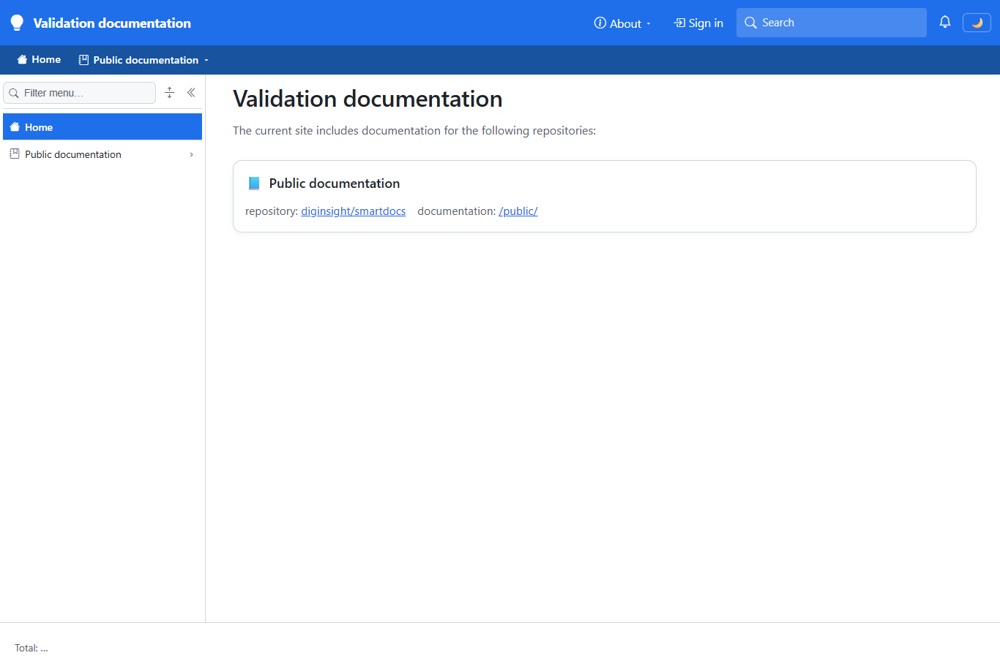
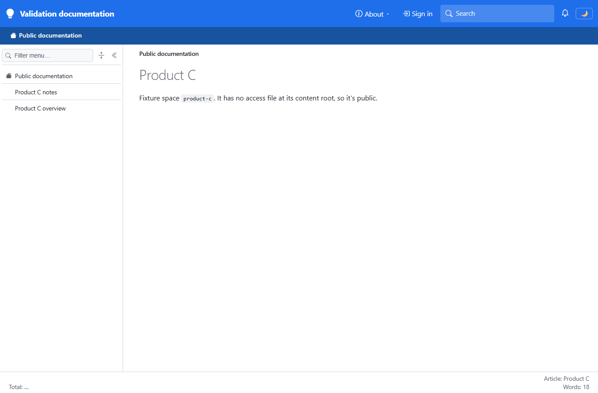
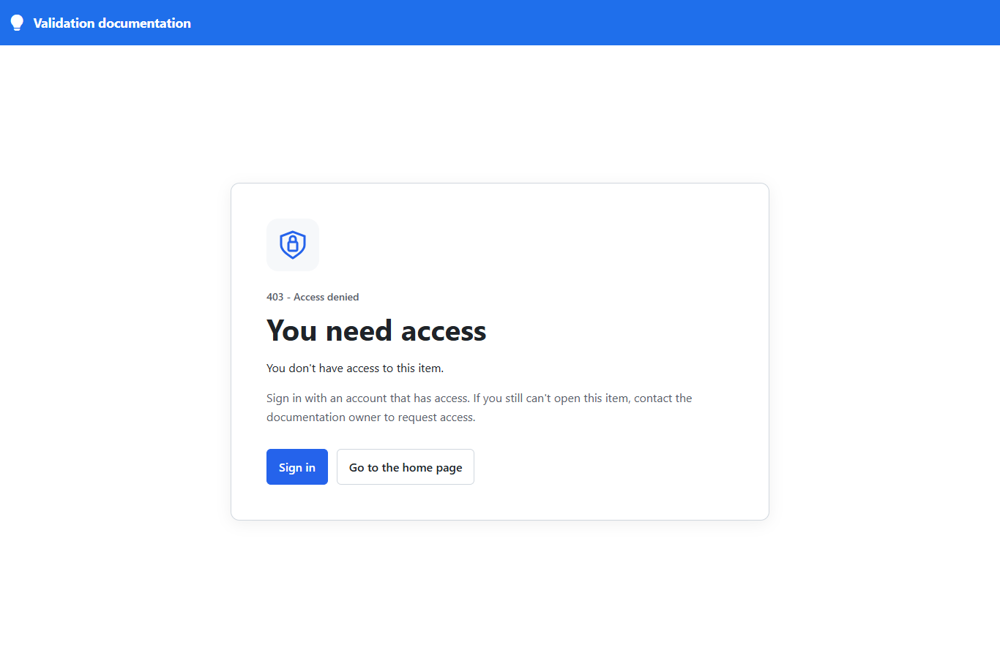
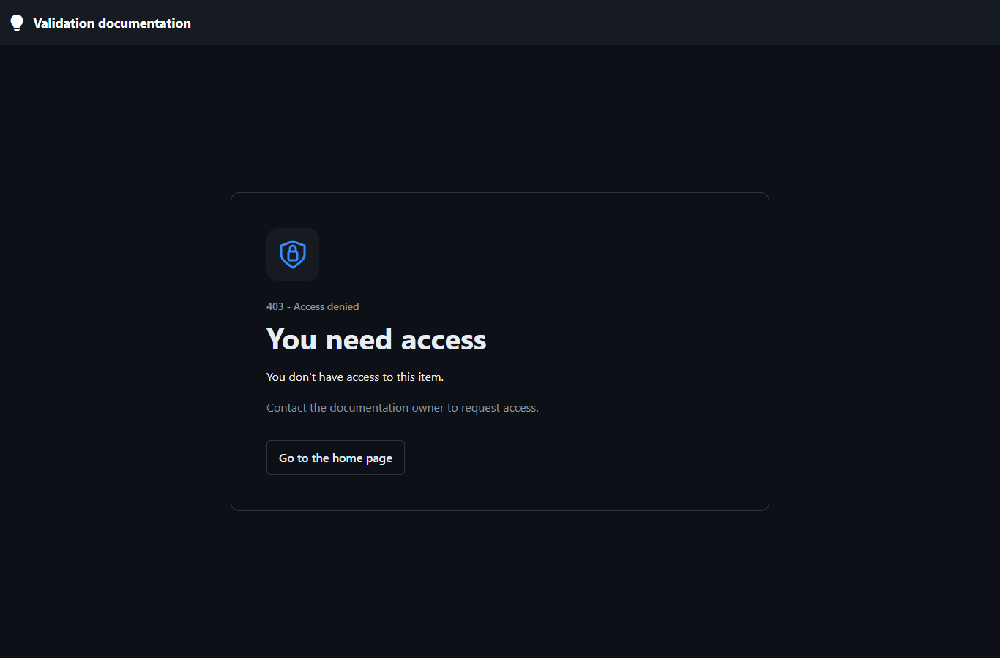
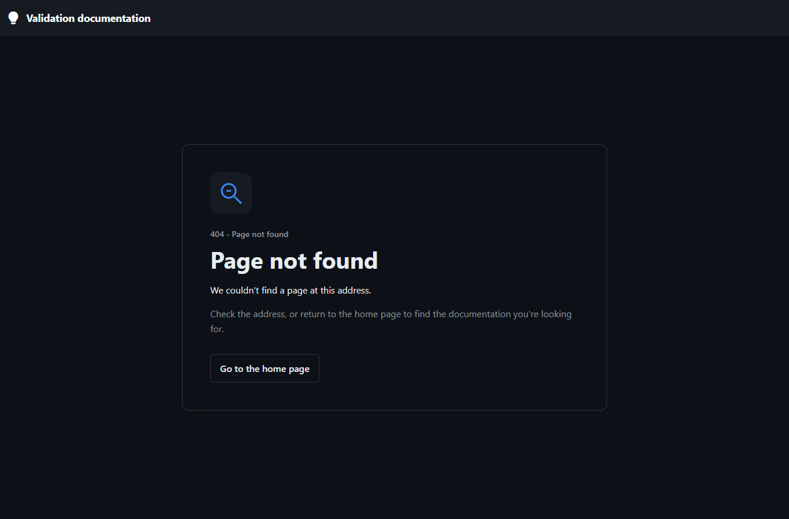

# Validation sequence - branded access-denied pages

This run proves that denied pages and missing pages display distinct, branded explanations without exposing protected content. It also checks recovery actions, responsive layout, and routing from the interactive application.

## 📚 Table of contents

- [🧪 Environment](#-environment)
- [✅ Sequence and results](#-sequence-and-results)
- [🖼️ Evidence](#-evidence)
- [⚠️ Notes](#-notes)
- [💡 Conclusion](#-conclusion)
- [📚 References](#-references)

## 🧪 Environment

The host used local fixture content only; no deployed service or real reader account was involved.

| Item | Value |
|---|---|
| URL | `http://localhost:5281/` |
| Build | `dotnet build src\Diginsight.SmartDocs.slnx -c Debug --artifacts-path <session-build>`; succeeded with 0 warnings and 0 errors |
| Run | Rebuilt with `dotnet run --launch-profile http --artifacts-path <session-build>` in a visible foreground PowerShell console; command-line configuration selected port 5281 and fixture spaces |
| Content | `eng/fixtures/access-tree/product-c` at `/public`; `product-a` at `/restricted` |
| Identity | Anonymous browser; sign-in first configured with dummy local identifiers, then disabled |
| Theme | Built-in `cosmo`, then configured site-default `github-dark` |
| Browser | Independent, visible headed Microsoft Edge window controlled by Playwright |
| Viewports | 1366 x 900 desktop; 390 x 844 mobile |
| Date | 2026-11-10 |

`<session-build>` denotes isolated build output. The normal build initially encountered files locked by an existing server; that server wasn't stopped or replaced.

## ✅ Sequence and results

Each UI observation below was read from the live DOM and captured in the corresponding screenshot.

| # | Precondition | Action | Expected | Observed | Result |
|---|---|---|---|---|---|
| 1 | Anonymous, sign-in configured | Open `/restricted/` with an encoded query | Branded 403, sign-in and home actions, no protected title or body | HTTP `403`; `You need access`; `You don't have access to this item.`; `Sign in`; `Go to the home page`. The sign-in return URL retained the original path and query; no script element was injected. | PASS |
| 2 | Same reader, 390 x 844 viewport | Open `/restricted/overview` and focus Sign in | Readable mobile layout and visible keyboard focus | `You need access`; document width didn't exceed the viewport; focused link computed outline style was `solid`. | PASS |
| 3 | Anonymous, restricted space exists | Open `/restricted/no-such-page` | 404, not 403 | HTTP `404`; `Page not found`; `We couldn't find a page at this address.`; no Sign in action | PASS |
| 4 | Missing-page screen | Select Go to the home page | Recover to filtered home | `Validation documentation`; only `Public documentation` was offered; the restricted space wasn't listed. | PASS |
| 5 | Anonymous | Open `/public/` | Public article remains readable | HTTP `200`; `Product C` | PASS |
| 6 | Public page, interactive application loaded | Navigate through the WASM router to `/restricted/overview` | Full branded denied document | `403 - Access denied`; `You need access` | PASS |
| 7 | Restarted fixture host, sign-in disabled, dark site default | Open `/restricted/overview` | Dark branded denial without an unusable sign-in link | HTTP `403`; `You need access`; `Contact the documentation owner to request access.`; no Sign in link; background `rgb(13, 17, 23)` | PASS |
| 8 | Dark public page, interactive application loaded | Navigate through the WASM router to `/no-such-page` | Branded missing-page document | `404 - Page not found`; `Page not found` | PASS |

The same browser session also made these nonvisual HTTP checks:

| Request | Expected and observed | Result |
|---|---|---|
| `GET /_page/restricted/overview` | `403`, empty body, private cache control | PASS |
| `GET /_page/restricted/guides` | `403`, empty body, private cache control | PASS |
| `GET /_page/restricted/no-such-page` | `404`, empty body, private cache control | PASS |
| `GET /_page/public/notes` | `200` | PASS |
| `GET /_page/public/images` | `204`, preserving visible-folder handling when no article exists | PASS |
| `GET /_content/restricted/overview.md` | `404`, preserving raw-content concealment | PASS |
| `GET /favicon-missing.ico` | `404` | PASS |
| `HEAD /restricted/overview` | `404`, empty body; component routes remain GET-only | PASS |

These requests have no rendered UI of their own; their screenshots are the corresponding document states, not fabricated API images.

## 🖼️ Evidence

The screenshots show local fixture labels only.

| Step | Screenshot |
|---|---|
| **1** - Desktop denial with recovery actions |  |
| **2** - Mobile layout and focused action |  |
| **3** - Missing route within a restricted space |  |
| **4** - Recovery to the filtered home |  |
| **5** - Public reading still works |  |
| **6** - Interactive denial |  |
| **7** - Dark theme without sign-in |  |
| **8** - Interactive missing route in dark mode |  |

## ⚠️ Notes

- Interactive transitions used the running framework's `Blazor.navigateTo` entry point, rather than adding artificial links to the fixture content.
- The error document deliberately uses the site-default theme and a minimal branded header. It doesn't hydrate the full shell, restore a browser-saved theme override, or enumerate navigation.
- The initial HEAD check expected 403, but the live response was 404 because component routes are GET-only. The regression expectation was corrected without changing HEAD routing.
- Not covered: real identity-provider login, signed-in readers with insufficient roles, deployed environments, custom publisher logos, space-specific or browser-saved theme overrides, screen-reader use, and other browser engines.
- No access-request form or account-switching workflow was requested or tested.

## 💡 Conclusion

All eight UI scenarios and eight HTTP regression checks passed. The permission model remains intact; only document and rendered-page status reporting intentionally distinguishes restricted routes from missing ones.

## 📚 References

- 📘 [Official repository: issue and approved behavior](../overview.md). Records the clarified request and the implemented scope.

<!--
validations:
  runtime_ui: {status: "passed", last_run: "2026-11-10"}
article_metadata:
  filename: "20261110.01-validation-sequence.md"
-->
