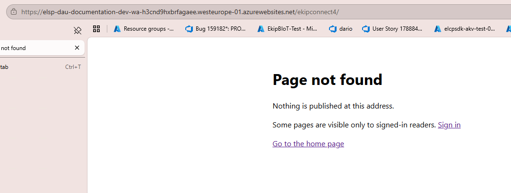
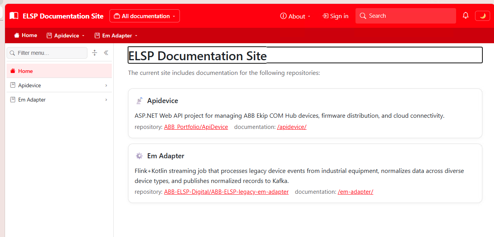
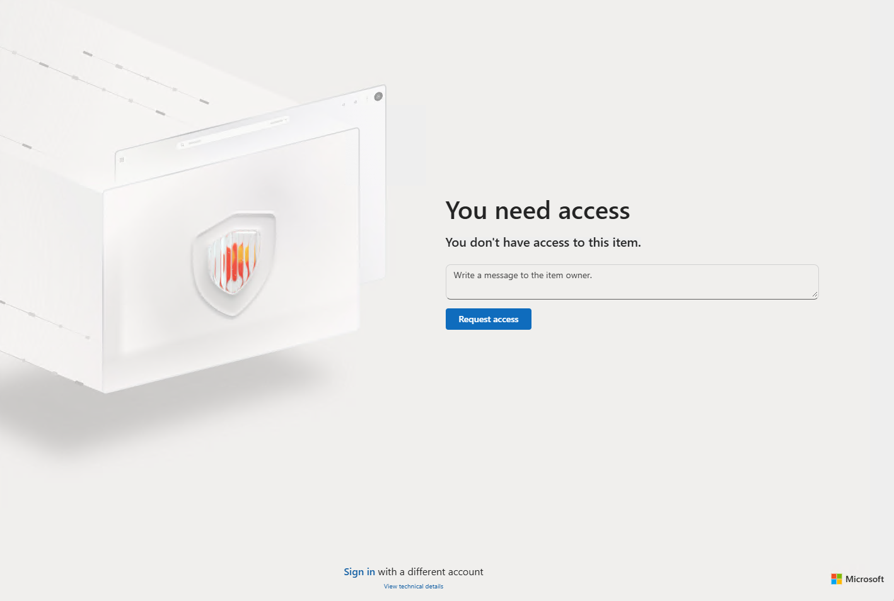

# Access-denied page

SmartDocs previously displayed a plain **Page not found** response when a reader opened restricted documentation. This issue records the requested design, the approved behavior, and the local validation.

## 🎯 Reported experience

The original response didn't match the site's presentation or explain the access problem.

The replacement should use the site's branding and visual style.

The supplied access-denied example illustrates a clearer explanation. Its request form isn't part of this change.

## ✅ Approved behavior

The request was clarified before implementation:

- Restricted page routes return **403 Forbidden** with **You need access**.
- Missing page routes return **404 Not Found** with **Page not found**, including missing addresses inside a restricted space.
- An anonymous reader sees **Sign in** when sign-in is configured. The link preserves the requested path and query.
- Both error states provide a home action. Access-denied pages advise contacting the documentation owner.
- No request form, email destination, permission grant, or account-switching workflow is added.

Distinguishing 403 from 404 intentionally replaces route concealment: a caller can now distinguish an existing restricted page from a nonexistent page. Protected titles, content, and navigation remain undisclosed.

## ⚙️ Resolution (✅ done)

- Added a lightweight server-rendered error page using the configured site title, logo or icon, site-default theme, and shared stylesheet. It doesn't load the interactive shell or protected menus. (✅ done)
- Applied the distinction to rendered-page requests as well as document requests. A denied or missing route reached through the interactive router opens the corresponding full error document. Visible folders without an article retain their 204 rendered-page response. (✅ done)
- Preserved private cache revalidation for reader-dependent errors and the existing 404 behavior for denied raw-content requests. The site-wide anonymous sign-in challenge is unchanged. (✅ done)
- Validated desktop, mobile, keyboard focus, light and dark themes, home recovery, public reading, and interactive routing in a visible browser. See the [validation sequence](./_validation/20261110.01-validation-sequence.md). (✅ done)

## 💡 Conclusion

Readers now receive an accurate, branded explanation and actionable recovery links. Permission checks haven't been relaxed. Real identity-provider login and a signed-in reader without the required role weren't exercised by the local fixture run.

## 📚 References

- 📘 [Official repository: route guard](../../../../Diginsight.SmartDocs.Web/Endpoints/PageRouteGuard.cs). Decides whether a route is served, missing, or restricted.
- 📘 [Official repository: error-page component](../../../../Diginsight.SmartDocs.Web/Components/RouteStatusPage.razor). Defines the branded explanation and recovery actions.
- 📘 [Official repository: rendered-page endpoint](../../../../Diginsight.SmartDocs.Web/Endpoints/ContentEndpoints.cs). Carries the status distinction to interactive page resolution.

<!--
validations:
  runtime_ui: {status: "passed", last_run: "2026-11-10", artifact: "_validation/20261110.01-validation-sequence.md"}
article_metadata:
  filename: "overview.md"
-->