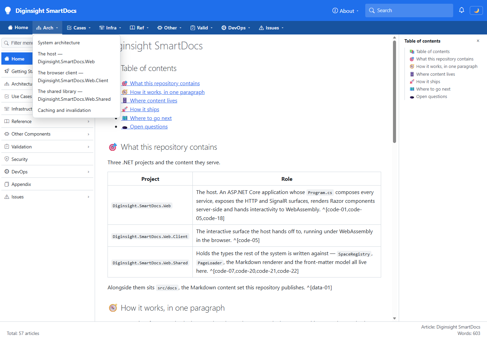
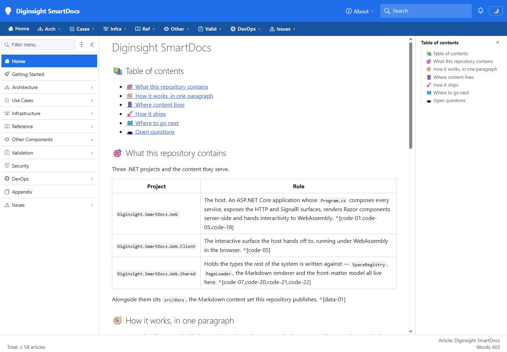

# Keyed menu persistence validation

This run validates the rebuilt layout's prerendered state and interactive menus.
A passing run proves that both menu instances retain separate state, survive a full reload,
and still respond to browser input.

## 🖥️ Environment

The validation host used a separate port to leave the existing host untouched.

| Item | Value |
|---|---|
| URL | `http://localhost:5281/` |
| Build | Host project, Debug, isolated session artifacts: zero warnings and zero errors |
| Run | `dotnet run --launch-profile http --artifacts-path <session-output> -- --urls http://localhost:5281`, in a visible VS Code task terminal; no `--no-build` |
| Configuration | Development, repository documentation, console logging enabled |
| Browser | Visible headed Microsoft Edge, viewport 1440 × 1000 |
| Date | November 26, 2026 |

## ✅ Sequence and results (✅ done)

The observations below were read from the live DOM and the same browser navigation's
original HTML response. Browser hydration consumes the state comment, so the response,
not a later DOM serialization, is the correct source for persistence assertions.

| # | Precondition | Action | Expected | Observed | Result |
|---|---|---|---|---|---|
| 1 | Rebuilt host listening on the separate port | Open the home page and decode the prerender-state comment | Both menus render and persist independently | Heading: `Diginsight SmartDocs`. Left menu: `Home`. Right labels: `Arch`, `Cases`, `Infra`, `Ref`, `Other`, `Valid`, `DevOps`, `Issues`. State: 16 entries; two equal nine-item menu-root arrays under distinct keys. | PASS |
| 2 | Home page loaded; allow WebAssembly initialization to finish | Select `Arch` | An interactive dropdown opens | Open menu count: `1`. Dropdown DOM text: `System architectureThe host — Diginsight.SmartDocs.WebThe browser client — Diginsight.SmartDocs.Web.ClientThe shared library — Diginsight.SmartDocs.Web.SharedCaching and invalidation` | PASS |
| 3 | Home page already loaded | Perform a full browser reload and compare persisted keys | State serialization succeeds again, with stable separate identities | Heading: `Diginsight SmartDocs`. State: 16 entries. Two nine-item menu roots. Every key from the first response exists in the reloaded response. Browser page errors: `[]`. | PASS |

The independently persisted menu roots used these keys:

```text
bUfUSsSnL2MNbRKBAQpwyFl5Ua48JSJFIPzKcEZrJys=
2tOKbcmD3Egr+KG5xIN+zoZncARub1kxzRiCvbaDiuI=
```

## 📷 Evidence

Screenshots show the actual validated states; they contain public repository content.

| Step | Screenshot |
|---|---|
| Home page and both menu groups |  |
| Interactive Architecture dropdown |  |
| Full reload |  |

## ⚠️ Notes

The first attempted capture inspected the hydrated DOM, where Blazor had already consumed
the state comment. The final assertions correctly inspected the original HTML response.
An early interaction attempt ran before WebAssembly initialization finished; the successful
dropdown run allowed initialization to settle before selecting the menu.

This run didn't cover the original deployed environment, private content, authentication,
space switching, every dropdown, or performance thresholds. The initial report supplies
the failure evidence; this run didn't remove the fix to reproduce it.

## 💡 Conclusion

The rebuilt layout preserves two distinct menu state identities through full page loads
and retains interactive dropdown behavior.

## 📚 References

- **[Blazor prerendered state persistence](https://learn.microsoft.com/en-us/aspnet/core/blazor/state-management/prerendered-state-persistence?view=aspnetcore-10.0)** 📘 [Official].
  Explains persistence identity for repeated components and why full reloads exercise
  prerendering. This run applies that guidance to the two menu instances.

<!--
validations:
  runtime: {status: "passed", last_run: "2026-11-26"}
article_metadata:
  filename: "20261126.01-validation-sequence.md"
-->
